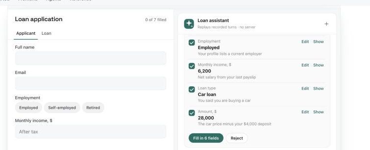

# Dushes

**Dushes is a chat assistant for your site or app: it answers questions from your pages and documents, takes people to the right page or field, and fills in forms with them, changing nothing until they confirm.**



**[Try it live](https://dushes-ai.fly.dev/demo/site.html)** · **[Docs](https://dushes-ai.fly.dev/)** · [Card gallery](https://dushes-ai.fly.dev/frontend/card-gallery/) · [Benchmarks](https://dushes-ai.fly.dev/get-started/benchmarks/)

## Quickstart

```bash
pip install "formguide[all] @ git+https://github.com/denvasylenko/dushes.git#subdirectory=backend"
formguide init my-agent
ANTHROPIC_API_KEY=... formguide serve --config my-agent/formguide.yaml --cors "*"
```

Then put the chat on your page:

```html
<script src="agui-chat.iife.js"></script>   <!-- build it: cd packages/agui-chat && npm install && npm run build (dist/) -->
<agui-chat url="http://localhost:8000/agent/run"></agui-chat>
```

Step by step, from loading the widget to connecting your own form: [Quickstart](https://dushes-ai.fly.dev/get-started/quickstart/).

## What it can do

| | What it does | Status |
| --- | --- | --- |
| **Know** | Answers questions from your pages and documents, and cites the source | available |
| **Show** | Opens the right page, tab or section, and highlights the field | available |
| **Fill** | Suggests values for your form; the user accepts, edits or rejects each one | available |
| **Do** | Runs actions you define, after the user confirms | available; Undo for quick actions planned |
| **Analyze** | Shows charts and tables in the chat | charts available; questions about the user's data planned |

Works with any LangChain model (Anthropic, OpenAI, Azure, Gemini, Ollama and more) and any frontend. The chat is a standard Web Component. It uses the open AG-UI protocol, so CopilotKit and other AG-UI clients work too.

## Names

The product is **Dushes**. The Python package, the CLI and the code are named **`formguide`** (for example, the `FormGuide` class).

## Learn more

- [Docs](https://dushes-ai.fly.dev/): guides, reference and a live demo, with **Ask AI** on every page
- [Card gallery](https://dushes-ai.fly.dev/frontend/card-gallery/): every card the chat can show, live
- [Connect your form](https://dushes-ai.fly.dev/frontend/connect-your-form/): what your form sends and what comes back
- [Configuration keys](https://dushes-ai.fly.dev/reference/configuration/): every setting with its default
- [Benchmarks](https://dushes-ai.fly.dev/get-started/benchmarks/): how well Dushes does in scored test runs
- Recipes: tested setups for common cases (coming soon)

## Work on this repository

```bash
cd backend && uv run pytest -q                 # offline tests, no API keys
cd site && npm install && npm run dev          # the docs at http://localhost:4321/dushes/
```

To run the demo app on your machine, see [Live demo](https://dushes-ai.fly.dev/get-started/live-demo/). Where each part lives: `backend/formguide/` is the library, `packages/agui-chat/` the chat widget and `site/` the docs.
