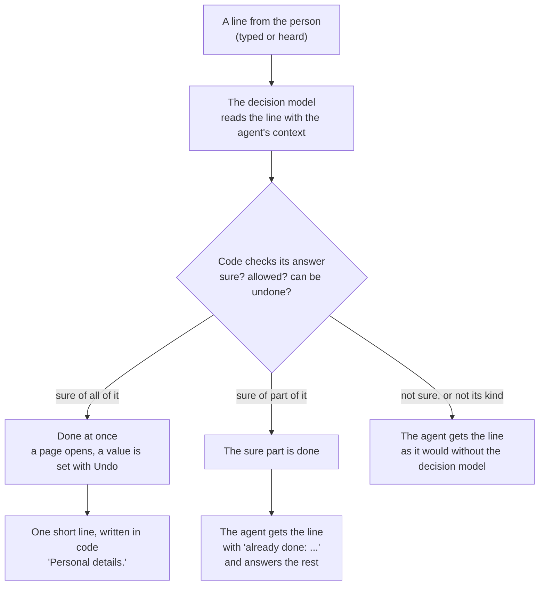
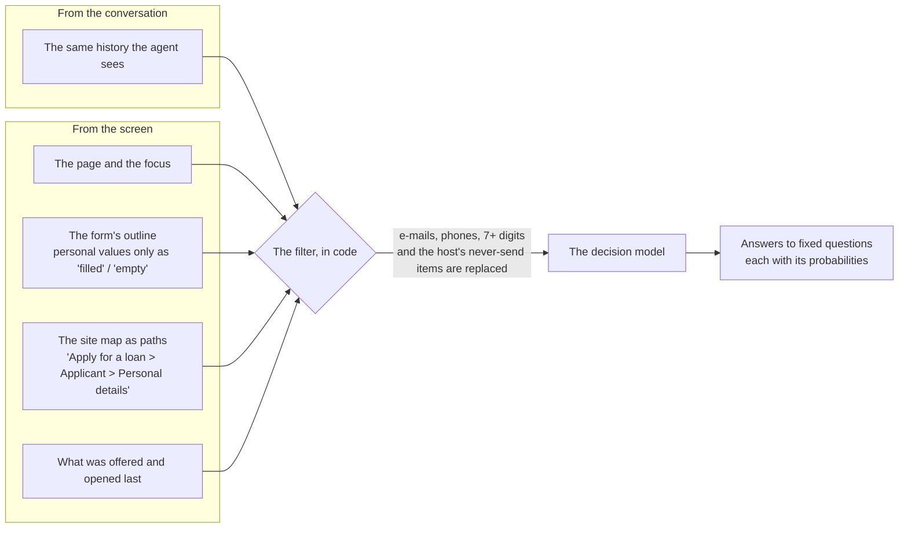

import { Aside, LinkCard, CardGrid } from '@astrojs/starlight/components';
import { Summary } from '../../../../components/ui';

<Summary what={"A small, fast model that picks among what is on the screen: a page, a part of a page, a section of the form, a value of a field."} when={"A person says what they want and part of it is a plain action on the screen."} write={"Nothing in code: the host switches it on."} />

<Aside type="caution" title="Experimental">
Experimental: it works only after you enter an activation code. On a host with activation codes, open **+** in the chat, choose **Experimental**, enter your code and turn on **Decision model**. Without a code it is off, and nothing is sent to TypeSafe. A host without codes turns it on with its own settings. More: [Experimental features](../../shared/experimental-features/).

In the package, off by default; a host switches it on ([how](../../site-agent/decision-model/)). No numbers are given until the QA Lead measures it. Some of what this page describes is decided but not built yet; the last section says which.
</Aside>

The agent's large model is slow at one thing that people do all the time: "open personal details", "Gender: Male", "go to car insurance". These need no thinking, only a pick from what the screen already shows. The decision model is a small, fast model that makes that pick, and the server carries it out. In the demo the decision model is Jev, a small classification model by TypeSafe AI.

Everything that needs thinking still goes to the agent: questions, explanations, texts to write.

## What happens to a line

Every line goes to the decision model first.



- **Sure of the whole line.** The page opens or the value is set, and the turn ends with one short line built in code, in the conversation's language. The agent is not called.
- **Sure of part of it.** "Open car insurance and tell me the cheapest level": the page opens at once, and the agent gets the line with the opening marked as already done. It does not open it again; it answers the question, in the same run.
- **Not sure.** Nothing is done, and the line goes to the agent as it would without the decision model. What the decision model is not sure of is never applied.

## What the decision model is given



- **The same context as the agent**, so "open it" after an offer means the thing that was offered.
- **The targets come from the server**: every page, part of a page, tab and section, and the options of the form's choice fields, each with an id that says what it is (`screen:/insurance`, `part:/insurance#levels`, `form:/apply:acc_personal`, `gender=m`). The decision model picks one of them; it cannot invent a target.
- **The filter runs before anything leaves the process.** An e-mail, a phone number, a run of seven or more digits and anything on the host's never-send list are replaced.

## What it is asked

The decision model does not write text. It answers a fixed set of questions about the line, each a yes/no or a pick from a list, with a probability for every option. Every pick also offers "nothing of these is named" (`none`), added by the client on the wire.

| Question | What it decides |
| --- | --- |
| `is_command` | is this an order to do something? |
| `kind` | what kind of line: `go_to`, `show`, `set_value`, `question`, `other`, `none` |
| `needs_agent` | does it name someone not on the screen, ask a question, ask for a text, or need judgement? |
| `asks_move` | does any part of it ask to open, go to or show something? |
| `asks_more` | beside the action, does it ask anything else? |
| `target` | which page, part, tab or section it means |
| `value` | which option of a choice field it names outright ("Gender: Male") |
| `f:<field>` | on a form page, one question for each choice field or tick on the screen (up to 16 in one call), so one line can set several values |
| `date_field` | which visible date field a bare date is for |

## What code never leaves to it

These rules are in code, whatever the decision model answers:

- **A move only on the person's own request.** A page opens only when the person's line asks for it, or takes up an offer just made. Text the agent read (a document, a passage) can never move the person.
- **A date never moves the person.** It can only fill the date field it is for.
- **Nothing irreversible.** Sending a form, a consent: never an option. They stay with the agent's card or confirmation.
- **Free text and explanations go to the agent**, even when the line starts with "open" or "set": a description, an address, "why", "how", "what does it mean".
- **Nothing is said that was not done.** "Opened" means the page was sent to the screen.

## A real example

From the demo, on the loan application page, the line "open personal details". This is the request as it left the process, after the filter. Trimmed for the page: the form's outline is shortened, and of the targets and their probabilities only the first few are shown.

```json title="The request"
{
  "state": {
    "line": "open personal details",
    "screen_now": "/apply",
    "language": "en",
    "page": "Apply for a loan",
    "form": "FORM \"Loan application\" · required filled 0/33\n1.1 [Tab tab_applicant] \"Applicant\" [FOCUS]\n  1.1.1 [Accordion acc_personal] \"Personal details\"\n  1.1.2 [Accordion acc_passport] \"Passport\"\n  …"
  },
  "questions": {
    "is_command": {"type": "noul", "instructions": "…"},
    "kind": {"type": "choice", "instructions": "…",
             "criteria": {"go_to": "…", "show": "…", "set_value": "…", "question": "…", "other": "…", "none": "…"}},
    "asks_more": {"type": "noul", "instructions": "…"},
    "target": {"type": "choice", "instructions": "…",
               "criteria": {"screen:/": "Home", "screen:/loans": "Loans", "form:/apply:acc_personal": "…", "…": "…"}}
  }
}
```

```json title="The answer"
{
  "answers": {
    "is_command": {"type": "noul", "noul": 0.8},
    "kind": {"type": "choice", "choice": "go_to", "confidence": 0.92,
             "probabilities": {"go_to": 0.93, "show": 0.05, "question": 0.01, "other": 0.01}},
    "asks_move": {"type": "noul", "noul": 0.96},
    "asks_more": {"type": "noul", "noul": 0.05},
    "target": {"type": "choice", "choice": "form:/apply:acc_personal", "confidence": 1.0,
               "probabilities": {"form:/apply:acc_personal": 1.0, "form:/apply:acc_passport": 0.0, "…": 0.0}}
  }
}
```

It is an order to go somewhere, it asks nothing more, and the target is the Personal details section. So the section opens, and the reply is one line written in code: "Personal details." The agent is not called.

## A line, step by step

From the demo, on the home page: "open car insurance and tell me the cheapest level".

1. **The line goes to the decision model** with the page (Home) and every target of the site, from `screen:/` to `part:/insurance#levels`.
2. **It answers.** An order (`is_command` yes), of the kind `go_to`, asking to move (`asks_move` yes), and asking something more (`asks_more` yes). The target it ranks first is `part:/insurance#levels`, "Car insurance › Cover levels", ahead of the Car insurance page.
3. **Code acts on the sure part.** The move is the person's own request and can be undone, so the server sends the page:

   ```json title="Sent to the page"
   {"name": "site_directive", "value": {"type": "navigate", "path": "/insurance", "tab": "levels"}}
   ```

4. **The rest goes to the agent**, with the opening marked as already done. The agent does not open it again; it answers the question.
5. **The reply comes in the same run, as two messages:** the code's line, "Cover levels.", then the agent's answer, "The cheapest cover level is third-party liability, …". The chat shows two bubbles; the voice says them one after the other.

## The agent's own tool

When the agent works out on its own that a pick is needed ("the second one", after it listed two), it can call the decision model as a tool, `choose_on_screen`, with the target by its on-screen name. The server builds the options, the decision model ranks them, and the tool answers `done` (sent to the screen), `candidates` (two fit; the agent asks which), `offer`, `not_found`, `needs_confirmation`, `refused` or `unavailable`. The same rules hold: nothing moves without the person's own request.

No recorded run of the agent calling this tool exists yet, so this page shows none.

## By voice

The same as in text. After a done action the voice says one short line ("Loans.") and nothing more; its own "let me check" is cancelled when the action is already done.

## Decided, and built so far

| Decided | In the package |
| --- | --- |
| Every line goes to the decision model first | built |
| It picks the target; code only carries it out and keeps the rules | built |
| Free text and explanations always go to the agent | built |
| Sure of part of a line: done, and the rest to the agent with "already done" | built for opening a page, a tab or a section |
| The same for values, several in one line | partly: several values of the screen are set on one card, and when the line asks more the agent goes on after the card. Covered by a test, not yet tried live |
| The same for a form's section on the screen | not built |
| The same history and state as the agent | partly: the demo sends the last ten messages, not the agent's own history window |
| "I need more context": the decision model picks a source and an object (the help of a field, a page of the site), the server reads it and asks once more. No search text from the decision model; off by default | not built |
| A card as an option ("show card X"), for cards the server builds without a model | not built |
| The label under a turn says who did what: the decision model, the agent, or both | built |

## Next

<CardGrid>
  <LinkCard title="One schema for what a person wants" description="A proposal: one way to read any request, for any configuration." href="../intents/" />
  <LinkCard title="One turn" description="What the agent does with a line it gets." href="../turn/" />
  <LinkCard title="Voice mode" description="Talking to the assistant, with the same rules." href="../../shared/voice/" />
  <LinkCard title="Navigation and routing" description="How the site agent decides where a person goes." href="../../site-agent/navigation/" />
</CardGrid>
