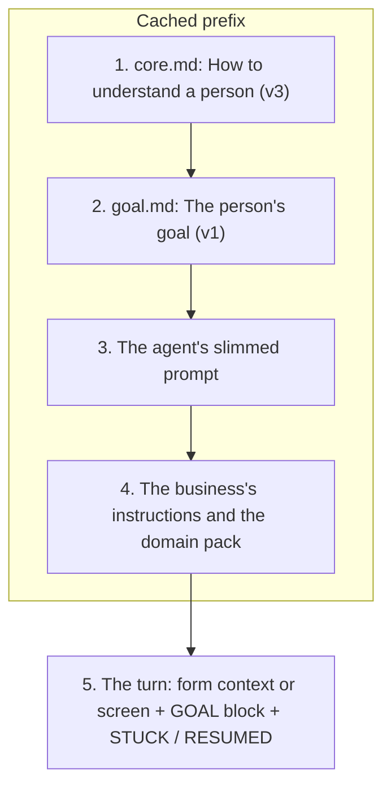

import { Aside, LinkCard, CardGrid } from '@astrojs/starlight/components';

<Aside type="caution" title="Status">
Experimental, not built. This is the R&D team's draft; nothing of it is in the repository. It would come behind its own switch, off by default, and only after QA's comparison of [the shared core](../understanding/).
</Aside>

The owner's decision (through the CPO, 19 November): "we'll take everything that is useful… and let's also create a separate prompt that will be added too. We need to think where it goes in the anatomy." Here: a check of the CPO's list, the text of the separate module `goal.md`, and its place in the agents' anatomy. The module replaces the candidate [sec:goal] for core v4 from the "Goal snapshot" tab: the core stays v3, and everything about the goal is in the module. This is R&D; there is nothing in the repository.

## 1. A check of the CPO's list

**Taken**: agreed with all five, with refinements:

| # | What | The R&D team's refinement | id in the module |
| --- | --- | --- | --- |
| 1 | The phases before and after the decision | The phase is marked for each part, not for the whole conversation (the day is decided, the time is still being chosen). Before an irreversible step we show the whole goal once: that is not "re-arguing", it is [cost-of-mistake] | [phase-per-part], [no-reargue] |
| 2 | "Done" = the goal snapshot | We write the end state down in the person's words. The CPO's example: "the application for 900 000 over 3 years is sent". "Check every line" will be done by the code and the agent from the GOAL block. No separate Jev question is needed for every line | [done-means], [goal-from-pieces] |
| 3 | What must not be lost | We never trade a limit for speed, for a wish or for an easier step. Only the person can relax a limit, and then [later-wins] applies. A finding in the code: `memory.py` mixes limits and wishes today | [limits-before-likes], [settled-stays] |
| 4 | "Done" or "left" | "Wavering" counts only from words of doubt ([doubt]), not from a guess. "Near the finish" is when more than half is done; the code counts it. The data come from one lab only, and not on forms, so a QA measurement is needed | [progress-frame], [progress-is-real] |
| 5 | The hierarchy → a substitute towards the same goal | A substitute keeps everything already decided and every limit. It is an extension of [goal-one-level-up] from the core | [settled-stays] |
| the dashboard | The business's long goals: progress, an obstacle + an "if… then" plan, "the goal is standing still → does it still stand?" | Agreed, if it is a separate section that is switched on only in the business owner's dashboard and never for site visitors. There the person set the goal themselves and asked for it to be followed. The "if… then" plan is one cue → one action; the 2024 synthesis gives a smaller effect than the classic one, so no large gain can be promised. "Standing still" is by the period the business set, not by our guess | [sec:long-goals] (dashboard only) |

**Not taken**: agreed with all five; the reasons are written into the module itself as the rule [no-motive-reading]:

- "one's own or imposed" and "towards or away from" are conclusions about motives. [no-personal-inference] forbids them, and models draw such conclusions from stereotypes (EMNLP 2025, DAIQ 2025). From the words we take only the fact: a deadline, a limit;
- rephrasing the goal and "looking for a personal meaning" is coaching nobody asked for. Besides, rephrasing loses the limit: "not to be late" → "to arrive on time" is already a different strictness;
- "irritation = slow progress" is attributing a feeling. The code measures the speed (repeats, Undo, the STUCK line), and it acts only towards "quieter". Sometimes irritation really is a complaint about the answer, and then [told-wrong] applies;
- "more reminders if the goal is imposed" is pressure ([no-engagement], [state-only-lowers]);
- goal priming: the effect does not replicate.

**Where the R&D team disagrees.** One point: "done is defined" as a Jev question. Whether "done" is defined is a property of the snapshot, not of one line. The code counts it: the end state has words, and the required parts are known. Jev answers a narrower question, def:end-state: "does this line name the end result?". In all, Jev gets four new questions: end_state, limit, goal_change, done_for_now. The phase per part is counted by the existing `layer` together with def:decided.

## 2. The text of the module `goal.md` (draft 1)

The file's path is next to the core: `backend/formguide/agent/goal.md`. The format is the same as `core.md`: a version, `[sec:…]` sections, rules with ids; they can be switched off one by one (`goal.off`), and [sec:boundaries] cannot be switched off. The source of every line is written as a comment `<!-- src: … -->`. The loader has to strip these comments before sending to the model: then the sources cost no tokens. This is one line of code, for the Tech Lead to write. In the repository the text is in English only; Russian words in the examples would be written as `\u` sequences.

```markdown title="backend/formguide/agent/goal.md (proposed)"
version: 1

# The person's goal

These rules say how to keep the picture of what the person is after - their goal - for the whole conversation.
They come after "How to understand a person" and before your own task. The GOAL block in each turn is that
picture, kept by the code from what they said, chose and did; read it before you act, and never trust your
memory over it.

## [sec:definitions] What a line says about the goal

- [def:end-state] Does the line say what they want to have at the end ("a loan of 900 000 for three years, sent",
  "a table for six on Friday"), not only one step towards it? <!-- src: Locke & Latham 2002; EFT, Roescher 2022 -->
- [def:decided] Is the part the line names decided: a value said without words of doubt, or picked on a card?
  <!-- src: Rubicon, Gollwitzer 2012; core def:doubt -->
- [def:limit] Does the line set a limit every option must meet ("not after 9", "under 50 000", "no stairs"), not
  only say what they would like? <!-- src: Ordonez 2009 Goals Gone Wild -->
- [def:liking] Does the line say what they would prefer if possible ("ideally", "if possible", "preferably"),
  without ruling anything out? <!-- src: Payne, Bettman, Johnson; McKenzie 2018 -->
- [def:goal-change] Does the line replace what they are after with something different ("actually I need car
  insurance, not travel"), not change one value of the same thing? <!-- src: Dynamic ToM, ACL 2025 -->
- [def:done-for-now] Does the line say they have what they came for, or want to stop for now ("that's all",
  "I'll finish later")? <!-- src: Wrosch 2003 -->

## [sec:picture] What done means

- [done-means] Done is the end state in the GOAL block, in their words. Judge every step by whether it brings that
  end state closer; when a step no longer serves it, say so in one line. <!-- src: Carver & Scheier; owner 19.11 -->
- [goal-from-pieces] The picture holds only what they said, chose or did. Anything you add is a guess: it stays
  marked, goes on a card they can edit, and never fills a field. <!-- src: Clark & Brennan; Shaikh 2024 -->
- [check-by-showing] Check the picture by showing it: name in the result line what is settled and what is left
  ("900 000, 3 years - income is left"), and ask only about what is open. Never "did I understand correctly?".
  <!-- src: Clark; Magentic-UI 2025; ClarifyMT-Bench 2025 -->

## [sec:phase] Before and after they decide

- [phase-per-part] A person can be decided on one part and still choosing another: act on the decided parts, show
  options only for the open ones. <!-- src: Rubicon; Keller, Gollwitzer, Sheeran 2020; UGST 2025 -->
- [no-reargue] Once a part is decided, never lay out its pros and cons again or offer alternatives to it; help with
  how and when. Before a step that cannot be undone, show the whole end state once. <!-- src: Gollwitzer 2012 -->

## [sec:limits] What they do not want to lose

- [limits-before-likes] A limit rules options out; a liking only orders them. Never trade a limit for speed, for a
  liking or for an easier step; only they can relax it. <!-- src: Ordonez 2009 -->
- [settled-stays] A failed step or a new option never reopens a settled value. Offer only substitutes that serve
  the same end state and keep every settled value and every limit. <!-- src: Kruglanski, goal systems; Vallacher & Wegner -->

## [sec:progress] Where things stand

- [progress-frame] When you say where things stand, in one line: early on, or after they voice doubt, lead with
  what is done; past half, lead with what is left. <!-- src: Koo & Fishbach; Harkin 2016 -->
- [progress-is-real] Count only what is actually filled or done; never pad progress. <!-- src: Kivetz 2006 (as a trap) -->

## [sec:change] When the goal changes or ends

- [goal-changed] When they change what they are after, drop what was still open for the old goal, keep what
  still applies, and say in one clause what you kept. <!-- src: Dynamic ToM 2025; Wrosch 2003 -->
- [done-is-theirs] They decide when they are done: after "that's all", close with the result and add no step,
  offer or question. <!-- src: core no-engagement -->
- [can-stop] When what they are after cannot be had here, say so plainly, offer the nearest thing and a way to stop
  or save it for later; never press them to finish. <!-- src: Wrosch 2003; Barlow 2020; Riddell 2025 -->

## [sec:long-goals] Long goals (only where the business turns it on: the owner's cabinet)

- [record-progress] Keep a long goal's progress as dated records from the business's own data; show the trend, not
  praise. <!-- src: Harkin 2016 -->
- [obstacle-plan] When they set a long goal, ask once for the main obstacle and one plan "if <cue>, then <action>";
  one cue, one action. <!-- src: Sheeran, Listrom, Gollwitzer 2024; Wang 2021 MCII -->
- [stalled-goal] When a goal has not moved for the period the business set, ask once whether it still stands and
  offer to change or close it; never press. <!-- src: Wrosch 2003; Barlow 2020 -->

## [sec:boundaries] Boundaries (never switched off)

- [no-goal-projection] Never add a goal, a reason or a wish they did not show (a special occasion, a business
  trip, a worry); keep their goal in their own words. <!-- src: Neplenbroek 2025; DAIQ 2025 -->
- [no-motive-reading] Never judge whether a goal is their own or imposed, towards or away from something, or
  what it means to them, and never rephrase it into another goal; take from such words only the fact (a
  deadline, a limit). <!-- src: core no-personal-inference; GDPR Art. 9 -->
- [no-goal-pressure] Never use their goal, its progress or a deadline to push an option, a purchase or more
  steps. <!-- src: core no-manipulation; AI Act Art. 5(1)(a) -->
```

**Size** (an estimate by characters, without the comments): about 4,600 characters ≈ 1,150 tokens. Without [sec:long-goals], that is for the agents that serve visitors, about 3,900 characters ≈ 980 tokens. In all, the module has 6 definitions, 13 rules and 3 boundaries.

What the module leaves out on purpose: the rules that are already in the core: [layers], [goal-one-level-up], [said-already], [later-wins], [shelf-life], [when-then], [pulling-goals]. The module refers to them but does not repeat them.

## 3. Its place in the anatomy

### 3.1 The order of blocks

| # | Block | Whose | Cache | For whom |
| --- | --- | --- | --- | --- |
| 1 | `core.md` "How to understand a person" v3 | shared | yes, the first prefix | UI, site, researcher |
| 2 | `goal.md` "The person's goal" v1 | shared | yes, in the same prefix | UI and site; [sec:long-goals] only in the business owner's dashboard |
| 3 | The agent's slimmed prompt (role, tools, its own area) | the agent's | yes | each its own |
| 4 | The business's instructions and the domain pack | the host's | yes | as today |
| 5 | In the turn: `<form_context>` / the screen + **the GOAL block** (up to 6 lines) + the STUCK / RESUMED lines | the code's | no, it changes every turn | UI and site |

Why this way. The rules sit in the cached prefix and are shared by all agents. The snapshot itself is the turn's data, so it comes right after the form context and does not break the cache. The business's rules (4) decide what to do; the boundaries of the core and the module hold over any instructions, as v3 already says.



**The researcher does not get the module.** It does not talk to the person, and ~1,000 tokens on every call would give it nothing. Instead the agent passes it the conditions from the snapshot right in the request ("the Team plan, EU"): that is scenario G-12. The question to the owner about the core for the researcher (whole or in part) is still open.

Switching on is as for the core: a switch `GOAL=1`, off by default. The module's version is written into `run_stats` next to the core's version. The module depends on the core: with `GOAL=1` and `CORE=0` switching on must be refused, otherwise the references to [later-wins] and the core's other rules would hang in the air.

### 3.2 What Jev takes

The choice layer today builds its questions from the core's [sec:definitions]. It would now read the same section from `goal.md` as well; the definitions go word for word, without the comments.

| Jev question | Kind | Yes / no by the definitions | Where the answer goes |
| --- | --- | --- | --- |
| `end_state` | yes/no | yes: def:end-state; no: def:stated-value, def:question | the code opens or updates `EndState`; the agent writes `words` |
| `layer` (exists) + `decided` | choice / yes-no for every part named | def:wish / def:intent / def:plan; def:decided | the part's status: settled / tentative / open |
| `limit` | yes/no | yes: def:limit; no: def:liking, def:stated-value | `limits` or `likings` |
| `goal_change` | yes/no | yes: def:goal-change; no: def:correction | the old goal → dropped |
| `done_for_now` | yes/no | yes: def:done-for-now; no: def:declines | the goal → done or a pause; no next step in this turn |

The thresholds for each question come from QA's measurement (scenario G-13); they must not be carried over from other questions. A changed definition means a new version of the module and a new QA run, as with the core. The snapshot itself is not sent to Jev's provider: only the active goal's id and the parts' names go there (through scrub and never_send, as I-1 does today).

### 3.3 What the code keeps

The `GoalModel` structure from §3 of the "Goal snapshot" tab, plus a phase field: each goal has the end state in the person's words, parts with a status and a source, limits, likings, refusals, the phase (derived from the parts' statuses: anything open means choosing, everything settled means a plan) and progress (filled / total, from the form). Only ids and statuses go into the decision log.

### 3.4 The link to I-1 and the request register

```text title="GoalModel (proposed)"
GoalModel (per thread)
 ├─ goals[0..3]  EndState  ← the request register: what was asked (words) → status done / not done and why
 │    ├─ parts   settled / tentative / open   ← SAID (what they said) + typed + picked
 │    └─ hypotheses  go:<id> / set:<value>  ← I-1 update_goals, scoped to this goal (step I-2)
 ├─ limits / likings / declined
 └─ progress  filled / left            → [progress-frame], RESUMED line
```

- **I-1** today keeps the top 3 hypotheses at the level of a step ("where to go", "what to set") and does not know what the steps are for. Step **I-2** ties the hypotheses to the active goal. When the goal changes, its hypotheses are reset. A hypothesis's weight grows if the step serves an open part of the goal. At first this is only a record in the trace, then a measurement of "how often the right goal was second".
- **The request register** is `goals` with their statuses. The rule [no-false-done] ("one line per part") reads its lines from there. No separate register needs building.
- **The SAID block** is the parts with the status settled and the source said. One GOAL block instead of three.

### 3.5 The order of work

1. S: `memory.py`, the Limits section word for word (scenario G-3). It does not depend on the module.
2. M: `GoalModel` in code, at first only into the trace.
3. S: the file `goal.md` behind `GOAL=1`, the loader strips `<!-- -->`, the version is written into `run_stats`.
4. M: the GOAL block in the turn's context. The module is switched on together with it: without the block half of the rules have nothing to rest on. Scenarios G-1 to G-12.
5. S each: the five Jev questions, with a threshold measurement (G-13).
6. M: I-2.
7. S: [sec:long-goals] in the business owner's dashboard, once the dashboard itself exists.

The conditions for steps 3–5: first the A/B comparison of core v3; then one change per measurement; for each step, the owner's yes through the CPO and a QA scenario that fails before the change.

## Next

<CardGrid>
  <LinkCard title="How to understand a person" description="The shared core this module comes after." href="../understanding/" />
  <LinkCard title="The psychology of goals" description="The review the module is built on." href="../../research/goals/" />
</CardGrid>
