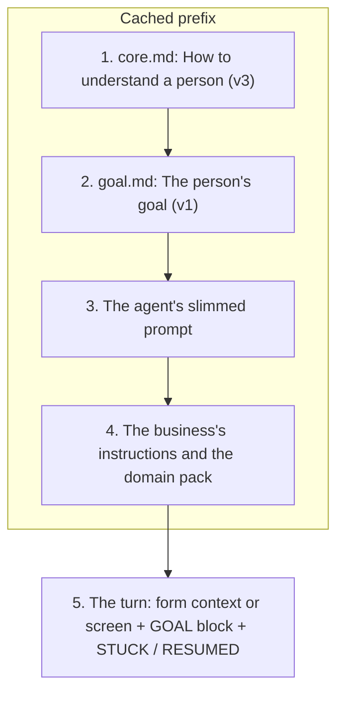

import { Aside, LinkCard, CardGrid } from '@astrojs/starlight/components';

<Aside type="caution" title="Status">
Experimental, not built. This is the R&D team's draft; nothing of it is in the repository. It would come behind its own switch, off by default, and only after QA's comparison of [the shared core](../understanding/).
</Aside>

The owner's decision (through the CPO, 19 November): "we'll take everything that is useful… and let's also create a separate prompt that will be added too. We need to think where it goes in the anatomy." Here: a check of the CPO's list, the text of the separate module `goal.md`, and its place in the agents' anatomy. The module replaces the candidate [sec:goal] for core v4 from [the goal snapshot](../../research/goal-snapshot/): the core stays v3, and everything about the goal is in the module. This is R&D; there is nothing in the repository.

## 1. A check of the CPO's list

**Taken**: agreed with all five, with refinements:

| # | What | The R&D team's refinement | id in the module |
| --- | --- | --- | --- |
| 1 | The phases before and after the decision | The phase is marked for each part, not for the whole conversation (the day is decided, the time is still being chosen). Before an irreversible step we show the whole goal once: that is not "re-arguing", it is [cost-of-mistake] | [phase-per-part], [no-reargue] |
| 2 | "Done" = the goal snapshot | We write the end state down in the person's words. The CPO's example: "the application for 900 000 over 3 years is sent". "Check every line" will be done by the code and the agent from the GOAL block. No separate Jev question is needed for every line | [done-means], [goal-from-pieces] |
| 3 | What must not be lost | We never trade a limit for speed, for a wish or for an easier step. Only the person can relax a limit, and then [later-wins] applies. A finding in the code: `memory.py` mixes limits and wishes today | [limits-before-likes], [settled-stays] |
| 4 | "Done" or "left" | "Wavering" counts only from words of doubt ([doubt]), not from a guess. "Near the finish" is when more than half is done; the code counts it. The data come from one lab only, and not on forms, so a QA measurement is needed | [progress-frame], [progress-is-real] |
| 5 | The hierarchy → a substitute towards the same goal | A substitute keeps everything already decided and every limit. It is an extension of [goal-one-level-up] from the core | [settled-stays] |
| the dashboard | The business's long goals: progress, an obstacle + an "if… then" plan, "the goal is standing still → does it still stand?" | Agreed, if it is a separate section that is switched on only in the business owner's dashboard and never for site visitors. There the person set the goal themselves and asked for it to be followed. The "if… then" plan is one cue → one action; the 2024 synthesis gives a smaller effect than the classic one, so no large gain can be promised. "Standing still" is by the period the business set, not by our guess | [sec:long-goals] (dashboard only) |

**Not taken**: agreed with all five; the reasons are written into the module itself as the rule [no-motive-reading]:

- "one's own or imposed" and "towards or away from" are conclusions about motives. [no-personal-inference] forbids them, and models draw such conclusions from stereotypes (EMNLP 2025, DAIQ 2025). From the words we take only the fact: a deadline, a limit;
- rephrasing the goal and "looking for a personal meaning" is coaching nobody asked for. Besides, rephrasing loses the limit: "not to be late" → "to arrive on time" is already a different strictness;
- "irritation = slow progress" is attributing a feeling. The code measures the speed (repeats, Undo, the STUCK line), and it acts only towards "quieter". Sometimes irritation really is a complaint about the answer, and then [told-wrong] applies;
- "more reminders if the goal is imposed" is pressure ([no-engagement], [state-only-lowers]);
- goal priming: the effect does not replicate.

**Where the R&D team disagrees.** One point: "done is defined" as a Jev question. Whether "done" is defined is a property of the snapshot, not of one line. The code counts it: the end state has words, and the required parts are known. Jev answers a narrower question, def:end-state: "does this line name the end result?". In all, Jev gets four new questions: end_state, limit, goal_change, done_for_now. The phase per part is counted by the existing `layer` together with def:decided.

## 2. What the module `goal.md` holds (draft 1)

The file's path would be next to the core: `backend/formguide/agent/goal.md`, with the same format: a version, `[sec:…]` sections and rules with ids that can be switched off one by one (`goal.off`), except `[sec:boundaries]`. Each line's source is a comment the loader strips before the model sees it. This page describes the module; its text is not reprinted. Its sections:

| Section | What it covers |
| --- | --- |
| preamble | the module comes after the core and before the agent's own task; the GOAL block each turn is the picture of the goal, kept by code, and is trusted over memory |
| `[sec:definitions]` | 6 yes/no questions for Jev and the agent: does the line name the end state, is the part decided, is it a limit, a liking, a change of goal, done for now |
| `[sec:picture]` | what done means (the end state in the person's words), the picture only from what they said, chose or did, checking it by showing it |
| `[sec:phase]` | decided on one part, still choosing another; never re-arguing a decided part |
| `[sec:limits]` | a limit rules options out and a liking only orders them; settled values stay |
| `[sec:progress]` | where things stand in one line, done first early on and left first past half; real progress only |
| `[sec:change]` | when the goal changes, when they are done, when it cannot be had here |
| `[sec:long-goals]` | only in the business owner's dashboard: dated progress, one obstacle and one "if… then" plan, asking once about a stalled goal |
| `[sec:boundaries]` | never adding a goal or reason they did not show, never reading motives, never using the goal to push |

**Size** (an estimate by characters, without the comments): about 4,600 characters ≈ 1,150 tokens. Without [sec:long-goals], that is for the agents that serve visitors, about 3,900 characters ≈ 980 tokens. In all, the module has 6 definitions, 13 rules and 3 boundaries.

What the module leaves out on purpose: the rules that are already in the core: [layers], [goal-one-level-up], [said-already], [later-wins], [shelf-life], [when-then], [pulling-goals]. The module refers to them but does not repeat them.

## 3. Its place in the anatomy

### 3.1 The order of blocks

| # | Block | Whose | Cache | For whom |
| --- | --- | --- | --- | --- |
| 1 | `core.md` "How to understand a person" v3 | shared | yes, the first prefix | UI, site, researcher |
| 2 | `goal.md` "The person's goal" v1 | shared | yes, in the same prefix | UI and site; [sec:long-goals] only in the business owner's dashboard |
| 3 | The agent's slimmed prompt (role, tools, its own area) | the agent's | yes | each its own |
| 4 | The business's instructions and the domain pack | the host's | yes | as today |
| 5 | In the turn: `<form_context>` / the screen + **the GOAL block** (up to 6 lines) + the STUCK / RESUMED lines | the code's | no, it changes every turn | UI and site |

Why this way. The rules sit in the cached prefix and are shared by all agents. The snapshot itself is the turn's data, so it comes right after the form context and does not break the cache. The business's rules (4) decide what to do; the boundaries of the core and the module hold over any instructions, as v3 already says.



**The researcher does not get the module.** It does not talk to the person, and ~1,000 tokens on every call would give it nothing. Instead the agent passes it the conditions from the snapshot right in the request ("the Team plan, EU"): that is scenario G-12. The question to the owner about the core for the researcher (whole or in part) is still open.

Switching on is as for the core: a switch `GOAL=1`, off by default. The module's version is written into `run_stats` next to the core's version. The module depends on the core: with `GOAL=1` and `CORE=0` switching on must be refused, otherwise the references to [later-wins] and the core's other rules would hang in the air.

### 3.2 What Jev takes

The choice layer today builds its questions from the core's [sec:definitions]. It would now read the same section from `goal.md` as well; the definitions go word for word, without the comments.

| Jev question | Kind | Yes / no by the definitions | Where the answer goes |
| --- | --- | --- | --- |
| `end_state` | yes/no | yes: def:end-state; no: def:stated-value, def:question | the code opens or updates `EndState`; the agent writes `words` |
| `layer` (exists) + `decided` | choice / yes-no for every part named | def:wish / def:intent / def:plan; def:decided | the part's status: settled / tentative / open |
| `limit` | yes/no | yes: def:limit; no: def:liking, def:stated-value | `limits` or `likings` |
| `goal_change` | yes/no | yes: def:goal-change; no: def:correction | the old goal → dropped |
| `done_for_now` | yes/no | yes: def:done-for-now; no: def:declines | the goal → done or a pause; no next step in this turn |

The thresholds for each question come from QA's measurement (scenario G-13); they must not be carried over from other questions. A changed definition means a new version of the module and a new QA run, as with the core. The snapshot itself is not sent to Jev's provider: only the active goal's id and the parts' names go there (through scrub and never_send, as I-1 does today).

### 3.3 What the code keeps

The `GoalModel` structure from §3 of [the goal snapshot](../../research/goal-snapshot/#31-what-the-code-keeps), plus a phase field: each goal has the end state in the person's words, parts with a status and a source, limits, likings, refusals, the phase (derived from the parts' statuses: anything open means choosing, everything settled means a plan) and progress (filled / total, from the form). Only ids and statuses go into the decision log.

### 3.4 The link to I-1 and the request register

```text title="GoalModel (proposed)"
GoalModel (per thread)
 ├─ goals[0..3]  EndState  ← the request register: what was asked (words) → status done / not done and why
 │    ├─ parts   settled / tentative / open   ← SAID (what they said) + typed + picked
 │    └─ hypotheses  go:<id> / set:<value>  ← I-1 update_goals, scoped to this goal (step I-2)
 ├─ limits / likings / declined
 └─ progress  filled / left            → [progress-frame], RESUMED line
```

- **I-1** today keeps the top 3 hypotheses at the level of a step ("where to go", "what to set") and does not know what the steps are for. Step **I-2** ties the hypotheses to the active goal. When the goal changes, its hypotheses are reset. A hypothesis's weight grows if the step serves an open part of the goal. At first this is only a record in the trace, then a measurement of "how often the right goal was second".
- **The request register** is `goals` with their statuses. The rule [no-false-done] ("one line per part") reads its lines from there. No separate register needs building.
- **The SAID block** is the parts with the status settled and the source said. One GOAL block instead of three.

### 3.5 The order of work

1. S: `memory.py`, the Limits section word for word (scenario G-3). It does not depend on the module.
2. M: `GoalModel` in code, at first only into the trace.
3. S: the file `goal.md` behind `GOAL=1`, the loader strips `<!-- -->`, the version is written into `run_stats`.
4. M: the GOAL block in the turn's context. The module is switched on together with it: without the block half of the rules have nothing to rest on. Scenarios G-1 to G-12.
5. S each: the five Jev questions, with a threshold measurement (G-13).
6. M: I-2.
7. S: [sec:long-goals] in the business owner's dashboard, once the dashboard itself exists.

The conditions for steps 3–5: first the A/B comparison of core v3; then one change per measurement; for each step, the owner's yes through the CPO and a QA scenario that fails before the change.

## 4. goal.md v2 (after the integration, for the owner)

This is v2: four things the Tech Lead put into the design (commit 0803dd9) after [Similar ideas in AI](../../research/similar-ideas/) are built into the module. A readable file is in the sessions' shared folder: `goal.md`. The definitions (`def:`) are for Jev and the agent: Jev asks them word for word as yes/no questions about the latest line. All the other rules are for the agent only. Every line has a mark `<!-- for: … -->` and a source `<!-- src: … -->`; the loader strips them before sending to the model.

**Size** (an estimate by characters, without the comments): 5,958 characters ≈ 1,490 tokens; for visitors, without the dashboard section, 5,427 ≈ 1,360. In all, 6 definitions, 16 rules for the agent, 3 dashboard rules and 3 boundaries.

**What changed since v1:**

| What | v1 | v2 | id |
| --- | --- | --- | --- |
| How a goal ends | [done-is-theirs], [can-stop], [goal-changed]: scattered, the agent decided the status | a new section [sec:ending]: the three outcomes after Cohen and Levesque (reached / impossible / no longer wanted). The status comes from the `status` line of the GOAL block (the code sets it); the agent only acts on it | [ends-reached], [ends-impossible], [ends-dropped] (they replace [can-stop], [goal-changed]) |
| A change of goal | an ordinary definition, with no particular strictness | def:goal-change is stricter: "plainly replace…", and it says outright what does not count as a change (a new value of the same goal, a second goal, a question about another one). A new rule: in a doubtful case, one question with both options | def:goal-change, [change-needs-more] |
| A budget of questions | none | a new section [sec:questions]. The code counts the questions and writes a `questions left` line in the GOAL block; at zero the agent stops asking and offers to do it by hand or the business's contact | [ask-what-changes], [question-budget] |
| "Done" | [done-means]: "the end state in the person's words" | "done" is the `done when` line: conditions on the form's fields, checked by the code. The agent does not decide "done" itself: only when `left` is empty and the tool said "applied" | [done-means], [progress-is-real] |
| The GOAL block | described only on [the goal snapshot](../../research/goal-snapshot/) | the block's format is now written into the module itself, so the agent knows where everything is: `status`, `done when / met / left`, `questions left` | the preamble |
| Marks | only `src` | plus `for:` on every section (Jev / agent / dashboard) | — |

Unchanged: [goal-from-pieces], [check-by-showing], [phase-per-part], [no-reargue], [limits-before-likes], [settled-stays], [progress-frame], [sec:long-goals], [sec:boundaries]. A difference from the design: in the design the snapshot is "filled by the agent through a tool"; the module is written so that it does not matter who writes the GOAL block, the code from events or a tool. The agent only reads the block and never edits it itself.

The v2 text is the R&D team's, and like v1 it is not reprinted here. On top of v1 it adds the GOAL block's format to the preamble, the sections `[sec:questions]` (ask only what changes the next action; a budget of questions per goal) and `[sec:ending]` (the three ways a goal ends: reached, impossible, dropped, with the status set by code), a stricter definition of a change of goal, and "done" as the conditions on the form's fields that code checks.

## Next

<CardGrid>
  <LinkCard title="How to understand a person" description="The shared core this module comes after." href="../understanding/" />
  <LinkCard title="The psychology of goals" description="The review the module is built on." href="../../research/goals/" />
</CardGrid>
