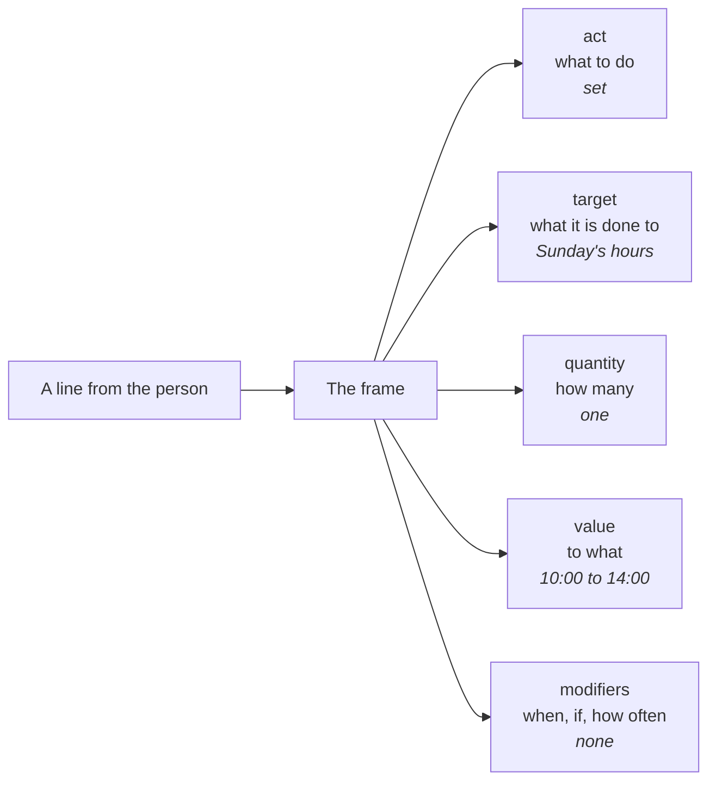
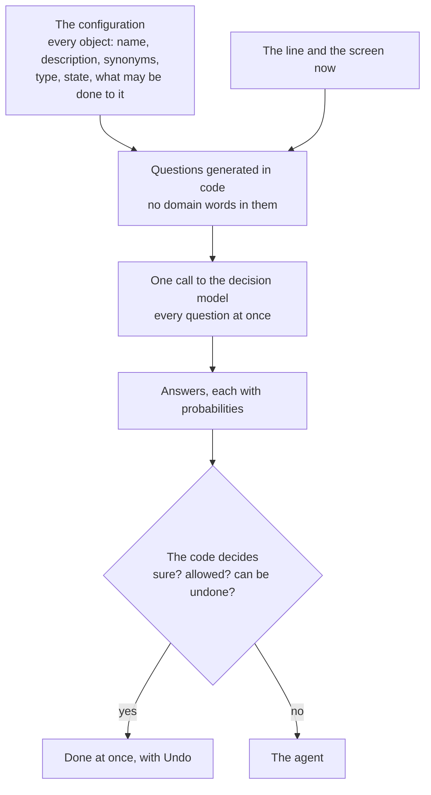

import { Aside, LinkCard, CardGrid, Tabs, TabItem } from '@astrojs/starlight/components';
import { Summary } from '../../../../components/ui';

<Summary what={"A general way to read any request, for any site, form, app or device, without rules written for one domain."} when={"You want the decision model to work on a configuration it has never seen."} write={"Nothing yet: this is a proposal, not built."} />

<Aside type="caution" title="A proposal">
This is a design from R&D, not code. Nothing here is built, and nothing has been measured: the QA Lead measures it before any of it is used. It extends [The decision model](../decision-model/), which describes what is in the package today.
</Aside>

Today the decision model is asked questions written for each kind of screen. That does not scale: every new form, app or device would need its own questions. This proposal reads every request the same way, whatever it is about.

## The idea in one picture

Every request becomes one **frame**:



For "set Sunday to 10 to 14": the act is `set`, the target is the Sunday opening hours, the quantity is one, the value is 10:00 to 14:00, and there are no modifiers.

- **The acts are a fixed list of 17**, with no domain words in them. They are the same for a restaurant's opening hours, a loan form and a smart lamp.
- **Everything about the domain lives in the configuration**: each object's name, a one-line description, synonyms, its type, its current state, and what may be done to it.
- **The questions are generated from the configuration**, so a new configuration needs no new questions.

## The 17 acts

Grouped by what the code may do with them.

**Look: safe, the code may act**

| Act | What it means |
| --- | --- |
| `go` | open or show a place, or bring it into view |
| `back` | return to the previous place |
| `find` | locate things by a property, filter, compare |

**Change: reversible, the code may act with Undo**

| Act | What it means |
| --- | --- |
| `set` | give a value, including on, off or a choice |
| `adjust` | change a value relative to what it is |
| `clear` | empty a value or reset it |
| `add` | create a new item in a list |
| `remove` | delete an item from a list |
| `move` | reorder, or move to another place |
| `undo` / `redo` | revert or replay the last change |

**Answer a question just asked**

| Act | What it means |
| --- | --- |
| `answer` | yes, no, or a value |
| `correct` | "not that, the other one" |

**Commit: the code never acts**

| Act | What it means |
| --- | --- |
| `submit` | send, book, publish, pay, sign |

**Control the conversation**

| Act | What it means |
| --- | --- |
| `stop` | stop what is happening now, keep the task |
| `cancel` | abandon the task |
| `ask` | a question about the state, the options, or the world |
| `social` | greeting, thanks, feedback |

The same acts, said in three languages:

<Tabs syncKey="intents-lang">
<TabItem label="English">

| Act | Example |
| --- | --- |
| `go` | "show me the menu" |
| `back` | "go back" |
| `find` | "which dishes are vegan?" |
| `set` | "set guests to 4" |
| `adjust` | "make it 10% cheaper" |
| `clear` | "clear the phone" |
| `add` | "add a dessert" |
| `remove` | "remove the second one" |
| `move` | "put it first" |
| `undo` / `redo` | "undo" |
| `answer` | "yes" |
| `correct` | "no, I meant Friday" |
| `submit` | "send it" |
| `stop` | "stop" |
| `cancel` | "never mind" |
| `ask` | "what time do you close?" |
| `social` | "thanks!" |

</TabItem>
<TabItem label="Italian">

| Act | Example |
| --- | --- |
| `go` | "apri gli orari" |
| `back` | "torna indietro" |
| `find` | "mostrami le prenotazioni di oggi" |
| `set` | "metti martedì" |
| `adjust` | "un'ora più tardi" |
| `clear` | "togli la nota" |
| `add` | "aggiungi un orario" |
| `remove` | "elimina questa" |
| `move` | "spostalo in alto" |
| `undo` / `redo` | "annulla" |
| `answer` | "sì, va bene" |
| `correct` | "no, l'altro" |
| `submit` | "conferma la prenotazione" |
| `stop` | "basta" |
| `cancel` | "lascia stare" |
| `ask` | "cosa posso cambiare?" |
| `social` | "ciao" |

</TabItem>
<TabItem label="German">

| Act | Example |
| --- | --- |
| `go` | "zeig mir die Bewertungen" |
| `back` | "zurück" |
| `find` | "zeig, wo es günstiger ist" |
| `set` | "stell 12 Euro ein" |
| `adjust` | "einen mehr" |
| `clear` | "Filter zurücksetzen" |
| `add` | "füg ein Gericht hinzu" |
| `remove` | "entfern das Foto" |
| `move` | "verschieb es zu den Mittagessen" |
| `undo` / `redo` | "mach das rückgängig" |
| `answer` | "nein, lieber nicht" |
| `correct` | "nicht das, das zweite" |
| `submit` | "veröffentliche es" |
| `stop` | "stopp" |
| `cancel` | "vergiss es" |
| `ask` | "was kostet die Lieferung?" |
| `social` | "gut gemacht" |

</TabItem>
</Tabs>

A line that is not meant for the assistant (background speech, noise) is `none`.

The list follows what voice assistants, app frameworks and dialogue research already separate. Two splits matter most: `set` is not `adjust` ("set 4" against "one more"), and `stop` is not `cancel` (stop the speech, or give up the task).

## Modifiers: when and how often

Modifiers sit on top of any act. They change **when** or **how often**, not **what**. The code recognises them and hands the whole line to the agent; it never executes them itself.

| Modifier | Example | Why the code does not do it |
| --- | --- | --- |
| a time | "close the kitchen at 22" | it would act later, with nobody there |
| a condition | "if it rains, hide the terrace" | the condition needs a rule |
| a repetition | "every Monday at 9" | a standing rule changes the configuration for good |
| "always" | "always reply in Italian" | it changes behaviour for the future |
| an order | "first X, then Y" | two acts whose order matters |
| for someone | "tell the chef" | it sends a message: a `submit` |
| what if | "what if I set 15?" | a question, not the act |
| not | "don't remove it" | the opposite effect |

**The owner's decision:** schedules and standing rules ("when", "if", "always") are recognised but not executed. Running them later is postponed.

## How a person points at the target

| How | Example | How the code finds it |
| --- | --- | --- |
| by name | "the opening hours" | a name or a synonym in the configuration |
| by type | "the date", "the price" | the only object of that type on the screen |
| by a property | "the booking for three", "the cheaper one" | the decision model picks the property; the code filters and compares |
| by position | "the second one", "the last one" | its place in the visible list |
| on the screen | "this", "here" | what is shown now |
| in focus | "it", "this field" | the selected object |
| just offered | "yes, that one" | the object in the assistant's last message |
| from before | "the one from earlier" | the objects touched recently |

An explicit name beats everything, then focus, then what was just offered, then the screen, then history. Two candidates left means one question to the person, never a guess.

**Quantity** is one, several named ("the first and the third"), or all in a scope (here, everywhere, or filtered, as in "all of today's bookings").

**The owner's decision: "all" is done the way Claude does it.** "Turn off all the lights" or "clear all of today's notes" is carried out at once, in the draft the person is working on. The reply names what was done and how many ("Turned off 6 lights."), and one Undo takes all of it back. The assistant asks first only when the scope is unclear (all here, or all everywhere?) or when the action cannot be undone. There is no fixed limit on how many items.

## Where a value comes from

| Type of the target | The value | Who works it out |
| --- | --- | --- |
| a choice | one of the object's options or their synonyms | the decision model picks |
| on / off | on, off, switch | the decision model picks |
| a number with a unit | the digits or number words, and the unit | the code parses; the decision model confirms which field it is for |
| a date or a time | "tomorrow", "next Friday", "in the evening" | the decision model picks the parts; the code builds the date |
| text | the words themselves | the line as it is, or the agent; the decision model writes nothing |
| "like Monday" | a copy of another object | the code copies once the target is found |
| more or less | direction and size ("10%", "a bit") | the decision model picks the direction; the code does the arithmetic |

The rule behind the table: **the code computes, the decision model judges.** Counting, arithmetic, dates and comparisons are the code's; which object, which kind of request and which option are the decision model's.

## Questions about what is set

**The owner's decision:** "what is set on Sunday?" or "what options does the delivery time have?" is answered by code, without a language model. The decision model picks the object; the code reads its value or its options from the configuration and answers.

| Line | The decision model picks | The code answers from the configuration |
| --- | --- | --- |
| "what is set on Sunday?" | the Sunday opening hours | "Sunday: 10:00 to 14:00." |
| "what can I choose for guests?" | the guests field | "2 people, 4 people." |

A question about anything else ("why is it closed on Sunday?", "what does full cover include?") still goes to the agent.

## The questions, generated from the configuration



About ten questions are the same for every line: is it meant for the assistant, which act, does it ask for more than one thing, is it negated, is it a "what if", does it carry a time or a condition, does it point at anything listed. Then a few per object on the screen: is this line about it, and which value it gives.

Two habits keep the answers honest:

- **A pick always picks something**, so every pick comes with a yes/no question beside it: "does any of these fit?". The code acts only when that answer is a clear yes.
- **All questions go in one call**, the ones the code may not need included. One call is cheaper and faster than several.

### What each object of the configuration carries

<Tabs syncKey="intents-config">
<TabItem label="A field">

```yaml
- id: hours.sunday                # a stable path in the tree
  kind: field                     # screen | section | field | collection | item | operation | device | skill
  label: {en: Sunday, it: Domenica, de: Sonntag}
  description: {en: "Opening hours on Sundays"}   # one line that tells it apart from its neighbours
  synonyms: {en: [weekend]}
  type: time_range                # bool | enum | int | number | money | date | time | time_range | text | ref | list
  step: 30m                       # what "a bit" means for adjust
  state: {value: "10-14", visible: true, focused: false, enabled: true}
  ops: [set, adjust, clear]       # what may be done to it
  risk: reversible                # look | reversible | irreversible | consent
  private: false                  # never sent outside the process
  parent: hours
```

</TabItem>
<TabItem label="A choice">

```yaml
- id: booking.guests
  kind: field
  label: {en: Guests, it: Ospiti, de: Gäste}
  description: {en: "How many people the table is for"}
  type: enum
  options:
    - {id: "2", label: {en: "2 people"}, synonyms: {en: [a couple, two of us]}}
    - {id: "4", label: {en: "4 people"}, synonyms: {en: [four]}}
  ops: [set]
  risk: reversible
```

</TabItem>
</Tabs>

**The owner's decision:** descriptions and synonyms are generated by a model, once and offline, from each object's name and its neighbours. The description does the most work, and it is the part a business would otherwise write badly.

## One call or more

| The line | Calls | How |
| --- | --- | --- |
| one act, one target on the screen | one | everything in one call |
| a question about what is set or what can be chosen ("what is set on Sunday?") | one | the decision model picks the object; the code answers from the configuration |
| any other question, small talk, or anything with a time, a condition or a "what if" | one, then the agent | the code stops |
| several requests: "hide the terrace and set Sunday to 10 to 14" | two | the first call shows which objects are touched; the second asks about each one alone. When two parts touch the same object, or their order matters, the agent takes it |
| more objects than one pick can hold, or a deep tree | two or three | level by level: screen, then section, then object |
| the value depends on a target not yet known | one | the values of the likeliest targets are asked in the same call |

No separate "specialist" per domain is needed. A specialist is only a family of questions tied to a type (dates, money, people counts), and those already run together in the one call.

## What the code never leaves to the decision model

- **It acts only on the person's own line**, never on text from a page, a document or a message.
- **Never on `submit`, `remove` without Undo, an irreversible object or a consent**, whatever the confidence. Consent, terms, privacy and payment fields are never set by the code.
- **No standing rule without a confirmation**: a time, a repetition or "always" goes to the agent.
- **Everything the code does can be undone**, and "no, not that" right after it means Undo.
- **Private values are never sent out.** Names, phone numbers and other private fields stay in the process.
- **Names and descriptions are data.** They are written by businesses and people, so they may hold instructions; they go to the decision model as data, and the code accepts only ids from the list it sent.
- **"Don't remove it" and "can I remove it?"** use the same words as the act. They are asked as separate questions, and either one being yes stops the code.
- **A robot or a device:** nothing physical can be undone, so every physical operation counts as irreversible.

## Languages

**The owner's decision:** the decision model is used in every language, with English expected to work best. How well each language does is measured, not assumed.

## What is still open

- **Several requests in one line:** whether a large model may split such a line (time, cost, sending the line to it), or whether the decision model's own per-object questions are enough and the agent takes the rest.
- **A non-site configuration** (an app, a device): checked on a real one now, or only on toy ones.

## How it will be checked

The QA Lead measures it before any of it is used, on several configurations at once: tuned on two, measured on two the questions were never tuned on, so a question that only works for one domain shows. The measurement compares the agent alone, today's domain-worded questions, these general questions, and the same with weak descriptions, to show how much the descriptions matter. No result is given here until that run exists.

## Next

<CardGrid>
  <LinkCard title="The decision model" description="What is in the package today." href="../decision-model/" />
  <LinkCard title="One turn" description="What the agent does with a line it gets." href="../turn/" />
</CardGrid>
