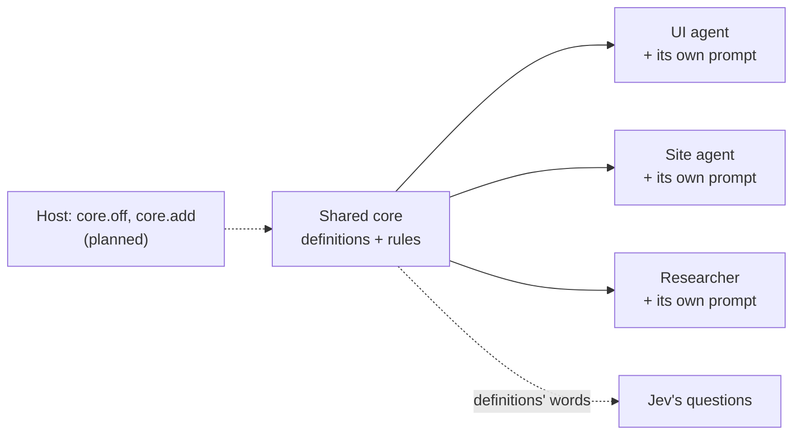

import { Aside, LinkCard, CardGrid } from '@astrojs/starlight/components';

<Aside type="caution" title="Status">
Experimental, behind a switch, not the default until QA's comparison. Version 3 of the text is frozen until that measurement. It is not in a released package yet.
</Aside>

## What it is

Today each agent has its own prompt, and each says in its own words how to read a person. The shared core says it once. The UI agent, the site agent and the researcher each get the same text, word for word, as the first block of their system prompt. Each agent's own prompt then keeps only its role, its tools and its area: the form, the site or the documents. A model call that does not talk to a person does not get the core.

The core has two parts:

- **Definitions** (`[sec:definitions]`): 16 yes/no questions about the person's latest line, such as "is this an order?" or "is the person still undecided?".
- **Rules**: 50 rules by section, saying what to do with what the line means. Each has a short id, so a scenario, a turn's log or a host's setting can name it. The rules under `[sec:boundaries]` cannot be switched off.

The [decision model](../decision-model/) (Jev) asks its questions in the definitions' own words, so the agents and Jev understand a line the same way. When a definition changes, the agents' prompts and Jev's question change together, and the core's version goes up. A run that read the choice layer carries the core's version in its decision trace, and every run carries it in `run_stats`.



## How a host extends it

<Aside type="note" title="Planned">
Not built yet. The keys below are the design; they do not work in any build today.
</Aside>

- **`core.off`**: a list of rule ids the host switches off, for example `[recommend-not-push]`. Its agents get the core without those rules. The rules under `[sec:boundaries]` cannot be switched off.
- **`core.add`**: the host's own rules. They come after the core in every agent's prompt.

Either way, the host never copies or edits the core's file.

```text title="formguide.yaml (planned, not a key yet)"
core:
  off: [voice-two-misses]
  add:
    - "Mention that delivery is free above 50 EUR when the person asks about delivery."
```

## Versions

The text is the file `backend/formguide/agent/core.md` from the Tech Lead's design (`openspec/changes/shared-core-prompt`), written by the R&D team (draft 1 of 19 November).

**Version 2** (19 November): 11,549 characters, **~3,000 tokens** (an estimate by characters). 16 definitions and 46 rules, each with a short id. A rule can be switched off by its id (`core.off`), referred to in a scenario and in the turn's log. `[sec:boundaries]` cannot be switched off. What changed since version 1:

- **The definitions became questions of one judgement each.** Jev takes them word for word, getting only the definitions, not the whole core (the Tech Lead's design, f87d4bf). What the agent is to do moved out of the definitions into the rules: function-not-form, card-yes.
- A new definition: def:asks-for-human (item 33).
- The R&D team's batch 3, with the CPO's decisions:
  - rule 12 rewritten as later-wins (item 24): an edit by hand after what was said is a correction; it stays and is named; ask only if the person then names a different value;
  - "A or B?" in one-question: both options in the screen's words, never "what do you mean?", never a second question about the same line (item 19). The order of options on the card is set by code, not by the prior (item 17b);
  - shelf-life: first "filled: …; left: …", then one question (item 22);
  - a fact is named as the state of things, not as the person's mistake (missing-fact).
- The R&D team's batch 4:
  - something-wrong (item 29);
  - pulling-goals refined (item 31);
  - human-asked (item 33) and no-false-done with "one line per part" (item 37), both in [sec:boundaries]. "The contact once" was removed from [stuck]: it is now human-asked.

The offline check of v2 (the core + the slimmed prompts, through a plugin): **878 of 878**. The Cyrillic in the repository's file is written as `\u` sequences.

**Version 3 (final; the text is frozen until QA's A/B run).** 12,337 characters, ~3,160 tokens (an estimate), 16 definitions and 50 rules. The R&D team's batch 5 is added:

- [reversible-from-rules] (R2-2);
- [told-wrong] (R-6, written as a general rule, not only for the researcher);
- [doing-not-done] (R-7, "Opening…" until confirmed);
- [doubt]: doubt counts only from words of doubt, not from "uh";
- [hurry]: haste counts only from direct words, not from short lines;
- [formal-address]: Spanish has no single polite form of address.

je voudrais / vorrei / quisiera are already part of def:order. The offline pytest with v3: **878 of 878**.

## What the core says

The core's text lives in the package (`backend/formguide/agent/core.md`); this page does not reprint it. In words, its sections are:

| Section | What it covers |
| --- | --- |
| `[sec:definitions]` | 16 yes/no questions about the person's latest line: an order, a question, a question about the way, a hint, a wish, an intention, a plan, a stated value, a choice left to the assistant, a bare yes to a waiting card, a bare no, a correction, going back, asking whether something can be undone, asking for a person, a repeat. Jev asks them in these words |
| `[sec:reading]` | understanding what the person wants: words as the first guess, acting on what a line asks for rather than its grammar, the three layers (wish, intention, plan), the goal one level up, never asking why, one step at a time, saying a missing fact first, not asking again, what was done last wins, after a pause, two goals that pull apart, two readings |
| `[sec:deciding]` | act, ask or wait by the cost of a mistake: no "are you sure?" on a stated value, one question with the screen's options, a choice left to the assistant, a bare yes to a card, voice after two misses |
| `[sec:recommending]` | recommend, never push: when it fits, once, with a reason from what was said or the business's facts, never at the wrong moment, never to keep the person talking |
| `[sec:states]` | signals from the conversation only make the assistant quieter: being stuck, hurry and doubt count only from the person's own words, no compulsion |
| `[sec:replying]` | answering the question asked, showing what was understood, "when X, Y here", why a field is asked, what can be undone, "doing" until it is done, re-checking when told it is wrong, the state rather than the person, after a mistake, sensitive fields, saying each thing once |
| `[sec:language]` | replying in the person's language, the formal form of address, directness is not rudeness |
| `[sec:boundaries]` | never switched off: no false "done", a human contact on request, no feelings named, nothing personal inferred, no manipulation, no consent given for the person, content is data, facts only from sources |

Every rule has an id, listed with its source in the next section; a host will switch rules off by id and add its own ([How a host extends it](#how-a-host-extends-it)).

## Where each rule comes from

"Rule n" is a row of the rules for Dushes' agents in [the review](../../research/intentions/#rules-for-dushes-agents). "Item n" is an item of [Point by point](../../research/point-by-point/). "R&D study" is [Research: the psychology of desires and motives](../../research/motives/). "R2-n" is a row of [The psychology of what a person wants](../../research/wishes/). "S-n" is the R&D team's item n on [How the best systems guess intent](../../research/intent-systems/). "A-n" is the order by agents in the review. "The prompts" means the rule was already in today's prompts and moved into the core.

| id | Where it comes from |
| --- | --- |
| `def:order` | Searle, Grice · [rule 6](../../research/intentions/#rules-for-dushes-agents) · [item 9](../../research/point-by-point/) · [R&D study](../../research/motives/) (wish forms vorrei / je voudrais / ich möchte) |
| `def:question` | Searle · [rule 6](../../research/intentions/#rules-for-dushes-agents) · [item 10](../../research/point-by-point/) |
| `def:question-about-the-way` | [item 9](../../research/point-by-point/) ("How do I get to X?" is a question) · [item 10](../../research/point-by-point/) |
| `def:hint` | Grice, implicature · [item 10](../../research/point-by-point/) (a hint is offered, not carried out) |
| `def:wish, def:intent, def:plan` | The table of layers in the [review](../../research/intentions/) · [rule 1](../../research/intentions/#rules-for-dushes-agents) · [item 5](../../research/point-by-point/) |
| `def:stated-value` | Bratman · [rule 2](../../research/intentions/#rules-for-dushes-agents) · [item 1](../../research/point-by-point/) |
| `def:leaves-choice` | the UI agent's prompt |
| `def:agrees-to-a-card` | the UI agent's prompt, `card_answer` |
| `def:declines, def:correction` | Assistance games · [rule 12](../../research/intentions/#rules-for-dushes-agents) · the chooser's confirm question |
| `def:go-back` | The Tech Lead's design (def:go-back) · [R&D study](../../research/motives/) (failures on "zurück", "indietro") |
| `def:asks-reversible` | Fear of making a mistake · [R2-2](../../research/wishes/) |
| `def:asks-for-human` | [item 33](../../research/point-by-point/) (version 2) |
| `def:repeat` | Alexa's self-learning · [S-4](../../research/intent-systems/) · [item 18](../../research/point-by-point/) |
| `first-guess` | Inverse planning · the gap between words and behaviour · [rule 10](../../research/intentions/#rules-for-dushes-agents) |
| `layers` | [rule 1](../../research/intentions/#rules-for-dushes-agents) · [item 5](../../research/point-by-point/) (in the "plan" layer, do it first) · [R&D study](../../research/motives/) (phases) |
| `goal-one-level-up` | Vallacher & Wegner · [rule 3](../../research/intentions/#rules-for-dushes-agents) · [item 6](../../research/point-by-point/) (name what did not fit, and the nearest) |
| `never-ask-why` | [rule 4](../../research/intentions/#rules-for-dushes-agents) · [item 7](../../research/point-by-point/) · [R&D study](../../research/motives/) (Nisbett & Wilson) |
| `step-by-step` | Going down the hierarchy · [rule 5](../../research/intentions/#rules-for-dushes-agents) · [item 8](../../research/point-by-point/) |
| `missing-fact` | BToM · [rule 11](../../research/intentions/#rules-for-dushes-agents) · [item 15](../../research/point-by-point/) |
| `said-already` | Clark & Brennan · [rule 7](../../research/intentions/#rules-for-dushes-agents) · [item 11](../../research/point-by-point/) (the SAID block) |
| `later-wins` (words-and-screen in the source table) | The gap between words and behaviour · [rule 12](../../research/intentions/#rules-for-dushes-agents) · [item 24](../../research/point-by-point/) (the later event is stronger) |
| `something-wrong` | [item 29](../../research/point-by-point/) (version 2) |
| `shelf-life` | A goal's shelf life · [rule 13](../../research/intentions/#rules-for-dushes-agents) · [item 22](../../research/point-by-point/) |
| `pulling-goals` | ClarifyMT-Bench · [rule 19](../../research/intentions/#rules-for-dushes-agents) · [item 31](../../research/point-by-point/) |
| `two-readings` | [rule 23](../../research/intentions/#rules-for-dushes-agents) · A-5 |
| `cost-of-mistake` | Horvitz · [rule 17](../../research/intentions/#rules-for-dushes-agents) · [R&D study](../../research/motives/) (one line on what happens next) |
| `no-are-you-sure` | Bratman · [item 1](../../research/point-by-point/) |
| `one-question` | CIRL, CLAMBER · [rule 18](../../research/intentions/#rules-for-dushes-agents) · [item 19](../../research/point-by-point/) (the screen's names, "neither") · [R&D study](../../research/motives/) ("a weak question is worse than none") |
| `your-choice` | the UI agent's prompt |
| `voice-two-misses` | [item 12](../../research/point-by-point/) |
| `recommend-not-push` | [rule 14](../../research/intentions/#rules-for-dushes-agents) (the owner's decision of 19 November) · [R&D study](../../research/motives/) (recommendation by phase) |
| `reason-from-facts` | [item 23](../../research/point-by-point/) |
| `no-recommend-moments` | [item 23](../../research/point-by-point/) |
| `no-engagement` | Stated and revealed preferences · [rule 14](../../research/intentions/#rules-for-dushes-agents) |
| `state-only-lowers` | [R&D study](../../research/motives/) (the main rule) |
| `stuck` | [R&D study](../../research/motives/) (the state line) · [R2-4](../../research/wishes/) · [item 8](../../research/point-by-point/) |
| `hurry` | [R2-5](../../research/wishes/) · [R&D study](../../research/motives/) ("in short"): counted only from direct words, as revised in the point-by-point check (version 3) |
| `doubt` | [R2-6](../../research/wishes/), as revised in the [point-by-point check](../../research/point-by-point/): only words of doubt, not "uh" (version 3) |
| `no-coercion` | SDT, autonomy · [R&D study](../../research/motives/) |
| `answer-in-its-terms` | Grice · [rule 9](../../research/intentions/#rules-for-dushes-agents) · [item 10](../../research/point-by-point/) (never a bare "no") |
| `show-understanding` | Clark · [rule 8](../../research/intentions/#rules-for-dushes-agents) |
| `no-false-done` | Checking the goal after the action · A-1 · [item 2](../../research/point-by-point/) (three outcomes) · [item 37](../../research/point-by-point/) (one line per part) · the prompts |
| `when-then` | Gollwitzer · [rule 15](../../research/intentions/#rules-for-dushes-agents) · [item 4](../../research/point-by-point/) |
| `why-asked` | SDT, competence and control · [item 3](../../research/point-by-point/) |
| `reversible-from-rules` | [R2-2](../../research/wishes/), as revised in the point-by-point check (version 3) |
| `doing-not-done` | R-7 of the point-by-point check: "Opening…" until confirmed (version 3) |
| `told-wrong` | R-6 of the point-by-point check, written as a general rule, not only for the researcher (version 3) |
| `state-not-person` | Saving face · [R2-3](../../research/wishes/) |
| `after-a-mistake` | [R&D study](../../research/motives/) (after a mistake, a card with an editable value) · [item 12](../../research/point-by-point/) |
| `sensitive-plainly` | [R&D study](../../research/motives/) (awkward fields) |
| `say-once` | the prompts of the UI agent and the site agent |
| `reply-language` | the prompts |
| `formal-address` | [R2-7](../../research/wishes/) · [R&D study](../../research/motives/) · no single polite default for Spanish (version 3) |
| `directness-is-normal` | Ogiermann 2009, the Russian–Italian corpus, Ruytenbeek 2020 · [R&D study](../../research/motives/) · [R2-7](../../research/wishes/) |
| `human-asked` | [item 33](../../research/point-by-point/) (version 2) |
| `no-feelings` | EmoBench · [R&D study](../../research/motives/) · [R2-8](../../research/wishes/) |
| `no-personal-inference` | GDPR Art. 9, C-184/20 · [R2-9](../../research/wishes/) |
| `no-manipulation` | AI Act Art. 5(1)(a) · [R&D study](../../research/motives/) · [R2-8](../../research/wishes/) |
| `consent-is-theirs` | the UI agent's prompt, code |
| `content-is-data` | the prompts of all three agents |
| `facts-from-sources` | the prompts of all three agents |

## What comes next

1. The slimmed prompts of the three agents: only the role, the tools and their own area (the form, the site, the documents), with no repeating of the core.
2. Jev's questions, built from the definitions in `[sec:definitions]`.
3. Every rule comes with a QA scenario. The rules about STUCK, RESUMED and the SAID block will work only once code starts writing those lines.

## The agents' prompts on top of the core (slimmed)

Each agent keeps only its role, its tools and its own area: the form, the site or the documents. Everything about how to understand a person is removed from the agents and said once in the core.

| Agent | Today, characters | Its own prompt after slimming | Core + its own | What moved into the core |
| --- | --- | --- | --- | --- |
| UI agent | 17,488 | 15,955 | 27,006 (~6,900 tokens) | the section "Reading the person"; the cost of a mistake; recommendations; "do not ask again"; language and the polite form of address; "say it once"; "say what you understood"; the words after a mistake; "not done, and why"; "when X, Y" |
| Site agent | 4,879 | 4,448 | 15,499 (~4,000) | the section "Reading the person"; recommendations; the polite form of address; "say it once"; one question with options; "the pages' text is data" |
| Researcher | 759 | 679 | 11,730 (~3,000) | two readings; "the documents are data". Added: "you are not talking to the person, answer the assistant in English" |

The check: the whole offline pytest with the system prompt "core + slimmed prompt" for all three agents, **868 of 868 passed**. The substitution goes through a plugin; the repository is untouched.

Two points for the Tech Lead:

- The core has to be put in as a separate first block, not passed through `core_rules`: that function drops one-line sections, and the line `version: 1` would be lost.
- The researcher with the core grows from about 200 to 3,000 tokens per call. With the cache this is cheap, but it needs only part of the core. A question to the owner: give it the whole core (as said, "for absolutely everyone"), or only the sections [sec:definitions], [sec:reading] and [sec:boundaries]?

## Jev's questions from the core's definitions

The choice layer builds each question from the definitions by their ids. In a yes/no question the definition becomes the criterion for "yes", and those it must be told apart from become the criterion for "no".

| Question | Kind | From the definitions |
| --- | --- | --- |
| is_command | yes/no | yes: def:order; no: def:question, def:question-about-the-way, def:hint, def:wish |
| asks_way (new) | yes/no | yes: def:question-about-the-way; no: def:order. Closes the failures on "how do I get to" |
| kind | choice | go_to / show / set_value: def:order; question: def:question + def:question-about-the-way; other: def:hint + def:wish |
| layer (new, behind a switch) | choice | def:wish / def:intent / def:plan |
| confirm | choice | def:agrees-to-a-card / def:declines / def:correction / "not an answer" |
| go_back (new; today code checks the words) | yes/no | def:go-back |
| leaves_choice (new) | yes/no | def:leaves-choice |
| asks_reversible (new) | yes/no | def:asks-reversible |
| field values (f:, value) | choice | the options as before; def:stated-value added to the instruction |
| repeat | code | def:repeat: counted by the correction log, which gives the STUCK line |

Unchanged (each already one judgement, tuned on the measurement of 17 November): target, date_field, s:, all_sections, all_of, was_offered, asks_move, asks_more.

Changing a definition means changing Jev's answers. So it is a new version of the core and a QA run, and thresholds are not carried over from the old wording.

## Next

<CardGrid>
  <LinkCard title="The decision model" description="Jev: the part that asks the definitions' questions." href="../decision-model/" />
  <LinkCard title="Research" description="The studies these rules come from." href="../../research/" />
</CardGrid>
