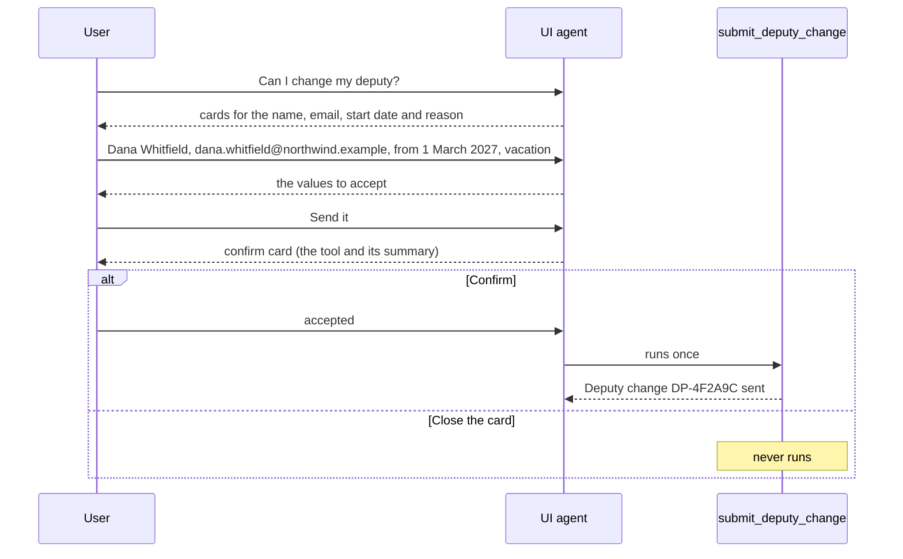

import { Aside, LinkCard, CardGrid } from '@astrojs/starlight/components';
import { Summary } from '../../../../components/ui';
import RecipeFiles from '../../../../components/recipe/RecipeFiles.astro';
import RecipeResult from '../../../../components/recipe/RecipeResult.astro';

<Summary what={"A form the user never sees, filled with cards and sent to your server"} when={"A short request (a deputy, an address, a leave day) does not deserve a page of its own"} write={"`ui.form_visible: false` in the page's state, a submit tool, and its name in `confirm_tools`"} />

Your server owns the form: its fields, rules and the API it is sent to. The page shows only the chat. The UI agent asks for the values with cards, and your own tool sends them, held until the user taps Confirm.

<Aside type="caution" title="Where it works today">The user must already be talking to this form's agent: on the page that hosts it, or opened by a link. The site agent cannot start a hidden form from another page yet; forms declared on the server, and host tools that return a card, are planned.</Aside>

## The files

The recipe is the folder `backend/demo/recipes/chat-only-form/`. `deputy_tools.py` sits at the folder root and is referenced as `"deputy_tools:submit_deputy_change"`. Replace its body with a call to your own API.

<RecipeFiles name="chat-only-form" />

## Tell the agent the form is hidden

The page says so in the state it sends with every message: `ui.form_visible: false`. The agent then never offers to show a field, never names a tab or a button, and collects and reads back every value in the chat. No hint in your domain pack is needed for it.

```json title="state (part), every run"
{ "form_id": "deputy_change", "ui": { "form_visible": false } }
```

Measured by QA on two forms with no hint in their packs, 5 runs each: no pointing at the page in 10 of 10 runs with the flag, 0 of 10 without it ([scenarios](https://github.com/denvasylenko/dushes/tree/main/backend/evals)). The recipe's own pack still carries a hint from before the flag existed; it does no harm.

A hidden form needs a tool that sends it, as the recipe's `submit_deputy_change`. Without one, the agent can only say the details are recorded and that this chat cannot send them.

## The page

The page still sends the form's state with every message, with `ui: {form_visible: false}`, but keeps it in memory instead of on screen: describe the four fields once with `schemaForm(schema, access)`, and keep the values in a plain object. Fetch the schema from your server, so the server stays the one place the form is defined. See [React Hook Form and schemaForm](../../../frontend/react-hook-form/).

## What happens



## How well it works

Two scenarios: the user confirms (the change must be sent), and the user closes the confirm card (it must not be sent). When the user confirms, the run also fails if more than one confirm card was shown, or a confirm card that is not the held tool's own. In both, the agent's replies are checked for words that point at a form on the page ("on the right", "the field on", "scroll", "fill in the form").

<RecipeResult name="chat-only-form" />

## Pitfalls

- Without `ui.form_visible: false`, the agent assumes the person sees the form and may say "see the field on the right". Send the flag with every run, not only the first.
- Hold the submit tool by name in `confirm_tools`; asking the model to "confirm first" in the prompt is not a hold.
- The confirm card reads "Run submit_deputy_change?" with the tool's arguments: give it one readable `summary` argument.
- The held tool's card is the only confirmation: the agent never asks "Send it?" by itself, in words or with a card of its own. Do not ask for a confirmation in your domain pack either.

## Next

<CardGrid>
  <LinkCard title="Confirm before a side effect" description="The hold on its own, with a visible form." href="../confirm-side-effect/" />
  <LinkCard title="Domain packs" description="Persona, flow hints, glossary and where packs live." href="../../ui-agent/domain-packs/" />
</CardGrid>
