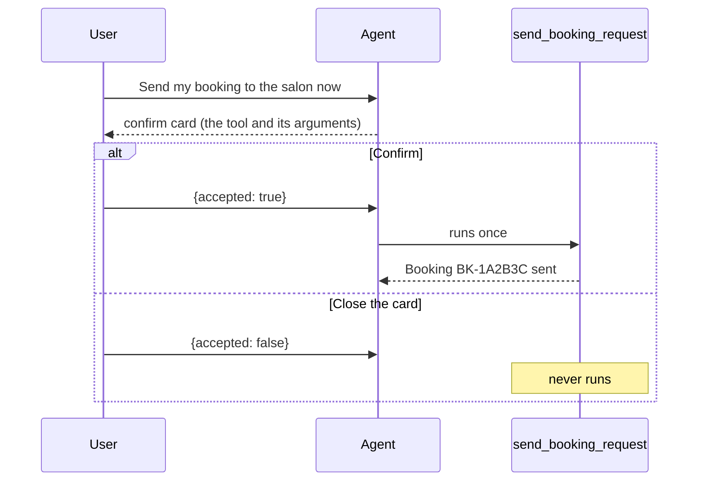

import { LinkCard, CardGrid } from '@astrojs/starlight/components';
import { Summary } from '../../../../components/ui';
import RecipeFiles from '../../../../components/recipe/RecipeFiles.astro';
import RecipeResult from '../../../../components/recipe/RecipeResult.astro';

## The files

The recipe is the folder `backend/demo/recipes/confirm-side-effect/`. `booking_tools.py` sits at the folder root and is referenced as `"booking_tools:send_booking_request"`.

<RecipeFiles name="confirm-side-effect" />

## What happens

`confirm_tools` holds **every** call of the tool, whatever the model decides; the model cannot skip the card. The card's payload carries `tool` and `args`, so the user sees what will be sent ([Cards](../../../frontend/cards/)).

## How well it works

Two scenarios: the user confirms (the tool must run), and the user closes the card (the tool must not run).

<RecipeResult name="confirm-side-effect" />

## Pitfalls

- Hold the tool, not the topic: list the tool's exact name in `confirm_tools`. A sentence in the prompt asking the model to "confirm first" is not a hold.
- The user reads the tool's name and arguments: the card says "Run send_booking_request?" and lists `summary: …`. Give the tool a plain name and one readable argument (a `summary`), not a row of ids.
- A tool that only reads (a lookup, a price check) does not need a hold: every card is one more tap.

## Next

<CardGrid>
  <LinkCard title="Skills and tools" description="Server tools, skills and every option." href="../../ui-agent/skills/" />
  <LinkCard title="Cards" description="The confirm card and its answer." href="../../../frontend/cards/" />
</CardGrid>
