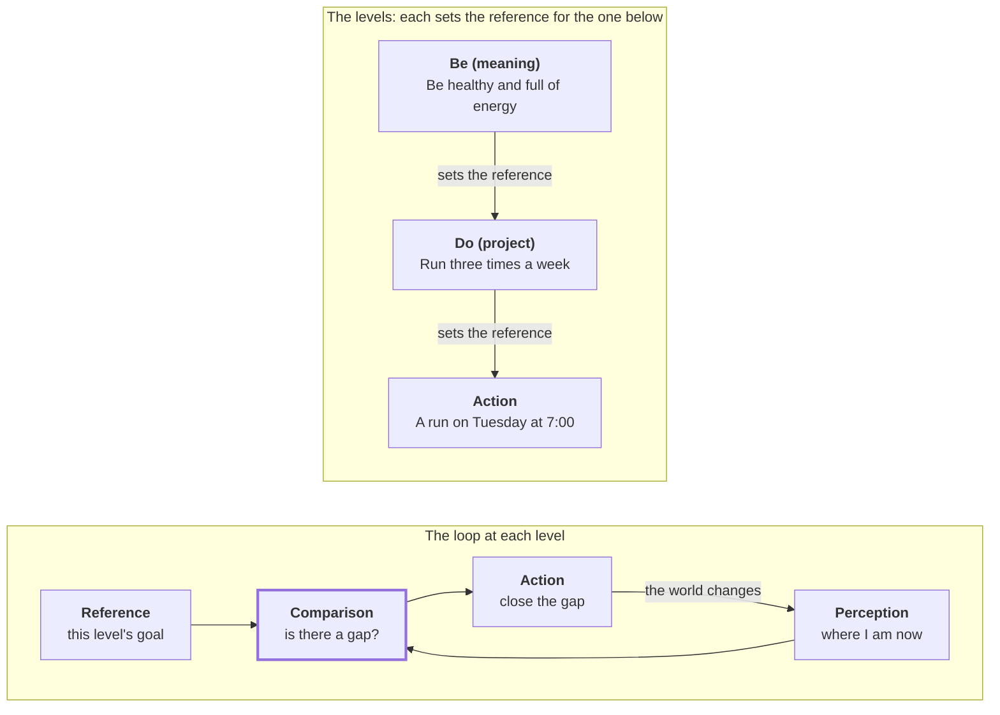

import { LinkCard, CardGrid } from '@astrojs/starlight/components';

*19 November 2026. The R&D team's review, translated into English one to one.*

## In short

A goal is not a task but a reference the person constantly checks themselves against. To help with goals, Jev needs to understand a goal's phase, level, reason and progress.

- Before the decision a person needs options and honest risks; after it, a plan and the next step. Mixing up these modes does harm.
- Goals form a hierarchy from "be" to "do", and at each level a comparison loop is at work; the speed of progress gives rise to emotions.
- Specific, hard goals work better than vague ones, but they narrow the focus and can push towards risk and dishonesty.
- What matters is not only what the goal is but also why: one's own goals and approach goals are reached more often than imposed goals and avoidance goals.
- Recorded progress helps; whether to stress "done" or "left" depends on whether the person is firm in the goal.
- Dreams without obstacles make people relax; being able to let go of an unreachable goal is as much a part of good self-regulation as persistence.

## What a goal is

A goal is a desired end state, and an intention is the decision to pursue it. Locke and Latham define a goal as the object or aim of an action: for example, reaching a certain level, usually by a deadline ([Locke & Latham, 2002](https://goal-lab.psych.umn.edu/orgpsych/2020/readings/5.%20Motivation/Locke%20&%20Latham%20(2002).pdf)).

**The Rubicon model (Heckhausen & Gollwitzer, 1987)** explains how a wish turns into a goal. The path is divided into four phases: before the decision, before the action, the action, and after the action ([Wikipedia](https://en.wikipedia.org/wiki/Rubicon_model)). The decision to pursue a goal is the crossing of the Rubicon.

Before and after this line a person thinks differently ([Gollwitzer, 2012](https://kops.uni-konstanz.de/entities/publication/94b010dd-ff41-4079-8bf8-f73f0e00f1d4)):

|  | Deliberative mindset (before the decision) | Implemental mindset (after the decision) |
| --- | --- | --- |
| The task | Choose what to pursue | Work out how, when and where |
| Attention | On the pros and cons, realistically | On the ways of reaching it, optimistically |
| What helps | Options, comparisons, honest risks | A concrete plan, the next step |
| What gets in the way | Early pressure to act | Discussing a decision already made all over again |

A person needs help in a different way before the decision and after it ([Keller, Gollwitzer, Sheeran, 2020](https://www.doi.org/10.1017/9781108677318.006)). For Jev the first question about any goal is: is the person still choosing or have they already decided? If they have decided, laying out the "pros and cons" for them again does harm.

## The hierarchy of goals and feedback

In Carver and Scheier's control theory a goal is a reference against which a person constantly compares their current state ([Carver, 2019](https://pmc.ncbi.nlm.nih.gov/articles/PMC6707771)). The loops are nested in each other: each level sets the reference for the level below ([Edwards, 1998](https://tarheels.live/jeffreyedwardswebsite/wp-content/uploads/sites/5503/2024/03/Edwards1998.pdf)). A second loop watches the speed at which the gap closes ([Guilford](https://www.cms.guilford.com/excerpts/moskowitz2.pdf?t=1)), and emotions arise from it ([Carver & Scheier](https://api.philpapers.org/rec/CAROTS)).

*Each level of a goal is a loop: compare where I am with where I want to be. A second loop watches the speed: when the gap closes faster than expected, a lift; slower, anxiety and irritation.*

For Jev there are two conclusions here. First: help at the lower level (a reminder about a run) makes sense only while it serves the upper one. Second: a person's mood is a signal about the speed of progress. Irritation often means "I am moving more slowly than I expected", not a complaint about the answer.

## Which goals work

Specific, hard goals give more results than "do your best", but they have side effects.

- **Goal-setting theory (Locke & Latham).** Over 35 years of research, specific hard goals consistently outperformed the call to do one's best; the effects in meta-analyses are d = 0.52–0.82. The result stopped growing only when it hit the limit of ability or when commitment to the goal disappeared ([Locke & Latham, 2002](https://home.ubalt.edu/tmitch/642/articles%20syllabus/locke%20pract%20goal%20setting%202002%20am%20psy.pdf)).
- **How goals act.** They direct attention to what matters, raise effort, lengthen persistence and make people look for a strategy (ibid.).
- **Conditions.** The effect works with commitment to the goal, feedback, sufficient ability and a task that is not too complex. Praise, feedback and taking part in choosing the goal affect behaviour to the extent that they lead to a specific hard goal and commitment to it ([Wikipedia](https://www.Wikipedia.com/wiki/Goal_setting)).
- **Side effects ("Goals Gone Wild", 2009).** A narrow focus, behind which unnamed things are forgotten; a distorted attitude to risk; a rise in unethical behaviour; inhibited learning; a fall in intrinsic motivation. The authors compare goals to a prescription drug that needs dosing and supervision ([Ordóñez et al., 2009](https://experts.arizona.edu/en/publications/goals-gone-wild-the-systematic-side-effects-of-overprescribing-go/)). In complex and new tasks a specific outcome goal can get in the way of trying other ways ([a summary](https://andrewclark.super.site/all-media/goals-gone-wild)).

For Jev: turning a vague goal into a specific one is worth it, but together with it one must keep in mind what the person does not want to lose. In tasks new to the person, a learning goal is better than a number.

## What stands behind a goal

The chance of reaching a goal depends not only on what the goal is but on why the person pursues it. Researchers single out three independent axes.

| Axis | Poles | What the data show | How it sounds in a request |
| --- | --- | --- | --- |
| Why (self-concordance) | Autonomous motivation (interest, one's own values) ↔ controlled (reward, pressure, guilt) | Goals with autonomous motives are linked to greater effort, attainment and well-being; a 2024 meta-analysis confirmed this ([Sezer et al., 2024](https://eprints.soton.ac.uk/493985)) | "I want to learn…" vs "I have to, or my boss…" |
| Towards something or away from it | Approaching the good ↔ avoiding the bad | Approach goals are on the whole linked to better results, avoidance goals to worse ([a meta-analysis](https://pmc.ncbi.nlm.nih.gov/articles/PMC3974764)) | "I want to perform well" vs "if only I don't make a fool of myself" |
| What counts as success | Mastery (become better) ↔ performance (be better than others) | Mastery goals support intrinsic motivation, performance-approach goals raise grades, and performance-avoidance goals harm both ([Elliot & Church, 1997](https://bibsonomy.org/bibtex/2b04f26c0694be34ceac22f618ad76508/villeh)) | "I want to understand SQL" vs "I want to do the best in the exam" |

Researchers of self-concordance stress that the probability of reaching a goal depends more on the reasons than on the type of goal itself ([Gore et al.](https://www.scribd.com/document/127424806/psp-90-5-848-pdf)). In sport, the link of autonomous motives to effort could not be reduced to the difficulty or specificity of the goal ([Smith, Ntoumanis, Duda](https://research.birmingham.ac.uk/en/publications/goal-striving-goal-attainment-and-well-being-an-investigation-of-/)).

For Jev these axes are hidden features of a goal that can often be heard in the wording. It is useful to rephrase an avoidance goal as an approach goal, and a controlled goal is a signal that the person will need more support and reminders.

## Dynamics on the way to a goal

Motivation on the way to a goal is not constant: it depends on how the person sees their progress. And it is exactly here that an assistant can help most.

- **Monitoring progress works.** In a meta-analysis of 138 experiments (N = 19,951) interventions greatly increased the checking of progress (d = 1.98), and this in turn raised goal attainment. The effect was stronger when progress was recorded or made public ([Harkin et al., 2016](https://eprints.whiterose.ac.uk/91437/)). The average effect on attainment is more modest: d ≈ 0.40 ([a retelling](https://siliconcanals.com/t-progress-monitoring-recorded-public-goal-achievement/)).
- **The goal gradient.** The closer the reward, the more effort. Even an illusion of progress speeds people up: a card with 12 stamps and two bonus ones was filled faster than an ordinary one with 10 ([Kivetz, Urminsky, Zheng, 2006](https://econpapers.repec.org/RePEc:feb:natura:00658)).
- **Done or left.** Motivation is raised both by commitment and by a lack of progress. If commitment is in question, it helps to show how much has already been done; if commitment is not in doubt, how much is left ([Koo & Fishbach](https://bohrium.dp.tech/paper/arxiv/812065010711789569)).
- **Progress as a licence.** A sense of progress on one goal can "permit" actions against it; thoughts of commitment, on the contrary, help people keep going ([Fishbach & Dhar, 2005](https://core.ac.uk/download/357313231.pdf)). Later research gives a mixed picture ([Isherwood, 2015](https://dukespace.lib.duke.edu/items/a954cf7b-240f-442f-b193-575530f4a2f5)).
- **Several goals at once.** With a single goal people act consistently; with several, they more often balance between them ([a summary of Fishbach & Dhar](https://chenx.netlify.app/consumer-behavior/notes-on-fishbach-dhar-2005-goals-as-excuses-or-guides)).

For Jev: keep a visible, recorded progress and choose the frame by the situation: "already done" at the start and when the person wavers, "left" closer to the finish. Praise for progress can make people relax, and stressing the goal's importance can hold them.

## Fantasies, unconscious goals and giving up goals

Good work with goals is not only moving towards them but also looking honestly at the obstacles and letting go of the unreachable in time.

- **Positive fantasies and mental contrasting (Oettingen).** According to Oettingen, people who imagine success relax and do not build up energy for action ([WEF](https://www.weforum.org/stories/leadership/positive-thinking-leads-to-success-doesnt-it/)). The alternative is WOOP: wish, outcome, obstacle, an "if… then" plan. A meta-analysis of 21 studies (15,907 participants) assessed this combination as a strategy that raises goal attainment ([Wang et al., 2021](https://www.frontiersin.org/journals/psychology/articles/10.3389/fpsyg.2021.565202/pdf)).
- **Unconscious goals (goal priming).** The idea that random words or surroundings activate goals without a person knowing is disputed. Direct replications often did not reproduce the effect ([Harris et al., 2013](https://www.ncbi.nlm.nih.gov/pmc/articles/PMC3745413/)), and a meta-analysis of priming with words finds an effect but considers it probably overestimated ([Weingarten et al.](https://pmc.ncbi.nlm.nih.gov/articles/PMC5783538/), [Sanders](https://ideals.illinois.edu/items/103508/bitstreams/328945/data.pdf)). Building a product on this is risky.
- **Giving up and switching (Wrosch).** The ability to let go of an unreachable goal and take up a new one is linked to higher well-being ([Wrosch et al., 2003](https://www.cmu.edu/dietrich/psychology/pdf/scales/GAS_article.pdf)). Giving up is linked to less distress and even to physical health, and a new goal to positive measures such as meaning in life ([Wrosch, Scheier, Miller](https://pmc.ncbi.nlm.nih.gov/articles/PMC4145404)).

For Jev: not only inspire, but also ask about the main obstacle and the plan for it. And if a goal has been standing still for a long time, gently ask whether it still stands, and help put a replacement into words.

## What this means for Jev

Every goal has eight properties that Jev can recognise with some probability. How to help depends on each of them.

| Property of the goal | Question | How it sounds in speech | What Jev does |
| --- | --- | --- | --- |
| Phase | Choosing, or already decided? | "Thinking whether to…" vs "I'm taking on…" | Before the decision, options and risks; after it, a plan and the next step |
| Level | Is it a meaning, a project or a task? | "I want to be healthy" vs "book me for the tests" | Link the task to the goal above, to look for a replacement |
| Specificity | Is it clear what "done" means? | "Read more" | Offer a measurable criterion and a deadline |
| Difficulty | Is it realistic given the time and skills? | "Learn Japanese in a month" | Make the goal hard but reachable |
| Reason | One's own or imposed? | "I want to" vs "I have to, or…" | Find a personal meaning; if there is none, more reminders |
| Direction | Towards something, or away from something? | "If only I don't fail" | Rephrase as an approach goal |
| Progress | How much is done and how much is left? | Data from the history and trackers | Keep a record; "done" at the start, "left" near the finish |
| Viability | Does the goal still stand? | Weeks without movement, avoiding the subject | Ask about the obstacle, offer to revise or close it |

Together with the previous review this gives two layers: the intention explains what the person wants now, and the goal, for the sake of what and for how long. A live model of a person's goals makes inferring intentions more accurate: every request can be checked against the active goals.

## Sources

- [Rubicon model (Wikipedia)](https://en.wikipedia.org/wiki/Rubicon_model)
- [Gollwitzer, Mindset Theory of Action Phases, 2012](https://kops.uni-konstanz.de/entities/publication/94b010dd-ff41-4079-8bf8-f73f0e00f1d4)
- [Keller, Gollwitzer, Sheeran, Changing Behavior Using the Model of Action Phases, 2020](https://www.doi.org/10.1017/9781108677318.006)
- [Carver, Control Theory, Goal Attainment, and Psychopathology](https://pmc.ncbi.nlm.nih.gov/articles/PMC6707771)
- [Carver & Scheier, On the Self-Regulation of Behavior](https://api.philpapers.org/rec/CAROTS)
- [Edwards, 1998 (a review of cybernetic theory)](https://tarheels.live/jeffreyedwardswebsite/wp-content/uploads/sites/5503/2024/03/Edwards1998.pdf)
- [Locke & Latham, A 35-Year Odyssey, 2002](https://home.ubalt.edu/tmitch/642/articles%20syllabus/locke%20pract%20goal%20setting%202002%20am%20psy.pdf)
- [Ordóñez et al., Goals Gone Wild, 2009](https://experts.arizona.edu/en/publications/goals-gone-wild-the-systematic-side-effects-of-overprescribing-go/)
- [Sezer et al., a meta-analysis of the self-concordance model, 2024](https://eprints.soton.ac.uk/493985)
- [Smith, Ntoumanis, Duda, Self-Concordance Model in sport](https://research.birmingham.ac.uk/en/publications/goal-striving-goal-attainment-and-well-being-an-investigation-of-/)
- [Elliot & Church, A Hierarchical Model of Approach and Avoidance Achievement Motivation, 1997](https://bibsonomy.org/bibtex/2b04f26c0694be34ceac22f618ad76508/villeh)
- [A meta-analysis of 2×2 achievement goals (PLOS ONE)](https://pmc.ncbi.nlm.nih.gov/articles/PMC3974764)
- [Harkin et al., Does Monitoring Goal Progress Promote Goal Attainment?, 2016](https://eprints.whiterose.ac.uk/91437/)
- [Kivetz, Urminsky, Zheng, The Goal-Gradient Hypothesis Resurrected, 2006](https://econpapers.repec.org/RePEc:feb:natura:00658)
- [Fishbach & Dhar, Goals as Excuses or Guides, 2005](https://core.ac.uk/download/357313231.pdf)
- [Koo & Fishbach, Dynamics of Self-Regulation](https://bohrium.dp.tech/paper/arxiv/812065010711789569)
- [Wang et al., a meta-analysis of MCII, 2021](https://www.frontiersin.org/journals/psychology/articles/10.3389/fpsyg.2021.565202/pdf)
- [Harris et al., Two Failures to Replicate Goal Priming, 2013](https://www.ncbi.nlm.nih.gov/pmc/articles/PMC3745413/)
- [Weingarten et al., a meta-analysis of priming](https://pmc.ncbi.nlm.nih.gov/articles/PMC5783538/)
- [Wrosch et al., Adaptive Self-Regulation of Unattainable Goals, 2003](https://www.cmu.edu/dietrich/psychology/pdf/scales/GAS_article.pdf)
- [Wrosch, Scheier, Miller, Goal Adjustment Capacities](https://pmc.ncbi.nlm.nih.gov/articles/PMC4145404)

## What Dushes takes from it

Nothing on this page is in the package yet: it is a review, and each idea goes into the agents only with the owner's yes through the CPO and a QA scenario that fails before it. The R&D team will add further studies on goals here as they are ready. What the agents do today is on [How the agent behaves](../../how-it-works/behaviour/).

## Next

<CardGrid>
  <LinkCard title="The psychology of intentions" description="The first layer: what the person wants now." href="../intentions/" />
  <LinkCard title="How to understand a person" description="The shared core of rules for every agent." href="../../how-it-works/understanding/" />
</CardGrid>
