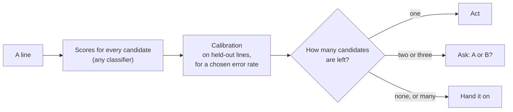

import { Aside, LinkCard, CardGrid } from '@astrojs/starlight/components';

A review of recent work, mostly 2024 to 2026, with a few older anchor papers. The question it asks: when an assistant reads a line, how do the best systems decide whether to carry it out, ask a question, or hand it on?

<Aside type="note" title="How to read the figures">
Figures are as the papers' authors report them, mostly from their abstracts and reviews. None of them were checked on Dushes' own data.
</Aside>

## The main findings

1. **Thresholds are calibrated, not picked by hand.** Conformal prediction and risk control turn any classifier's scores into a set of candidates with a guaranteed error rate. The size of the set decides what to do: one candidate, act; two or three, ask; none or many, hand it on (CICC, KnowNo, SAFER).
2. **"At most 1% wrong" has to be shown.** With no error in *n* test lines, the upper bound of the error rate at 95% confidence is about 3/*n* (the rule of three). Showing "at most 1%" for one action needs at least 300 error-free lines, or about a thousand if there are errors, on lines the threshold was not tuned on.
3. **A model scores how well a line fits each goal; the arithmetic decides.** Systems where a language model only scores the fit of a line to each possible goal, and the goal is inferred by explicit probability, beat large models that answer directly (CLIPS, AutoToM). What carries over from turn to turn matters: the result of one turn should be the starting point of the next.
4. **A correction is more often a rephrasing than an Undo.** Alexa's self-learning treats a rephrasing as a correction, and reported more than 30% fewer defects in A/B tests.
5. **How much to confirm depends on the cost of a mistake, and on whether one just happened.** While all goes well, an implicit confirmation is enough. After a mistake, an explicit one.
6. **Finding the element is the weak point of screen-reading agents.** Agents that locate buttons by pixels hit the right element in roughly 18% to 73% of cases on ScreenSpot-Pro. An assistant that picks from a known tree of pages and fields does not have this problem; its errors are about intent, and about not checking the result.

## The set of candidates decides

One mechanism replaces a handful of hand-set thresholds. Its guarantee holds only while live lines look like the lines it was calibrated on, so it has to be recalculated when the configuration changes.

## By area

### Calibration and selective prediction

[CICC](https://arxiv.org/pdf/2403.18973) (NAACL 2024) turns any intent classifier's scores into a candidate set with a coverage guarantee: one candidate acts, several ask; better than heuristic thresholds on seven datasets, without retraining. [KnowNo](https://arxiv.org/abs/2307.01928) (CoRL 2023) does the same for a robot planner, with 10–24% fewer requests for help at the same reliability. [SAFER](https://arxiv.org/abs/2510.10193) (ICLR 2026) controls risk and abstains when the target risk cannot be met

**What it suggests:** a threshold per action, derived for an acceptable error rate rather than chosen.

### Calibrating a model's confidence

[A 2024 survey](https://arxiv.org/pdf/2412.05563): large models are still overconfident. [A 2026 study](https://arxiv.org/pdf/2609.26489): the confidence a model states in words and its token probabilities are not interchangeable

**What it suggests:** calibrate scores per kind of question and per language; never act on a confidence the model states about itself.

### Inferring the goal

[CLIPS](https://arxiv.org/abs/2402.17930) (AAMAS 2024): a language model only scores how likely a line is under each goal, and the goal is inferred by inverse planning; reported 2.5 times more accurate than GPT-4V, with a 6.7B model. [AutoToM](https://arxiv.org/abs/2502.15676) (NeurIPS 2025): a model proposes several goals, probabilities are computed by Bayes, and the model is refined when unsure

**What it suggests:** carry the goal from one turn to the next instead of deciding every turn from scratch.

### Clarifying questions

[CLAMBER](https://arxiv.org/abs/2405.12063) (2024): language models are poor at noticing ambiguity. [Zhang et al.](https://arxiv.org/abs/2410.13788) (ICLR 2025): judge a question by what happens after it is answered; reported +4–5% F1, and the model learns not to ask when it need not

**What it suggests:** build "A or B?" from the candidate set; judge a question by whether the goal was reached after it, and in how many turns.

### Learning from corrections

Alexa's [self-learning from rephrasings](https://ar5iv.arxiv.org/html/1911.02557) models a chain of rephrasings as an absorbing Markov chain and turns successful ones into rewrites; reported more than 30% fewer defects. [ContReph](https://preview.aclanthology.org/moar-dois/2021.emnlp-main.143.pdf) finds rephrasings from context and the pause between turns. [PRELUDE/CIPHER](https://arxiv.org/abs/2404.15269) (NeurIPS 2024) derives a written preference from a person's edits

**What it suggests:** count a rephrasing soon after an action as a correction; suggest new synonyms for the configuration from what failed and then worked, applied only after a person checks them.

### Confirmation by voice

[Interspeech 2004](https://www.isca-archive.org/interspeech_2004/sagawa04_interspeech.html): while there are no errors, people prefer fewer confirmations; after one, an explicit one. Implicit confirmation (saying what was understood while doing it) is common voice practice when a mistake is cheap. No recent controlled study was found

**What it suggests:** implicit by default; explicit for the next few actions of the same kind after a mistake.

### Screen-reading agents

On [ScreenSpot-Pro](https://arxiv.org/html/2504.07981v1), pixel-based agents hit the right element in 18.9% to 73% of cases ([MEGA-GUI](https://arxiv.org/html/2511.13087v1), multi-stage); narrowing the search area takes one from 18.9% to 48.1%. [GUI-Critic-R1](https://arxiv.org/abs/2506.04614) (NeurIPS 2025) checks an action before it runs, because an irreversible one cannot be fixed afterwards

**What it suggests:** check the result after a move; narrow level by level (screen, section, field) when the list of options is long.

## What Dushes takes from it

**In the package today:**

- **Picking from a known tree, not from pixels.** The [decision model](../../how-it-works/decision-model/) chooses among the pages, sections and fields the server lists, so it cannot invent a target.
- **A model scores; code decides.** The decision model only answers fixed questions with probabilities. Code applies the thresholds and the rules, and never carries out anything that cannot be undone.
- **Implicit confirmation:** after an action, one short line says what was done, with Undo ([How the agent behaves](../../how-it-works/behaviour/)).

**Studied, not built** ([Coming next](../../how-it-works/behaviour/#coming-next)):

- Thresholds calibrated per action for an acceptable error rate, instead of fixed numbers.
- "A or B?" built from the candidate set when two fit.
- Counting a rephrasing as a correction, and learning synonyms from it after a person's review.
- Explicit confirmation for a short while after a mistake, by voice.

## Sources

- [CICC, NAACL Findings 2024](https://arxiv.org/pdf/2403.18973)
- [KnowNo, CoRL 2023](https://arxiv.org/abs/2307.01928)
- [SAFER, ICLR 2026](https://arxiv.org/abs/2510.10193)
- [Conformal Abstention Policies, 2025](https://www.arxiv.org/abs/2502.06884)
- [A survey of uncertainty in large language models, 2024](https://arxiv.org/pdf/2412.05563)
- [Calibration as a criterion, 2026](https://arxiv.org/pdf/2609.26489)
- [CLIPS, AAMAS 2024](https://arxiv.org/abs/2402.17930)
- [AutoToM, NeurIPS 2025](https://arxiv.org/abs/2502.15676)
- [CLAMBER, 2024](https://arxiv.org/abs/2405.12063)
- [Zhang, Knox & Choi, ICLR 2025](https://arxiv.org/abs/2410.13788)
- [Alexa, self-learning from feedback](https://ar5iv.arxiv.org/html/1911.02557)
- [Amazon Science: how Alexa corrects her own defects](https://www.amazon.science/blog/how-we-taught-alexa-to-correct-her-own-defects)
- [ContReph, EMNLP 2021](https://preview.aclanthology.org/moar-dois/2021.emnlp-main.143.pdf)
- [PRELUDE/CIPHER, NeurIPS 2024](https://arxiv.org/abs/2404.15269)
- [Confirmations, Interspeech 2004](https://www.isca-archive.org/interspeech_2004/sagawa04_interspeech.html)
- [ScreenSpot-Pro, 2025](https://arxiv.org/html/2504.07981v1)
- [MEGA-GUI, 2025](https://arxiv.org/html/2511.13087v1)
- [GUI-Critic-R1, NeurIPS 2025](https://arxiv.org/abs/2506.04614)

Not checked: no recent controlled studies of voice confirmations were found; the exact candidate-set rules of CICC should be checked against the paper's text; some ScreenSpot-Pro figures come from aggregators.

## Next

<CardGrid>
  <LinkCard title="Intentions: what psychology and AI say" description="The base: wishes, intentions, plans, and reading them." href="../intentions/" />
  <LinkCard title="The decision model" description="What runs in the package today." href="../../how-it-works/decision-model/" />
</CardGrid>
