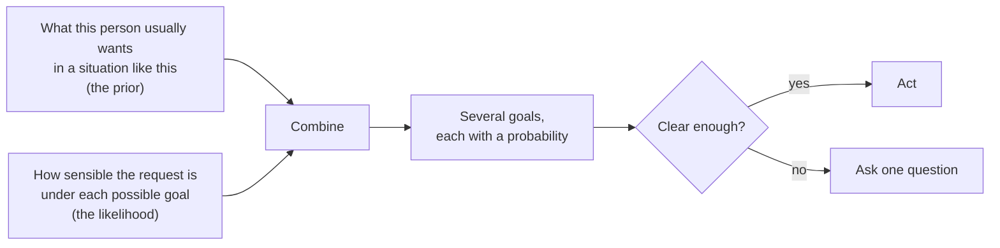

import { LinkCard, CardGrid } from '@astrojs/starlight/components';

An assistant that only matches words to actions gets many requests wrong. To serve a person well it has to hold several guesses about their goal, decide when to act and when to ask, and check that the result is what they wanted. This page summarises what psychology and AI research say about each of those steps.

## In short

- **An intention is a decision, not a wish.** A request can come from a wish, an intention or a plan, and each needs a different answer.
- **One action can be described at many levels**, from "why" down to "what to click". Knowing the level above gives alternatives when a plan breaks.
- **People speak indirectly and briefly**, counting on shared context. What matters is what a line does, not its form.
- **The best model of reading intentions is inverse planning:** which goal would make this request sensible?
- **Intentions predict behaviour only partly.** Words are the starting hypothesis; behaviour refines it.
- **An assistant should act on its own only when that is better than not acting.** A clarifying question is a rational move, and today's language models are still poor at it.

## What an intention is

An intention is not a desire. It is a decision a person has committed to and is building a plan around.

- **Planning theory (Bratman).** An intention is more than a belief plus a desire: it is a partial plan that settles a decision and coordinates later actions. While someone only wishes, they keep weighing; once they intend, they stop ([Bratman, 1984](https://agent-communications-vault.pages.dev/concepts/simple-view/)). The belief–desire–intention (BDI) architecture for software agents builds on this ([Rao & Georgeff, 1991](https://jmvidal.cse.sc.edu/library/rao91a.pdf)).
- **Theory of planned behaviour (Ajzen).** An intention is shaped by three things: the attitude to the action, what people who matter would think, and whether the person believes they can do it ([Ajzen, 1991](https://verdi.cs.ucl.ac.uk/constructDB/publications/ajzen-theory-1991.html)).
- **Implementation intentions (Gollwitzer).** A goal ("I want X") and an if-then plan ("if Y happens, I do Z") are different things. A 2006 meta-analysis reported a medium-to-large effect of such plans on reaching goals; a 2024 synthesis, after correcting for publication bias, reports a smaller one ([review](https://www.thebehavioralscientist.com/glossary/implementation-intentions)).

So a request can come from three layers:

| Layer | What it is | Example | What helps |
| --- | --- | --- | --- |
| A wish | not decided yet, options open | "I'd like to visit Japan some time" | help choose: show options and how they differ |
| An intention | decided, needs a way | "We're going to Tokyo in April" | build the plan, ask the one missing constraint |
| A plan | decided, and how | "Book the 9:40 flight" | do it; confirm first if it cannot be undone |

## Levels of an action

Any action can be described at several levels, from how it is done to why it is done. People prefer the higher levels, and drop to lower ones when an action is hard or goes wrong ([Vallacher & Wegner, 1987](https://typeset.io/pdf/what-do-people-think-they-re-doing-action-identification-and-3wpq5rx221.pdf)).

- **One level up gives alternatives.** A request usually arrives at the lowest level ("book the ticket"). Knowing the level above lets an assistant offer a replacement when the plan breaks: a train instead of a cancelled flight. Going higher without being asked is intrusive.
- **A person dropping to small steps** ("click this button, then this one") is a sign that something went wrong and they need more concrete help.

## How people say what they want

The literal meaning of a line and what the speaker intends often differ, and that is normal. People speak briefly and indirectly because they count on shared context.

- **Speech acts (Austin, Searle).** A line has a form and a function. "Can you pass the salt?" is a question about ability in form and a request in function ([UPenn](https://ling.upenn.edu/courses/ling0001/dialogue.html)).
- **The cooperative principle (Grice).** A listener assumes the speaker is being informative, truthful, relevant and clear. When one of these is plainly broken, there is a hidden meaning: "it's cold in here" often means "close the window".
- **Common ground (Clark & Brennan).** Any joint action rests on shared knowledge and assumptions, updated as the conversation goes. People keep the joint effort small and show they understood by a nod or a relevant next move ([Clark & Brennan, 1991](https://web.stanford.edu/%7Eclark/1990s/Clark,%20H.H.%20_%20Brennan,%20S.E.%20_Grounding%20in%20communication_%201991.pdf)).

## How people read what others want

People work out others' goals by **inverse planning**: they ask which goal would make the action sensible.

- **Inverse planning (Baker, Saxe & Tenenbaum, 2009).** An observer assumes the other person acts roughly rationally given what they believe, and combines how likely each goal is with how well the observed actions fit it ([MIT](https://dspace.mit.edu/handle/1721.1/60852)).
- **Bayesian theory of mind (2017).** Goals and beliefs are inferred together: someone may do something odd not because they want something else, but because they do not know a fact ([CBMM](https://cbmm.mit.edu/publications/rational-quantitative-attribution-beliefs-desires-and-percepts-human-mentalizing)).

The result is not one answer but a set of guesses with probabilities, and that is what lets an assistant decide whether to act or ask. When a request looks unreasonable, the person may not know something the assistant knows: telling them the fact is better than carrying the request out literally.

## The gap between intention and behaviour

What people say they intend predicts what they do only partly.

- **The size of the gap.** In experiments, a medium-to-large change in intention produces only a small-to-medium change in behaviour ([Webb & Sheeran, 2006](https://www.ovid.com/journals/plbul/pdf/00006823-200603000-00004~does-changing-behavioral-intentions-engender-behavior-change)).
- **Why.** People do not start, lose track along the way, miss the moment to act, or let habit or an easier option win at the critical moment ([Sheeran & Webb, 2016](https://eprints.whiterose.ac.uk/107519/)).
- **Stated and revealed preferences differ.** What people say they value and what their behaviour shows diverge, and engagement is not the same as what someone wants: a feed tuned for clicks can work against their own stated goals ([Kim et al., 2026](https://arxiv.org/abs/2604.11517)).

So a person's words are the starting hypothesis, and behaviour refines it. When the two disagree, it is better to ask than to silently pick one. And a goal has a shelf life: after a while it is worth asking whether it still stands.

## Acting, asking or waiting

The central idea of the field is old: an assistant never knows the person's goal for certain, and has to weigh whether acting, asking or doing nothing is best.

| Line of work | The key idea | What it suggests |
| --- | --- | --- |
| [Mixed initiative (Horvitz, 1999)](https://www.erichorvitz.com/chi99horvitz.pdf) | Agents fail through poor guesses about goals, ignoring the cost of a mistake, and bad timing. Act alone only when the expected benefit beats not acting | thresholds for act, ask and wait; the cost of an unneeded question counts too |
| [Cooperative inverse reinforcement learning](https://ar5iv.arxiv.org/html/1606.03137) | The machine does not know the person's goal at first but optimises for it; asking and learning follow from that | a clarifying question is a rational move, not a weakness |
| Assistance games | The person keeps watching and correcting; showing what you want is more reliable than stating it | learn from corrections, not only from wording |
| [Ambiguity in language models (CLAMBER, 2024)](https://arxiv.org/abs/2405.12063) | Language models are poor at noticing ambiguous requests and ask weak clarifying questions | detecting ambiguity is a component of its own, measured on one's own data |
| [Intent engineering (2026)](https://arxiv.org/pdf/2603.09619) | A prompt says what to do, context what to know, and intent what to want: goals, values and trade-offs | write down what matters more when goals conflict |

## What Dushes takes from it

**In the package today** ([How the agent behaves](../../how-it-works/behaviour/)):

- **Do it, or ask one question:** the agent does what it can and asks only what is missing, one question at a time.
- **Show what was understood:** after a card is applied, one short line says what was done ("Loan type: Car loan."), and Undo is there.
- **Irreversible steps ask first:** sending is the step that waits for a tap.
- **The function, not the form:** "can you open car insurance?" is an order. Where a host switches on the [decision model](../../how-it-works/decision-model/), it judges what a line asks for, not how it is phrased.

**Studied, not built** ([Coming next](../../how-it-works/behaviour/#coming-next)):

- Holding several guesses about the goal from turn to turn, and asking "A or B?" when two fit about equally.
- Offering another way to the same goal, one level up, when a step cannot be done.
- Noticing when what a person said and what they did on the screen disagree, and asking which stands.

## Sources

- [Bratman, Two Faces of Intention (summary)](https://agent-communications-vault.pages.dev/concepts/simple-view/)
- [Rao & Georgeff, Modeling Rational Agents within a BDI-Architecture, 1991](https://jmvidal.cse.sc.edu/library/rao91a.pdf)
- [Ajzen, The Theory of Planned Behavior, 1991](https://verdi.cs.ucl.ac.uk/constructDB/publications/ajzen-theory-1991.html)
- [Implementation intentions: the 2006 and 2024 meta-analyses (review)](https://www.thebehavioralscientist.com/glossary/implementation-intentions)
- [Vallacher & Wegner, What Do People Think They're Doing?, 1987](https://typeset.io/pdf/what-do-people-think-they-re-doing-action-identification-and-3wpq5rx221.pdf)
- [Speech Acts and Goal Directed Dialogue (UPenn)](https://ling.upenn.edu/courses/ling0001/dialogue.html)
- [Clark & Brennan, Grounding in Communication, 1991](https://web.stanford.edu/%7Eclark/1990s/Clark,%20H.H.%20_%20Brennan,%20S.E.%20_Grounding%20in%20communication_%201991.pdf)
- [Baker, Saxe & Tenenbaum, Action Understanding as Inverse Planning, 2009](https://dspace.mit.edu/handle/1721.1/60852)
- [Baker et al., Rational Quantitative Attribution of Beliefs, Desires and Percepts, 2017](https://cbmm.mit.edu/publications/rational-quantitative-attribution-beliefs-desires-and-percepts-human-mentalizing)
- [Webb & Sheeran, Does Changing Behavioral Intentions Engender Behavior Change?, 2006](https://www.ovid.com/journals/plbul/pdf/00006823-200603000-00004~does-changing-behavioral-intentions-engender-behavior-change)
- [Sheeran & Webb, The Intention–Behavior Gap, 2016](https://eprints.whiterose.ac.uk/107519/)
- [Kim et al., Stated vs Revealed Preferences in News Curation, CSCW 2026](https://arxiv.org/abs/2604.11517)
- [Horvitz, Principles of Mixed-Initiative User Interfaces, 1999](https://www.erichorvitz.com/chi99horvitz.pdf)
- [Hadfield-Menell et al., Cooperative Inverse Reinforcement Learning, 2016](https://ar5iv.arxiv.org/html/1606.03137)
- [Zhang et al., CLAMBER, 2024](https://arxiv.org/abs/2405.12063)
- [Prompt, context, intent and specification engineering (preprint, 2026)](https://arxiv.org/pdf/2603.09619)

## Next

<CardGrid>
  <LinkCard title="Guessing intent, 2024–2026" description="How leading systems decide to act, ask or stay quiet." href="../intent-systems/" />
  <LinkCard title="How the agent behaves" description="What the agents do with a line, and the settings." href="../../how-it-works/behaviour/" />
</CardGrid>
