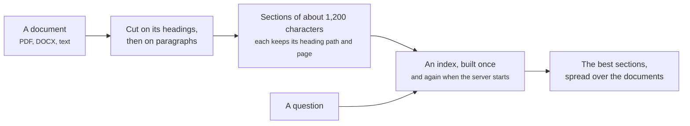

import { Steps, Tabs, TabItem, LinkCard, CardGrid } from '@astrojs/starlight/components';
import ArchFigure from '../../../../components/ArchFigure.astro';
import { Summary } from '../../../../components/ui';

<Summary what={"Your policies and price lists, uploaded once, answered from with citations."} when={"Users ask questions the form itself cannot answer."} write={"Upload files to `/agent/kb/...`; optionally `knowledge: {index: ...}` for a vector store."} />

<ArchFigure page="knowledge" />

## Three calls

<Steps>

1. **Upload** documents into a namespace (usually the form id). PDF, Markdown and text.

   ```bash
   curl -F "files=@lending_policy.pdf" -F "files=@rates.md" http://localhost:8000/agent/kb/loan_application/documents
   ```

2. **Compile** them for a form: rules and field notes go into its domain pack, so common questions need no retrieval.

   ```bash
   curl -X POST http://localhost:8000/agent/kb/loan_application/compile \
     -H "Content-Type: application/json" -d '{"jsx": "<Form ...>", "config": {"props": {}, "state": {}}}'
   ```

3. **Ask.** The agent answers from the compiled rules, and calls the researcher (`ask_documents`) for anything they do not cover. The answer cites the document and section.

</Steps>

## Who sees what: scopes

By default a form sees only its own namespace. Give it shared documents too:

```yaml
knowledge:
  dir: data/kb
  scopes:
    loan_application: [loan_application, bank_common]
    mortgage: [mortgage, bank_common]
```

## The index

<Tabs syncKey="index">
  <TabItem label="BM25 (default)">
    ```yaml
    knowledge: {index: bm25}          # in memory, no embeddings, nothing to run
    ```
  </TabItem>
  <TabItem label="A vector store">
    ```yaml
    knowledge:
      index: {factory: "my_app.vectors:make_store", filter: "my_app.vectors:ns_filter", fetch_factor: 5}
    ```
    ```python title="my_app/vectors.py"
    from langchain_postgres import PGVector
    from langchain_openai import OpenAIEmbeddings

    def make_store():                                   # any LangChain VectorStore
        return PGVector(embeddings=OpenAIEmbeddings(), collection_name="kb", connection=DB_URL)

    def ns_filter(namespaces: list[str]):               # the store's metadata filter
        return {"namespace": {"$in": namespaces}}
    ```
  </TabItem>
  <TabItem label="In code">
    ```python
    from formguide import KnowledgeBase, VectorStoreIndex

    kb = KnowledgeBase("data/kb", index=VectorStoreIndex(my_store), scopes={"loan_application": ["loan_application", "bank_common"]})
    ```
  </TabItem>
</Tabs>

The researcher needs the `research` extra (`deepagents`) and a tool-calling model for the `research` role.

<details>
<summary>Every endpoint</summary>

| Call | Does |
| --- | --- |
| `GET /kb/{form_id}` | documents, namespaces and the compiled result in the form's scope |
| `POST /kb/{namespace}/documents` | upload (multipart `files`, repeat) |
| `DELETE /kb/{namespace}/documents/{doc_id}` | delete one |
| `POST /kb/{form_id}/compile` | compile into the domain pack |

These endpoints change what the agent tells users: protect them with your managers' auth.

</details>

## How a document is cut and found

A 300-page handbook is not searched as one text. When you add it, it is cut into **sections**, and the search reads those.



- **A section knows where it is.** "4.2 Late payment" under "4 Fees" on page 118 of a PDF is kept as the path `4 Fees > 4.2 Late payment` and page 118, so an answer can say where it comes from.
- **Tables and lists stay whole** while they fit twice the section size; a price table is not split in the middle of a row.
- **Exact figures and clause numbers are found as written**: "27.90", "4.2".
- **One document does not crowd out the others.** When two documents answer equally well, the results hold sections from both.
- **With a vector store**, the word match and the vector match are combined.
- **An index from an older version is rebuilt** from the stored text when the server starts. Nothing is uploaded again.

Tested on sets of 100 to 500 pages: a search takes about 5 ms.

Two settings change the cut. Leave them alone unless answers miss context (make sections larger) or bring too much unrelated text (make them smaller):

```yaml title="formguide.yaml"
knowledge:
  chunk_chars: 1200      # about this many characters in a section
  chunk_overlap: 150     # shared by neighbouring sections under one heading
```

## Every option

```yaml title="formguide.yaml"
knowledge:
  dir: data/kb                             # default: <data_dir>/kb
  index: bm25                              # default; or a vector store:
  # index: {factory: "my_app.vectors:make_store", filter: "my_app.vectors:ns_filter", fetch_factor: 5}
  scopes:                                  # default: each form sees only its own documents
    loan_application: [loan_application, bank_common]
  chunk_chars: 1200                        # default: about this many characters in a section
  chunk_overlap: 150                       # default: shared by neighbouring sections under one heading
models:
  agent: "anthropic:claude-haiku-5-5"       # left out, it falls back to the top-level `model`
  compile: "anthropic:claude-haiku-5-5"     # compiles documents into rules; default: agent
  research: "anthropic:claude-haiku-5-5"  # answers from documents; default: agent
```
```python title="app.py"
from formguide import KnowledgeBase, BM25Index, VectorStoreIndex

KnowledgeBase(
    "data/kb",
    index=BM25Index(),                                   # or VectorStoreIndex(store, filter_builder=ns_filter, fetch_factor=5)
    scopes={"loan_application": ["loan_application", "bank_common"]},
    chunk_chars=1200, chunk_overlap=150,                 # the defaults
)
```


`make_store()` returns any LangChain `VectorStore`; `ns_filter(namespaces)` returns that store's metadata filter, so a form searches only its scopes.

From your own code, without a model call:

- `kb.search(form_id, query, k=6, per_document=None)`: the best sections with their scores; `per_document` caps how many come from one document.
- `kb.outline(form_id)`: each document's outline, its heading paths with pages and sizes.
- `kb.neighbours(form_id, chunk_id, before=1, after=1)`: the sections next to one section, to read around a hit.

## Next

<CardGrid>
  <LinkCard title="How retrieval works" description="Compiled rules first, the researcher for the rest." href="../../how-it-works/knowledge/" />
  <LinkCard title="User documents" description="Scans and payslips the user attaches." href="../../how-it-works/attachments/" />
</CardGrid>
