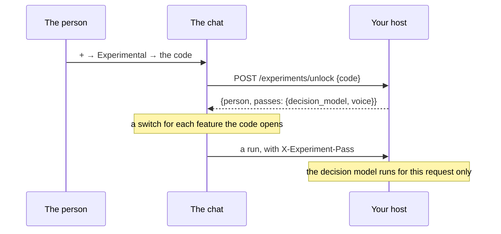

import { Aside, LinkCard, CardGrid } from '@astrojs/starlight/components';
import { Summary } from '../../../../components/ui';

<Summary what={"A gate on the host: experimental features run only for a person who entered their activation code."} when={"You want to try the decision model or voice mode with a few people, and nobody else."} write={"EXPERIMENT_CODES in the host's environment, and three lines that mount the gate."} />

<Aside type="caution" title="Experimental">
The gate and the features behind it are experimental. On a gated host, a visitor without a code sends nothing to the decision model's supplier or the voice provider.
</Aside>

A host that sets activation codes keeps its experimental features off for everyone, except a person who entered their own code. Today two features sit behind codes:

| Feature | Its list of codes | Without a code |
| --- | --- | --- |
| [The decision model](../../site-agent/decision-model/) | `EXPERIMENT_CODES` | the decision model is not asked at all: nothing goes to TypeSafe, and no label, score or trace is sent |
| [Voice mode](../voice/) | `VOICE_CODES` | there is no voice mode: nothing goes to the voice provider |

Each feature keeps its own list, so a voice code alone never turns the decision model on. A person whose code is on both lists enters it once and gets both.



## Mount it

```python title="app.py"
from formguide import experiments

exp = experiments.Experiments.from_env()      # EXPERIMENT_CODES, EXPERIMENT_SECRET, INTENT_PROVIDER
if exp.enabled:                               # no codes: no gate, and your own settings alone decide
    experiments.install(app, exp)             # reads the pass of every request
    app.include_router(experiments.create_experiments_router(exp), prefix="/experiments")
    exp.join("voice", talks.gate)             # optional: the same code entry opens voice mode too
```

```bash title="The host's environment"
EXPERIMENT_CODES="anna=correct-horse-battery,ben=another-long-code"   # one per person, 8 characters or more
EXPERIMENT_SECRET=...                                                 # signs the passes; without it a restart invalidates them
```

The decision model is offered as a feature only where the host has one to ask (`INTENT_PROVIDER` is not `off`). A host that installs no gate is not gated at all: its own settings alone decide, as on a developer's machine or a test stand.

A host that knows its own people (a signed-in cabinet) needs no codes: it decides on its server, for each run, by passing `layer=True` (or `False`) to [`Dushes.run`](../../../reference/python-api/#dushes-run-layer). That decision overrides the process settings and the gate.

- **The routes exist only with `EXPERIMENT_CODES`.** A host with voice codes alone has no `/experiments`: there the widget's own "Experimental voice mode" row and `/voice/unlock` are the code entry.
- **What the gate covers in the package:** the decision model in front of the site assistant (`formguide.site`). The demo host also puts it in front of a form that is talked to directly, behind the same gate; on your own host that part is yours to add.

## The routes

| Route | Body | Answer |
| --- | --- | --- |
| `GET /experiments` | | `{features, unlocked}`: what a code opens on this host, and whether this request already holds a valid pass |
| `POST /experiments/unlock` | `{code}` | `{person, pass, features, passes}`; 403 for a wrong code. Wrong codes count against the same daily limit per address as voice mode's. `passes` holds one pass per feature the code opens: `{decision_model?, voice?}`. `pass` is the one for `X-Experiment-Pass`, empty when the code opens only another feature |

The chat sends the decision model's pass in the `X-Experiment-Pass` header of each run, never in an address. The voice pass is the one voice mode uses for its own routes.

## What a person with a code sees

- **On the public host:** only the result. A code holder never gets the label under a turn or "How it decided"; those are the operator's diagnostics.
- **On a test host:** the label, the trace and the scores follow the host's own switches (`INTENT_LABELS`, `INTENT_TRACE`, `INTENT_SCORES`), and only for a request that carries a pass.

## In the chat

The `<agui-chat>` widget adds its own "Experimental voice mode" row to **+** when `voice-mode` is on. A host that gathers its experimental features under one item of its own, as the demo site does with one "Experimental" item and a switch per feature, turns that row off and hands the voice pass over:

```html
<agui-chat voice-mode="on" data-voice-menu="off"></agui-chat>
```

```js
// after the host's own code entry got passes.voice from POST /experiments/unlock:
sessionStorage.setItem('agui-voice-pass', passes.voice)   // where voice mode keeps its pass
chat.dispatchEvent(new Event('agui:voice-pass'))          // voice mode reads it again
```

## Every option

| Setting | Default | What it does |
| --- | --- | --- |
| `EXPERIMENT_CODES` | none | `name=code,name=code`, one code per person, 8 characters or more. Without it there is no gate |
| `EXPERIMENT_SECRET` | a new one at every start | signs the passes; set it so they survive a restart |
| `VOICE_CODES` | none | voice mode's own list ([Voice mode](../voice/#every-option)) |

In Python: `Experiments.from_env()`, `Experiments(codes, secret, features)`, `exp.enabled`, `exp.join(name, gate)`, `exp.person(headers)`, `install(app, exp)`, `create_experiments_router(exp)`, and `allowed()`, which says whether the experimental features may run for the request being served. Every one: [Python API](../../../reference/python-api/#experimental-features).

## Next

<CardGrid>
  <LinkCard title="The decision model" description="What it does once a code is entered, and its own switches." href="../../site-agent/decision-model/" />
  <LinkCard title="Voice mode" description="The voice routes, events and limits." href="../voice/" />
</CardGrid>
