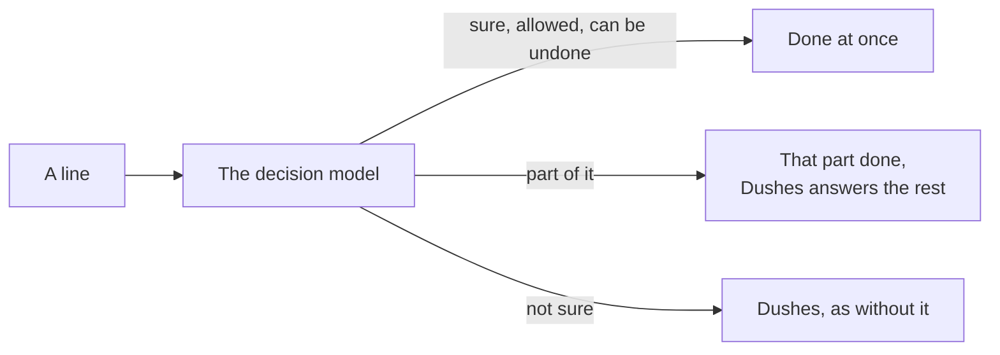

import { Aside, LinkCard, CardGrid } from '@astrojs/starlight/components';
import { Summary } from '../../../../components/ui';

<Summary what={"A part of Dushes you switch on: a small model that reads every line first and does the plain ones itself."} when={"People ask for pages and values a lot, and you want those done without waiting for the large model."} write={"A few switches in the host's environment."} />

<Aside type="caution" title="Experimental">
Experimental: it works only after you enter an activation code. On a host with activation codes, open **+** in the chat, choose **Experimental**, enter your code and turn on **Decision model**. Without a code it is off, and nothing is sent to TypeSafe. A host without codes turns it on with its own settings. More: [Experimental features](../../shared/experimental-features/).
</Aside>

Dushes answers with a large model, which takes a second or more. Many lines need no thinking at all: "open the loans page", "go to personal details", "Gender: Male". The decision model picks the answer from what the screen shows, and Dushes carries it out at once. A line that needs thinking, or that it is not sure about, goes on to Dushes exactly as it would without it. How it decides, with diagrams and a real example: [The decision model](../../how-it-works/decision-model/).



## Turn it on

Off is the default: a host that sets nothing gets Dushes as it was.

```bash title="The host's environment"
INTENT_PROVIDER=jev            # off (the default) or jev
INTENT_API_KEY=...             # the provider's key; it stays on the server
```

Restart the server. Every line on a page with the site map now goes to the decision model first. To keep it for a few people only, put it behind [activation codes](../../shared/experimental-features/): then it runs only for a request that carries a pass.

### Diagnostics for the operator

```bash
INTENT_LABELS=1                # a short label under each turn: who did it, the decision model or Dushes
INTENT_TRACE=1                 # CUSTOM decision_trace: how the turn was decided
INTENT_SCORES=1                # CUSTOM choice_scores: how sure it was, and how long it took
```

Each has its own switch and is off by default. They are for the operator on a test host, and never on the public site.

## What it sends and what it never does

- **Every line goes to the provider**, after a filter in code: phone numbers, e-mails, long numbers, names that are not on the screen and the items of your never-send list are masked first. Personal form values go only as "filled" or "empty".
- **It does by itself only looking and edits that can be undone:** open a page or a part of it, open a form's sections, fill in a value the person said (with Undo), a date. Never sending a form, never a consent. It acts only on the person's own request.
- **Anything it is not sure of goes to Dushes unchanged.**
- **Late is no answer.** When the provider does not answer in time, the line goes to Dushes.

## Every option

These are environment variables of the host, not keys of `formguide.yaml`. They are the layer's own switches while it is experimental: names and defaults may change before it becomes a configuration key.

| Variable | Default | What it does |
| --- | --- | --- |
| `INTENT_PROVIDER` | `off` | the decision model: `off` or `jev` |
| `INTENT_API_KEY` | none | the provider's key |
| `INTENT_MODEL` | `jev-latest` | pin a version of the provider's model |
| `INTENT_THRESHOLD` | `0.8` | how sure it must be to carry a line out by itself, before Dushes' model is called |
| `INTENT_ACT` | `0.8` | the same bar for the `choose_on_screen` tool, when the line did reach Dushes and its model calls the tool: it acts only at or above this |
| `INTENT_MARGIN` | `0.2` | ... and only when the first option is this far ahead of the second |
| `INTENT_TAIL` | `0.7` | how sure it must be that a line asks for more than the action, before that rest goes to Dushes as "already done" |
| `INTENT_TIMEOUT_MS` | `300` | how long one call may take; later is no answer |
| `INTENT_NEVER_SEND` | none | your own words that never leave the server, separated by `\|` (your guests' names, a list of phones) |
| `INTENT_LABELS` | `0` | diagnostics: `1` shows a short label under each turn, who did it. Never on the public site |
| `INTENT_TRACE` | `0` | diagnostics: `1` sends [`CUSTOM decision_trace`](../../../reference/agui-events/) with each run. Never on the public site |
| `INTENT_SCORES` | `0` | diagnostics: `1` sends [`CUSTOM choice_scores`](../../../reference/agui-events/) with each run |

The thresholds are placeholders until the QA Lead's measurement sets them.

## Next

<CardGrid>
  <LinkCard title="The decision model, how it works" description="The diagrams, the questions it is asked, a real example." href="../../how-it-works/decision-model/" />
  <LinkCard title="Navigation and routing" description="How Dushes decides where a person goes." href="../navigation/" />
  <LinkCard title="One schema for what a person wants" description="The proposal for any configuration." href="../../how-it-works/intents/" />
</CardGrid>
