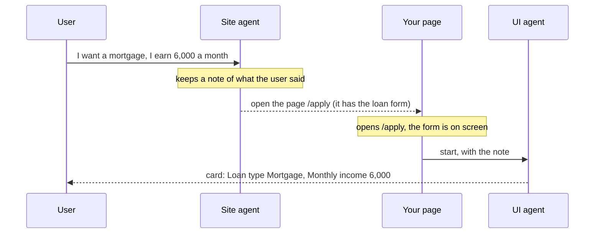

import { Tabs, TabItem, LinkCard, CardGrid, Aside } from '@astrojs/starlight/components';
import { Summary } from '../../../../components/ui';

<Summary what={"The site agent opens a form and passes on what the user already said"} when={"Your site has both content pages and forms"} write={"`form:` on the form's page in the site map; three short steps in the page"} />

Your site has two assistants: the **site agent** (Dushes) answers on every page, and the **UI agent** fills one form. A hand-off is the moment the first gives the conversation to the second.

Someone on the Loans page writes "I want a mortgage, I earn 6,000 a month". Without a hand-off they would be sent to the form and asked the same things again. With it, the form opens and the chat already proposes **Loan type: Mortgage** and **Monthly income: 6,000**.



## The minimal setup

On the server, the site map says which page holds which form. That is all the site agent needs to know where to send people:

<Tabs syncKey="side">
  <TabItem label="YAML">
    ```yaml title="site.yaml"
    title: Northwind Bank
    pages:
      - path: /loans
        title: Loans
        description: Our loans and their rates.
      - path: /apply
        title: Apply for a loan
        form: loan_application        # the form on this page
    ```
  </TabItem>
  <TabItem label="Python">
    ```python title="app.py"
    from formguide.site import Dushes, SiteMap

    site = Dushes(guide, SiteMap.load({"title": "Northwind Bank", "pages": [
        {"path": "/loans", "title": "Loans", "description": "Our loans and their rates."},
        {"path": "/apply", "title": "Apply for a loan", "form": "loan_application"},   # the form on this page
    ]}))
    ```
  </TabItem>
</Tabs>

In the page, three short steps open the form and start the UI agent: [Dushes in the page](../../../frontend/dushes-in-the-page/).

## What each part does

- **`form: loan_application`** (you, in the site map): the form on that page, by its `form_id`: the same form the UI agent already fills.
- **the note** (the site agent): what the user said that the form needs ("a mortgage, earns 6,000 a month"), kept with the conversation, so it survives a reload.
- **"open the page"** (the site agent sends it, your page follows it): a message to your page: go to `/apply`, it holds the form `loan_application` (the [directive](../../../frontend/dushes-in-the-page/#the-directive)).
- **"start, with the note"** (your page): one run of the chat once the form is on screen, marked as a hand-off; the UI agent gets the note as its first message.
- **the first card** (the UI agent): the fields the note covers, proposed at once.

The site agent decides by itself when to hand off: when the user wants something a form does (apply, book, register). On a question ("what are your rates?") it answers and stays.

## What you see

The page changes to the form, and the chat, without a new message from the user, shows a card with the values they already gave. Accepting it fills the form. The conversation stays one conversation: the earlier messages are still above.

## Without a second run: the form's state on the server

If your server can build the form's state itself, the UI agent answers in the same reply, and the page only has to open the form:

```python title="app.py"
def build_form(form_id, ctx):
    return my_forms.state(form_id, ctx.host["user"])   # {config, jsx_hash, form_id}; None: the page starts it, as above

site = Dushes(guide, SiteMap.load("site.yaml"), form_for=build_form)
```

The "open the page" message then says the hand-off is already done, so the page does not start the chat again.

## Common mistakes

- **The form opens, but the chat says nothing.** The page did not start the chat after the form appeared (step 3 of [Dushes in the page](../../../frontend/dushes-in-the-page/#3-run-once-when-the-form-is-on-the-page)), or started it before the form was on screen.
- **The site agent answers instead of opening the form.** The form's page has no `form:` in the site map, so the site agent does not know a form is there.
- **The user is asked again for what they said.** The page sent a normal message instead of the hand-off run: only the hand-off run carries the note.
- **The form opens twice or the chat starts twice.** With `form_for`, the page still starts the chat: check the directive's `handoff: "done"` first.

<Aside title="The names on the wire">For debugging: the site agent's tool is `open_form(form_id, note)`; the message to the page is `CUSTOM site_directive {type: "navigate", path, form_id}`; the page's hand-off run is `forwardedProps: {handoff: true}`. Typed: [Types and the contract](../../../frontend/connect-your-form/contract/#3-one-run).</Aside>

## Next

<CardGrid>
  <LinkCard title="In the page" description="The three steps in your page's code." href="../../../frontend/dushes-in-the-page/" />
  <LinkCard title="Site map" description="Tell the site agent about your pages and forms." href="../site-map/" />
</CardGrid>
