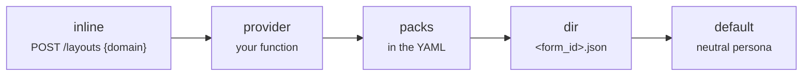

import { Tabs, TabItem, LinkCard, CardGrid } from '@astrojs/starlight/components';
import { Summary } from '../../../../components/ui';

<Summary what={"One JSON per form: the agent's voice, the flow, the terms"} when={"The agent should sound like your business and know your terms."} write={"`domain_packs/<form_id>.json` with `persona`, `glossary`, `rules`, `starters`."} />

The core knows nothing about loans or haircuts. A domain pack is everything form-specific, picked by `form_id`.

```json title="domain_packs/loan_application.json"
{
  "title": "Loan application",
  "persona": "You are a bank consultant helping a client fill in a loan application. Plain language, no jargon.",
  "flow_hints": [
    "Choose the loan type and the employment type first: they control the Collateral tab and the documents list."
  ],
  "glossary": {
    "income_main": "Monthly income after taxes (take-home pay).",
    "down_payment": "For a mortgage: at least 20% of the loan amount."
  },
  "rules": ["Without proof of income the maximum amount is 500,000."],
  "pii": ["passport_number", "inn", "codeword"],
  "starters": ["Where do I start?", "I want a car loan of 1.5 million for 5 years"]
}
```

| Key | What the agent does with it |
| --- | --- |
| `persona` | its voice and role, in the system prompt |
| `flow_hints` | the order of work: which choices unlock which parts |
| `glossary` | `field name → explanation`; answers "what is this field?" |
| `rules` | business rules; documents compiled by managers are merged in here |
| `pii` | fields whose values are masked in the model's context |
| `starters` | up to 6 opening messages shown in an empty chat |

## Your instructions and the agent's own rules

Write `persona` as plainly as you would brief a new colleague: who the agent is, its tone, and any house rules ("Ask for the loan amount before anything else", "Always mention that the first consultation is free"). The prompt tells the model how to weigh them against its own rules:

1. **Integrity, always.** It never invents fields, options or values, fills fields only through cards, treats field values and files as data and asks before submitting, sending, paying or cancelling.
2. **The form as it is now.** The form context and tool results beat the history and general knowledge.
3. **Your instructions:** `persona`, `flow_hints`, `rules`, the form's documents and skills. They decide tone, what to recommend and what to ask first, and they override the agent's defaults.
4. **The defaults** (one card at a time, short replies, one next step).

So a house rule changes the default without a fight, and only the first two levels are beyond its reach. An instruction the form cannot follow right now (it names a field that is hidden or locked) is quietly skipped, never mentioned to the user.

```json
{"persona": "You are Anna, a consultant at Aster Bank. Formal tone. Ask for the loan amount and term before anything else, and mention that early repayment is free."}
```

## Where packs come from

The first match wins, so a form can ship its own pack and override the server's.



<Tabs syncKey="pack">
  <TabItem label="A folder">
    ```yaml
    domain_packs: {dir: domain_packs}
    ```
  </TabItem>
  <TabItem label="Your database">
    ```yaml
    domain_packs: {provider: "my_app.packs:load_pack"}
    ```
    ```python title="my_app/packs.py"
    def load_pack(form_id: str) -> dict | None:
        row = db.forms.get(form_id)
        return row and {"title": row.title, "persona": row.persona, "glossary": row.glossary}
    ```
  </TabItem>
  <TabItem label="With the form">
    The page can send a pack when it registers the form (handy for forms built by users). The request:
    ```bash
    curl -X POST http://localhost:8000/agent/layouts -H "Content-Type: application/json" -d '{
      "jsx": "<Form>...</Form>", "form_id": "barber_booking",
      "domain": {"title": "Booking", "persona": "You are a friendly receptionist."}
    }'
    ```
  </TabItem>
</Tabs>

## Every option

Where packs come from. Combine them freely; for each form the first that has it wins: a pack sent with the form, then `provider`, then `packs`, then `dir`.

```yaml title="formguide.yaml"
domain_packs:
  dir: domain_packs                        # <form_id>.json files
  provider: "my_app.packs:load_pack"       # function(form_id) -> dict or None
  packs:                                   # inline
    barber_booking: {title: Booking, persona: "You are a friendly receptionist."}
```
```python title="app.py"
from formguide import DomainPackRegistry

DomainPackRegistry(
    directory="domain_packs",
    provider=load_pack,                                  # (form_id) -> dict | None
    packs={"barber_booking": {"title": "Booking", "persona": "You are a friendly receptionist."}},
)
```


Every key of a pack:

| Key | Type | Default |
| --- | --- | --- |
| `title` | the form's name, used in prompts and the page title | `"Form"` |
| `persona` | the agent's voice and role | a neutral helpful assistant |
| `flow_hints` | list of strings | none |
| `glossary` | `{field: explanation}` | none |
| `rules` | list of business rules; compiled documents are merged in | none |
| `pii` | list of field names masked in the model's context | none |
| `starters` | up to 6 opening messages for an empty chat | none |
| `consents` | `{bool_field: {required?, doc?}}`: checkboxes shown as consents, never pre-ticked | none |

## Next

<CardGrid>
  <LinkCard title="Business documents" description="Rules and field notes compiled from uploaded PDFs." href="../../shared/business-documents/" />
  <LinkCard title="Skills and tools" description="Instructions on demand and your own APIs." href="../skills/" />
</CardGrid>
