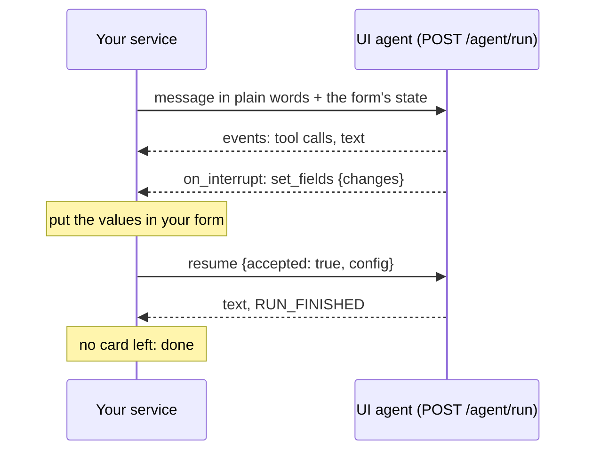

import { Code, LinkCard, CardGrid, Tabs, TabItem } from '@astrojs/starlight/components';
import { Summary } from '../../../../components/ui';
import HeadlessDemo from '../../../../components/HeadlessDemo.astro';
import fill from '../../../../../public/examples/no-ui/fill.py?raw';

<Summary what={"The UI agent filling a form for a service: plain words in, field values out."} when={"The data comes from another system (an email, a CRM note, a call transcript), not from a person in a chat."} write={"A loop of about thirty lines around `POST /agent/run`."} />

The chat widget is one client of the agent. A service can be another: it sends the same request the widget sends and reads the same events. Where the widget would show a card and wait for a tap, the service puts the proposed values into the form and answers the card itself.

## Try it

Pick a request and press **Run**. Nothing here is a chat: the page shows the request body, each step of the agent, the form's fields as they fill, and the JSON your service would get back.

<HeadlessDemo />

The badge says where the run came from. **Live agent** is the hosted agent, within the public demo's daily limits; **Recorded run** replays the same events on this page, and nothing leaves it.

## How it works



1. **Send one message with the form's state.** The state is the object a page sends: `{config, jsx_hash, form_id}`. The form is registered once with `POST /agent/layouts`, exactly as for the chat.
2. **Read the events.** Tool calls and text are progress. A `CUSTOM` event named `on_interrupt` with `type: "set_fields"` is the agent proposing values; in the chat it is the card with **Fill in**.
3. **Put the values in and answer the card.** Apply `changes` to your form, then call `/agent/run` again on the same thread with `forwardedProps.command.resume = {accepted: true, config}`, where `config` is the form after the change. The agent validated every value against the form before proposing it.
4. **Stop when a run ends with no card.** The values you applied are the result.

If the agent sends any other card (a question, a confirmation before sending), nobody is there to answer it: return it to the caller as "needs input" and let a person decide. A tool listed in `confirm_tools`, such as one that submits the form, always asks first, so a service cannot submit by accident.

## The code

<Tabs syncKey="lang">
<TabItem label="Python">

<Code code={fill} lang="python" title="fill.py" />

</TabItem>
<TabItem label="HTTP">

```http title="First request"
POST /agent/run
Accept: text/event-stream
Content-Type: application/json

{
  "threadId": "7b0c1c0e-5a2f-4b0b-9d3e-2f6f3a1c9e11",
  "messages": [{"role": "user", "content": "Car loan for Alex Morgan, alex.morgan@example.com, $28,000 over 36 months."}],
  "state": {"config": {"props": {}, "state": {}}, "jsx_hash": "<from POST /agent/layouts>", "form_id": "loan_application"}
}
```

```http title="After a set_fields card: the values are in, the card is accepted"
POST /agent/run
Accept: text/event-stream
Content-Type: application/json

{
  "threadId": "7b0c1c0e-5a2f-4b0b-9d3e-2f6f3a1c9e11",
  "messages": [{"role": "user", "content": "Car loan for Alex Morgan, alex.morgan@example.com, $28,000 over 36 months."}],
  "state": {"config": {"props": {}, "state": {"full_name": "Alex Morgan"}}, "jsx_hash": "<the same>", "form_id": "loan_application"},
  "forwardedProps": {"command": {"resume": {"accepted": true, "config": {"props": {}, "state": {"full_name": "Alex Morgan"}}}}}
}
```

</TabItem>
</Tabs>

What comes back from `fill()`:

```json
{
  "status": "done",
  "values": {
    "full_name": "Alex Morgan",
    "email": "alex.morgan@example.com",
    "loan_type": {"id": "auto", "name": "Car loan"},
    "amount": 28000
  }
}
```

`status` is `done`, `needs_input` (with the agent's `question`) or `error` (with a `message`). A choice comes back as `{id, name}`, the form's own option.

## One call, or a conversation?

| You have | Use | Why |
| --- | --- | --- |
| Structured data, a note or a document, and want values back in one call | [Prefill](../prefill/): `POST /agent/prefill` | One request, one JSON answer, no thread |
| Plain words that may need the agent's tools, your documents or a follow-up | This page: the loop on `POST /agent/run` | The whole agent, with its steps visible |
| A person who will answer questions | [The chat widget](../../../frontend/widget/) | Cards, Undo, voice |

## Next

<CardGrid>
  <LinkCard title="Prefill" description="Values in one call, with no thread." href="../prefill/" />
  <LinkCard title="HTTP API" description="Every endpoint, with its body and answer." href="../../../reference/http-api/" />
  <LinkCard title="AG-UI events" description="Every event the run sends." href="../../../reference/agui-events/" />
  <LinkCard title="Chat-only form" description="The same idea with a chat: the form is never drawn." href="../../recipes/chat-only-form/" />
</CardGrid>
