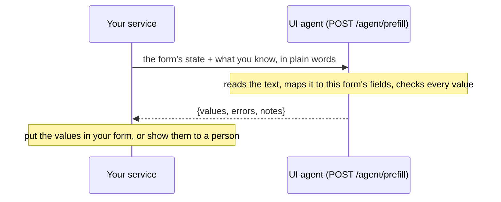

import { LinkCard, CardGrid, Tabs, TabItem } from '@astrojs/starlight/components';
import { Summary } from '../../../../components/ui';
import HeadlessDemo from '../../../../components/HeadlessDemo.astro';

<Summary what={"The UI agent filling a form for a service: plain words in, field values out."} when={"The data comes from another system (an email, a CRM note, a call transcript), not from a person in a chat."} write={"One call: `POST /agent/prefill` with the form's state and the text."} />

The chat is one way to reach the UI agent. A service does not need it: it sends the form's state and what it knows, and the answer is a list of values for this form's fields. Every value is checked against the form the same way the agent's own proposals are, so a wrong option or a field that does not exist comes back as an error, not as a value.

## Try it

Pick what the service knows and press **Run**. Nothing here is a chat: the page shows the form's fields with the values that came back, the request body and the JSON answer.

<HeadlessDemo />

The badge says where the answer came from. **Live agent** is the hosted agent, within the public demo's daily limits; **Recorded answer** is the same answer kept on this page, and nothing leaves it.

## How it works



1. **Register the form once**, as for the chat: `POST /agent/layouts` returns its `jsx_hash`.
2. **Send the state and what you know.** `state` is the object a page sends, `{config, jsx_hash, form_id}`. What you know goes in `text` (free words), `data` (keys and values from your system) or `attachment_ids` (files).
3. **Use the answer.** `values` are ready for your form. `errors` say what was refused and why. `notes` say what was left out, for example a value read with low confidence.

Nothing is written for you: the call proposes, your service decides. Sending the form stays your own step.

## The code

<Tabs syncKey="lang">
<TabItem label="HTTP">

```bash
curl -X POST http://localhost:8000/agent/prefill -H "Content-Type: application/json" -d '{
  "state": {"config": {"props": {}, "state": {}}, "jsx_hash": "3f9a1c0d2b7e4a55", "form_id": "loan_application"},
  "text":  "Car loan for Alex Morgan, alex.morgan@example.com. Wants $28,000 over 36 months."
}'
```

</TabItem>
<TabItem label="Python">

```python
result = await guide.suggest_prefill(
    state,                                         # {config, jsx_hash, form_id}
    text="Car loan for Alex Morgan, alex.morgan@example.com. Wants $28,000 over 36 months.",
)
for v in result["values"]:
    print(v["name"], "=", v["display"])            # put v["value"] into your form
```

</TabItem>
</Tabs>

What comes back:

```json
{
  "values": [
    {"name": "full_name", "label": "Full name", "value": "Alex Morgan", "display": "Alex Morgan", "status": "now", "source": "text", "confidence": "high"},
    {"name": "loan_type", "label": "Loan type", "value": {"id": "auto", "name": "Car loan"}, "display": "Car loan", "status": "now", "source": "text", "confidence": "high"},
    {"name": "amount", "label": "Amount", "value": 28000, "display": "28000", "status": "now", "source": "text", "confidence": "high"}
  ],
  "errors": [],
  "notes": []
}
```

A choice comes back as the form's own option. `status` is `now` for a field that can be filled at once and `later` for one that is hidden or disabled until another field is set. Every field of the answer: [Prefill](../prefill/#what-comes-back).

## One call, or a conversation?

| You have | Use | Why |
| --- | --- | --- |
| A note, structured data or a document, and no person in the loop | This page: `POST /agent/prefill` | One request, one JSON answer, no conversation |
| The same data, and a person who should confirm it | [Start the chat with prefill](../prefill/#prefill-inside-a-chat) | The values arrive as a card the person accepts or edits |
| A person who will answer questions | [The chat widget](../../../frontend/widget/) | Cards, Undo, voice |

## Next

<CardGrid>
  <LinkCard title="Prefill" description="Every input and every field of the answer." href="../prefill/" />
  <LinkCard title="HTTP API" description="Every endpoint, with its body and answer." href="../../../reference/http-api/" />
  <LinkCard title="User documents" description="Values read from a scan or a PDF." href="../user-documents/" />
  <LinkCard title="A form only in the chat" description="The same idea with a chat: the form is never drawn." href="../../recipes/chat-only-form/" />
</CardGrid>
