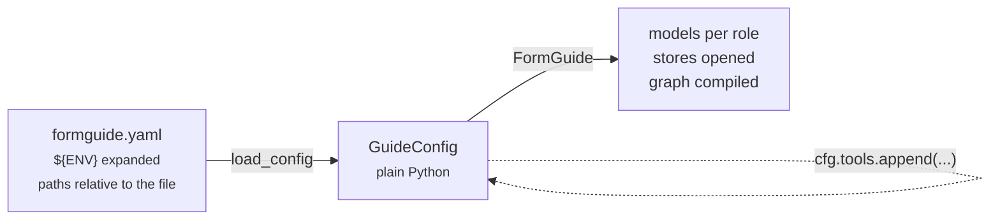

import { Steps, Tabs, TabItem, LinkCard, CardGrid, Aside } from '@astrojs/starlight/components';

The whole backend is configured from one YAML file. It becomes a plain `GuideConfig` you can still edit in Python, and `FormGuide(config)` builds everything from it.



Check any file without calling a model: `formguide check --config formguide.yaml`.

## Build it up

<Steps>

1. **The minimum: a model.** Everything else has a default: history in memory, documents in `data/kb`, no domain pack.

   ```yaml title="formguide.yaml"
   model: "anthropic:claude-opus-5-5"
   ```

   No file at all works too: `FORMGUIDE_MODEL=openai:gpt-5 formguide serve`.

2. **A model per role.** A cheaper model for research and memory; one that reads scans for extraction. Unset roles fall back. See [Models and providers](../models/).

   ```yaml
   models:
     agent: {provider: anthropic, model: claude-opus-5-5, max_tokens: 16000}
     research: "anthropic:claude-sonnet-5-5"
   memory: {model: "anthropic:claude-haiku-5-5"}
   ```

3. **What your form is about.** A domain pack per form: persona, flow hints, glossary, PII fields, opening messages. See [Domain packs](../domain-packs/).

   ```yaml
   domain_packs: {dir: domain_packs}        # domain_packs/<form_id>.json
   ```

4. **The business's documents.** Managers upload policies; each form sees its scope. BM25 by default, or any LangChain vector store. See [Business documents](../knowledge/).

   ```yaml
   knowledge:
     dir: data/kb
     index: bm25                            # or {factory: "my_app.vectors:make_store"}
     scopes: {loan_application: [loan_application, bank_common]}
   ```

5. **Know-how and your own tools.** Skills load instructions on demand; tools call your APIs. See [Skills and tools](../skills/).

   ```yaml
   skills: {dir: skills}                    # skills/<name>/SKILL.md
   tools: ["my_app.tools:check_credit_score"]
   confirm_tools: [check_credit_score]      # ask the user before it runs
   ```

6. **History that survives restarts.** The model's history and what the user saw. See [Persistence and history](../persistence/).

   ```yaml
   checkpointer: {sqlite: data/checkpoints.sqlite}
   transcripts: {dir: data/transcripts}
   ```

7. **Polish.** Quick replies, long-chat compaction, tracing, the card channel.

   ```yaml
   suggestions: {enabled: true, max: 3}
   memory: {max_history_tokens: 60000, keep_turns: 4}
   tracing: {callbacks: ["my_app.tracing:langfuse_handler"]}
   interrupt_mode: legacy                   # legacy (CopilotKit) | structured (AG-UI 1.0) | both
   ```

</Steps>

## The complete file

<details>
<summary>Everything from the steps above in one file</summary>

```yaml title="formguide.yaml"
data_dir: data

models:
  agent: {provider: anthropic, model: claude-opus-5-5, max_tokens: 16000}
  research: "anthropic:claude-sonnet-5-5"
  extract: {provider: anthropic, model: claude-opus-5-5, max_tokens: 8000}
memory: {model: "anthropic:claude-haiku-5-5", max_history_tokens: 60000, keep_turns: 4}

domain_packs: {dir: domain_packs}
knowledge:
  dir: data/kb
  index: bm25
  scopes: {loan_application: [loan_application, bank_common]}
skills: {dir: skills}
tools: ["my_app.tools:check_credit_score"]
confirm_tools: [check_credit_score]

checkpointer: {sqlite: data/checkpoints.sqlite}
transcripts: {dir: data/transcripts}

suggestions: {enabled: true, max: 3}
interrupt_mode: legacy
```

</details>

## How the file is read

- **Paths** (`data_dir`, `domain_packs.dir`, `knowledge.dir`, `skills.dir`, `checkpointer.sqlite`, `transcripts.dir`) are relative to the YAML file, not to the working directory.
- **`${VAR}`** in any string is replaced from the environment. Keep secrets there: `api_key: "${AZURE_OPENAI_API_KEY}"`.
- **Import strings** `"package.module:attr"` (tools, providers, factories, model classes) use the running process's Python path, so your modules must be importable.
- **An unknown key** fails `load_config` with its name. Typos never pass silently.

## The same in code

<Tabs syncKey="cfg">
  <TabItem label="Load, then change">
    ```python
    from formguide import FormGuide, load_config

    cfg = load_config("formguide.yaml")
    cfg.tools.append(my_tool)                 # any LangChain BaseTool
    guide = FormGuide(cfg)
    ```
  </TabItem>
  <TabItem label="All in code">
    ```python
    from formguide import FormGuide, GuideConfig, Models, KnowledgeBase, VectorStoreIndex, SkillRegistry, \
        DomainPackRegistry, sqlite_checkpointer
    from langchain_openai import AzureChatOpenAI

    guide = FormGuide(GuideConfig(
        models=Models(agent=AzureChatOpenAI(azure_deployment="gpt-5", api_version="2025-04-01-preview"),
                      research="openai:gpt-5-mini"),
        domain_packs=DomainPackRegistry(directory="domain_packs"),
        knowledge=KnowledgeBase("data/kb", index=VectorStoreIndex(my_pgvector),
                                scopes={"loan_application": ["loan_application", "bank_common"]}),
        skills=SkillRegistry.from_dir("skills"),
        checkpointer=sqlite_checkpointer("data/checkpoints.sqlite"),
    ))
    ```
  </TabItem>
</Tabs>

## Next

<CardGrid>
  <LinkCard title="Every key" description="The full table with defaults." href="../../reference/configuration/" />
  <LinkCard title="Models and providers" description="Roles, fallbacks, a tab per provider." href="../models/" />
</CardGrid>
