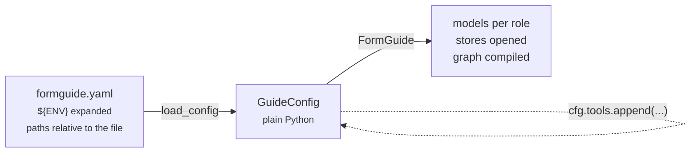

import { Steps, Tabs, TabItem, LinkCard, CardGrid, Aside } from '@astrojs/starlight/components';
import { Summary } from '../../../components/ui';

<Summary what={"Every server setting, step by step, in YAML and the same in Python."} when={"You want more than the defaults: models per role, documents, history."} write={"`formguide.yaml` (or `GuideConfig(...)`); only `model` is required."} />

The whole backend is configured from one YAML file. It becomes a plain `GuideConfig` you can still edit in Python, and `FormGuide(config)` builds everything from it.



Check any file without calling a model: `formguide check --config formguide.yaml`.

## Build it up

Each step twice: first as YAML, then the same in Python. Pick one; you never need both. In the Python snippets `cfg` is the config you are building (`cfg = GuideConfig()`, or `cfg = load_config("formguide.yaml")` to start from a file), and the last line of your app is `guide = FormGuide(cfg)`. Every name is imported in the snippet that uses it.

<Steps>

1. **The minimum: a model.** Everything else has a default: history in memory, documents in `data/kb`, no domain pack.

   ```yaml title="formguide.yaml"
   model: "anthropic:claude-haiku-5-5"
   ```
   ```python title="app.py"
   from formguide import FormGuide, GuideConfig, Models

   guide = FormGuide(GuideConfig(models=Models(agent="anthropic:claude-haiku-5-5")))
   ```


   No file at all works too: `FORMGUIDE_MODEL=openai:gpt-5 formguide serve`.

2. **A model per role.** A cheaper model for research and memory; one that reads scans for extraction. Unset roles fall back. See [Models and providers](../models/).

   ```yaml title="formguide.yaml"
   models:
     agent: {provider: anthropic, model: claude-haiku-5-5, max_tokens: 16000, effort: low}
     research: "anthropic:claude-haiku-5-5"
   memory: {model: "anthropic:claude-haiku-5-5"}
   ```
   ```python title="app.py"
   from formguide import Models
   from formguide.config import MemoryConfig
   from langchain_anthropic import ChatAnthropic       # pip install langchain-anthropic

   cfg.models = Models(agent=ChatAnthropic(model="claude-haiku-5-5", max_tokens=16000),
                       research="anthropic:claude-haiku-5-5")
   cfg.memory = MemoryConfig(model="anthropic:claude-haiku-5-5")
   ```


3. **What your form is about.** A domain pack per form: persona, flow hints, glossary, PII fields, opening messages. See [Domain packs](../domain-packs/).

   ```yaml title="formguide.yaml"
   domain_packs: {dir: domain_packs}        # domain_packs/<form_id>.json
   ```
   ```python title="app.py"
   from formguide import DomainPackRegistry

   cfg.domain_packs = DomainPackRegistry(directory="domain_packs")
   ```


4. **The business's documents.** Managers upload policies; each form sees its scope. BM25 by default, or any LangChain vector store. See [Business documents](../knowledge/).

   ```yaml title="formguide.yaml"
   knowledge:
     dir: data/kb
     index: bm25                            # or {factory: "my_app.vectors:make_store"}
     scopes: {loan_application: [loan_application, bank_common]}
   ```
   ```python title="app.py"
   from formguide import KnowledgeBase, VectorStoreIndex

   cfg.knowledge = KnowledgeBase("data/kb", index=VectorStoreIndex(my_vector_store),   # or leave index out: BM25
                                 scopes={"loan_application": ["loan_application", "bank_common"]})
   ```


5. **Know-how and your own tools.** Skills load instructions on demand; tools call your APIs. See [Skills and tools](../skills/).

   ```yaml title="formguide.yaml"
   skills: {dir: skills}                    # skills/<name>/SKILL.md
   tools: ["my_app.tools:check_credit_score"]
   confirm_tools: [check_credit_score]      # ask the user before it runs
   ```
   ```python title="app.py"
   from formguide import SkillRegistry
   from my_app.tools import check_credit_score   # a LangChain @tool

   cfg.skills = SkillRegistry.from_dir("skills")
   cfg.tools = [check_credit_score]
   cfg.confirm_tools = ["check_credit_score"]
   ```


6. **History that survives restarts.** The model's history and what the user saw. See [Persistence and history](../persistence/).

   ```yaml title="formguide.yaml"
   checkpointer: {sqlite: data/checkpoints.sqlite}
   transcripts: {dir: data/transcripts}
   ```
   ```python title="app.py"
   from formguide import FileTranscriptStore, sqlite_checkpointer

   cfg.checkpointer = sqlite_checkpointer("data/checkpoints.sqlite")   # or any LangGraph saver: Postgres, Redis
   cfg.transcripts = FileTranscriptStore("data/transcripts")
   ```


7. **Polish.** Quick replies, long-chat compaction, tracing, the card channel.

   ```yaml title="formguide.yaml"
   suggestions: {enabled: true, max: 3}
   memory: {max_history_tokens: 60000, keep_turns: 4}
   tracing: {callbacks: ["my_app.tracing:langfuse_handler"]}
   interrupt_mode: legacy                   # legacy (CopilotKit) | structured (AG-UI 1.0) | both
   ```
   ```python title="app.py"
   from formguide.config import MemoryConfig, SuggestionsConfig, TracingConfig

   cfg.suggestions = SuggestionsConfig(enabled=True, max=3)
   cfg.memory = MemoryConfig(max_history_tokens=60_000, keep_turns=4)
   cfg.tracing = TracingConfig(callbacks=[langfuse_handler])   # handlers, or factories that return one
   cfg.interrupt_mode = "legacy"
   ```


</Steps>

## Every key in one file

All of Dushes' configuration on one screen: every key, its default, and what it does. Copy it and delete what you do not need; only a model is required.

```yaml title="formguide.yaml"
# Paths are relative to this file. ${VAR} is replaced from the environment.
data_dir: data                       # formguide's own files: deps/, layouts/, kb/, attachments/, transcripts/

# --- Models --------------------------------------------------------------------------------------
model: "anthropic:claude-haiku-5-5"   # one model for every role; or per role (wins over model:):
models:
  agent: {provider: anthropic, model: claude-haiku-5-5, max_tokens: 16000, effort: low}   # required: the conversation
  research: "anthropic:claude-haiku-5-5"     # the document researcher        default: agent
  compile: "anthropic:claude-haiku-5-5"        # documents -> domain pack rules default: agent
  extract: {provider: anthropic, model: claude-haiku-5-5, max_tokens: 8000}  # scans, prefill   default: agent
  # any form: "provider:model" | {provider, model, ...kwargs} | {class: "pkg.module:Class", ...kwargs}

# --- Your form's components ----------------------------------------------------------------------
components:                          # given lists REPLACE the defaults below, so list all your tags
  containers: {Form: form, Tabs: tabs, Tab: tab, Accordion: accordion, Section: section}
  fields:
    Input: text
    NumberInput: number
    TextArea: text
    DatePicker: date
    Dropdown: select
    RadioGroup: radio
    MultiSelect: multiselect
    Checkbox: bool
    FileUpload: file
    # a field spec instead of a role, when a component stores its value its own way:
    # Select:   {role: select, value: id, options_prop: items, option_keys: {id: code, name: title}}
    # Toggle:   {role: bool, true: "Y", false: "N"}
    # Calendar: {role: date, format: "%d.%m.%Y"}            # iso | strftime pattern | epoch_ms
    # Amount:   {role: number, value: string}
    # Phone:    {role: text, codec: "my_app.codecs:PhoneCodec"}

# --- What each form is about ---------------------------------------------------------------------
domain_packs:                        # default: none (a neutral persona)
  dir: domain_packs                  # <form_id>.json files
  provider: "my_app.packs:load_pack" # function(form_id) -> dict | None, e.g. from your database
  packs: {}                          # inline: {form_id: {title, persona, flow_hints, glossary, rules, pii, starters, consents}}

# --- The business's documents --------------------------------------------------------------------
knowledge:
  dir: data/kb                       # default: <data_dir>/kb
  index: bm25                        # or {factory: "my_app.vectors:make_store", filter: "my_app.vectors:ns_filter", fetch_factor: 5}
  scopes: {loan_application: [loan_application, bank_common]}   # default: each form sees its own documents

# --- Know-how and your tools ---------------------------------------------------------------------
skills: {dir: skills}                # skills/<name>/SKILL.md; default: none
tools: ["my_app.tools:check_credit_score"]   # LangChain tools for every form; default: none
confirm_tools: [check_credit_score]  # these always ask the user first (a confirm card); default: none
cards: []                           # cards from blocks, each a tool show_<type> (Backend > Cards from blocks)
max_tool_rounds: 10                  # model <-> tool rounds per turn
actions:                             # the agent's built-in actions: true | false | auto
  ask_user: true
  request_file: auto                 # auto: only when attachments are on
  confirm_action: true
  focus_field: true
  review_form: true
  ask_documents: auto                # auto: only when the form has documents
  extract_from_attachment: auto
transcription:                       # dictation on the server (POST /transcribe); default: off; or just: true
  provider: faster_whisper           # a local Whisper (pip install 'formguide[transcribe]'); openai; or "module:function"
  model: small                       # tiny | base | small | medium | large-v3; downloaded once on the first request
  device: auto                       # auto | cpu | cuda
  compute_type: int8                 # int8 on a CPU, float16 on a GPU
  language: null                     # null: the chat's language (sent with the recording)
  max_seconds: 120                   # a longer recording is cut
  max_bytes: 10000000                # a larger upload gets 413
  warm: true                         # load the model when the server starts, not on the first recording
prompt_cache: auto                   # auto: cache breakpoints where the provider needs them (Anthropic); off
attachments:                         # or just: false
  enabled: true
  privacy_note: "Your file stays on our server; only the values reach the chat."   # shown on file requests

# --- History -------------------------------------------------------------------------------------
checkpointer: {sqlite: data/checkpoints.sqlite}   # the model's history; default: in memory (lost on restart)
transcripts: {dir: data/transcripts}              # what the user saw; or: memory; default: files under data_dir
memory:                              # long chats
  max_history_tokens: 60000          # compact the model's history above this
  keep_turns: 4                      # recent user turns kept word for word
  model: "anthropic:claude-haiku-5-5"   # the summarizer; default: the research model
learn_dependencies: true             # remember which fields unlock which, per form

# --- The chat ------------------------------------------------------------------------------------
suggestions:                         # quick replies after answers; or just: true; default: off
  enabled: true
  max: 3                             # 1-5
  timeout: 4                         # seconds; on timeout nothing is sent
  model: "anthropic:claude-haiku-5-5"   # default: the memory model
interrupt_mode: legacy               # how cards travel: legacy (CUSTOM on_interrupt) | structured (AG-UI 1.0) | both

# --- Tracing -------------------------------------------------------------------------------------
tracing:                             # LangSmith needs only LANGSMITH_TRACING=true and LANGSMITH_API_KEY
  callbacks: ["my_app.tracing:langfuse_handler"]   # LangChain callback handlers, or factories returning one
  tags: [staging]                    # added to every turn
  otel: {exporter: otlp, endpoint: "http://collector:4317"}   # OpenTelemetry (formguide[otel]); default: off
```

The same in Python. Every field of `GuideConfig`, with the defaults where they are not obvious:

```python title="app.py"
from formguide import (FormGuide, GuideConfig, Models, ComponentMap, DomainPackRegistry, KnowledgeBase, BM25Index,
                       SkillRegistry, FileTranscriptStore, sqlite_checkpointer)
from formguide.config import MemoryConfig, SuggestionsConfig, TracingConfig
from langchain_anthropic import ChatAnthropic                # pip install langchain-anthropic
from my_app.packs import load_pack                           # yours
from my_app.tools import check_credit_score                  # yours: a LangChain @tool

guide = FormGuide(GuideConfig(
    data_dir="data",
    models=Models(
        agent=ChatAnthropic(model="claude-haiku-5-5", max_tokens=16000),   # an object, or a string / dict as in YAML
        research="anthropic:claude-haiku-5-5",          # None: agent
        compile=None,                                    # None: agent
        extract={"provider": "anthropic", "model": "claude-haiku-5-5", "max_tokens": 8000},
    ),
    components=ComponentMap(                             # default: the tags in the YAML above
        containers={"Form": "form", "Tabs": "tabs", "Tab": "tab", "Accordion": "accordion", "Section": "section"},
        fields={"Input": "text", "Dropdown": "select", "Checkbox": "bool",
                "Select": {"role": "select", "value": "id", "options_prop": "items"}},
    ),
    domain_packs=DomainPackRegistry(directory="domain_packs", provider=load_pack, packs={}),
    knowledge=KnowledgeBase("data/kb", index=BM25Index(),
                            scopes={"loan_application": ["loan_application", "bank_common"]}),
    skills=SkillRegistry.from_dir("skills"),
    tools=[check_credit_score],
    confirm_tools=["check_credit_score"],
    max_tool_rounds=10,
    actions={"request_file": "auto", "review_form": True},   # the rest keep their defaults
    attachments_enabled=True,
    privacy_note="Your file stays on our server; only the values reach the chat.",
    checkpointer=sqlite_checkpointer("data/checkpoints.sqlite"),   # None: in memory; any LangGraph saver
    transcripts=FileTranscriptStore("data/transcripts"),            # None: files under data_dir
    memory=MemoryConfig(max_history_tokens=60_000, keep_turns=4, model="anthropic:claude-haiku-5-5"),
    learn_dependencies=True,
    suggestions=SuggestionsConfig(enabled=True, max=3, timeout=4.0, model="anthropic:claude-haiku-5-5"),
    interrupt_mode="legacy",
    tracing=TracingConfig(callbacks=[], tags=["staging"], otel={"exporter": "otlp", "endpoint": "http://collector:4317"}),
))
```

Each key in a table, with links to the guides: [Configuration reference](../../reference/configuration/). A working file: [`demo/formguide.yaml`](https://github.com/denvasylenko/dushes/blob/main/backend/demo/formguide.yaml).

## How the file is read

- **Paths** (`data_dir`, `domain_packs.dir`, `knowledge.dir`, `skills.dir`, `checkpointer.sqlite`, `transcripts.dir`) are relative to the YAML file, not to the working directory.
- **`${VAR}`** in any string is replaced from the environment. Keep secrets there: `api_key: "${AZURE_OPENAI_API_KEY}"`.
- **Import strings** `"package.module:attr"` (tools, providers, factories, model classes) use the running process's Python path, so your modules must be importable.
- **An unknown key** fails `load_config` with its name. Typos never pass silently.

## Mix both

Load the file, then change what YAML cannot express (objects, your own classes):

```python title="app.py"
from formguide import FormGuide, load_config
from formguide.app import create_app

cfg = load_config("formguide.yaml")
cfg.tools.append(my_tool)                    # any LangChain BaseTool
cfg.checkpointer = my_postgres_saver         # any LangGraph checkpointer
app = create_app(FormGuide(cfg), cors=["https://your-app.example"])
```

## Next

<CardGrid>
  <LinkCard title="Every key" description="The full table with defaults." href="../../reference/configuration/" />
  <LinkCard title="Models and providers" description="Roles, fallbacks, a tab per provider." href="../models/" />
</CardGrid>
