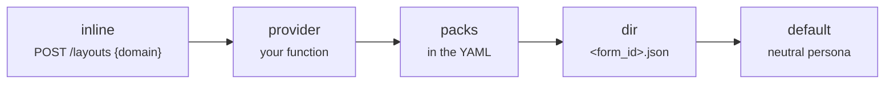

import { Tabs, TabItem, LinkCard, CardGrid } from '@astrojs/starlight/components';

The core knows nothing about loans or haircuts. A domain pack is everything form-specific, picked by `form_id`.

```json title="domain_packs/loan_application.json"
{
  "title": "Loan application",
  "persona": "You are a bank consultant helping a client fill in a loan application. Plain language, no jargon.",
  "flow_hints": [
    "Choose the loan type and the employment type first: they control the Collateral tab and the documents list."
  ],
  "glossary": {
    "income_main": "Monthly income after taxes (take-home pay).",
    "down_payment": "For a mortgage: at least 20% of the loan amount."
  },
  "rules": ["Without proof of income the maximum amount is 500,000."],
  "pii": ["passport_number", "inn", "codeword"],
  "starters": ["Where do I start?", "I want a car loan of 1.5 million for 5 years"]
}
```

| Key | What the agent does with it |
| --- | --- |
| `persona` | its voice and role, in the system prompt |
| `flow_hints` | the order of work: which choices unlock which parts |
| `glossary` | `field name → explanation`; answers "what is this field?" |
| `rules` | business rules; documents compiled by managers are merged in here |
| `pii` | fields whose values are masked in the model's context |
| `starters` | up to 6 opening messages shown in an empty chat |

## Where packs come from

The first match wins, so a form can ship its own pack and override the server's.



<Tabs syncKey="pack">
  <TabItem label="A folder">
    ```yaml
    domain_packs: {dir: domain_packs}
    ```
  </TabItem>
  <TabItem label="Your database">
    ```yaml
    domain_packs: {provider: "my_app.packs:load_pack"}
    ```
    ```python title="my_app/packs.py"
    def load_pack(form_id: str) -> dict | None:
        row = db.forms.get(form_id)
        return row and {"title": row.title, "persona": row.persona, "glossary": row.glossary}
    ```
  </TabItem>
  <TabItem label="With the form">
    ```ts
    await fetch('/agent/layouts', {
      method: 'POST', headers: { 'Content-Type': 'application/json' },
      body: JSON.stringify({ jsx, form_id: 'barber_booking', domain: { title: 'Booking', persona: 'You are a friendly receptionist.' } }),
    })
    ```
  </TabItem>
</Tabs>

## Next

<CardGrid>
  <LinkCard title="Business documents" description="Rules and field notes compiled from uploaded PDFs." href="../knowledge/" />
  <LinkCard title="Skills and tools" description="Instructions on demand and your own APIs." href="../skills/" />
</CardGrid>
