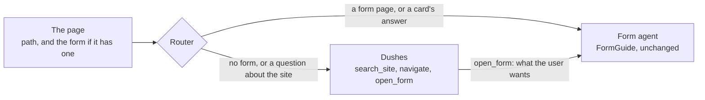
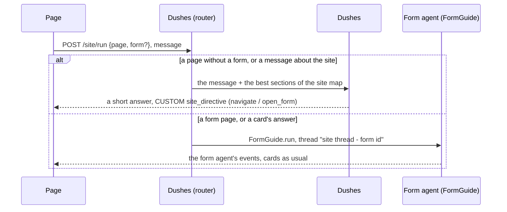

import { LinkCard, CardGrid, Aside } from '@astrojs/starlight/components';
import SiteDemoLink from '../../../components/SiteDemoLink.astro';
import { Summary } from '../../../components/ui';

<Summary what={"One chat for a whole site, above the form agent."} when={"Your site has many pages and the forms are only some of them."} write={"A site map (`site.yaml`) and `create_dushes_router(Dushes(guide, site_map))`."} />

`Dushes` sits above the form agent. On a page without a form, **Dushes** answers from the site's content and moves the user around. On a page with a form, the turn goes to the **form agent**: the same `FormGuide` as everywhere else, unchanged. One chat follows the user from page to page.

<SiteDemoLink />



## Set it up

Two things on the server: a **site map** (what the site has and where the assistant may go), and the router next to Dushes' own.

```yaml title="site.yaml"
title: Main Street
pages:
  - path: /loans
    title: Loans
    description: Aster Bank's car loans, mortgages and cash loans.
    keywords: [car loan, mortgage, interest rate]     # words that point here from another page
    tabs:
      - {id: mortgage, title: Mortgage, text: "A mortgage from 16.5% a year, for up to 30 years."}
  - path: /apply
    title: Apply for a loan
    form: loan_application                            # this page holds a form: the form agent works here
  - path: /contacts
    title: Contacts
    sections:
      - {id: bank, title: Aster Bank, text: "Monday to Friday 9:00 to 19:00."}
```

```python title="app.py"
from formguide.app import create_app
from formguide.site import Dushes, SiteMap, create_dushes_router

app = create_app("formguide.yaml", prefix="/agent")            # the form agent, as on every other page
guide = app.state.guide                                         # its FormGuide

site = Dushes(guide, SiteMap.load("site.yaml"))              # Dushes, above it
app.include_router(create_dushes_router(site), prefix="/site")    # POST /site/run, GET /site/map
```

The site map is both what Dushes knows (a search index over every tab, accordion and section) and where it may go: `navigate` and `open_form` accept only its pages, tabs, sections and forms, so the model cannot invent a page.

## What the assistant knows

The **site map** and the site's **business documents**. It does not crawl the site or read the page's HTML: you describe the pages once, and that description is both its knowledge (it answers from the `text` of tabs, accordions and sections) and its map (it may open only those pages, tabs, sections and forms). That is why it never invents a page or a link. Deeper facts (partners, terms, policies) come from the documents of its knowledge scope; see [Knowledge](#knowledge) below.

The map does not have to be a hand-written file. `SiteMap.load()` takes a dict too, so build it from what you already have when the server starts:

```python title="app.py"
from formguide.site import Dushes, SiteMap

def site_map_from_cms() -> dict:
    pages = []
    for p in cms.pages(published=True):                       # your CMS, database or routes
        pages.append({
            "path": p.url, "title": p.title, "description": p.summary,
            "form": p.form_id,                                 # None on a content page
            "sections": [{"id": b.anchor, "title": b.heading, "text": b.plain_text} for b in p.blocks],
        })
    return {"title": "Main Street", "pages": pages}

site = Dushes(guide, SiteMap.load(site_map_from_cms()))
```

| Source | When it fits |
| --- | --- |
| `site.yaml` by hand | a small site, or the pages that matter most (FAQ, prices, hours) |
| built from your CMS or database at start-up | content that editors change; restart (or rebuild the `Dushes`) after publishing |
| built from your app's routes plus short texts | an app where the pages are screens rather than articles |

The forms on form pages need nothing new: they are the same forms the form agent already knows (`form: loan_application`).

## How a turn works on the server



1. **The router** looks at the page and the message. A card's answer always goes to the form agent. On a page without a form the turn goes to Dushes. On a form page, words about moving ("open the …", "go to", "where is") send it to Dushes. Another page's title or keywords without a move are unclear: a cheap router model answers one word, form or site, and on any failure the turn stays with the form. Everything else goes to the form agent.
2. **Dushes** gets the message, the last few turns, the sections of the site map that match it best (a BM25 search) and the best matching passages of the site's business documents. It answers in one to three sentences and may call four tools: `search_site` (look again), `ask_documents` (the document researcher), `navigate` (a page, tab or section; the result tells it what that part says) and `open_form` (a form, with a note of what the user already said).
3. **Each move is checked** against the site map. A valid one becomes a `site_directive` event for the page; an unknown path is refused and the model is told so.
4. **The hand-off.** After `open_form` the page opens the form and runs once with `handoff: true`. The router gives the form agent the note as its first message, so it proposes those fields at once.
5. **The form agent** is the same `FormGuide` as on a page of its own, with its own conversation per form inside the site's thread: its history, cards and Undo work as everywhere else.

## How a turn is routed

| The user is | and writes | The turn goes to |
| --- | --- | --- |
| on a page without a form | anything | Dushes |
| on a form page | about the form ("my name is Anna") | the form agent |
| on a form page | about moving ("open the contacts page", "take me to the FAQ") | Dushes |
| on a form page | naming another page's words ("when is the bank open?", "a car loan please" on the loan form) | the router model decides: form or site |
| anywhere | a card's answer | the form agent (only it shows cards) |

A page's own keywords stay with its form: on the booking page, "book a haircut" is the form's.

## Your instructions

`instructions:` at the top of the site map is your brief for Dushes: tone, what to recommend, what to say first. The prompt ranks it below truth (business facts only from the site and its documents) and below the map (only its pages, tabs, sections and forms), and above the agent's own defaults. If the agent runs out of tool rounds without a word, it gets one more call without tools, so the user always gets a reply.

## Extend it for your app

A site with live data of its own (an admin cabinet, a shop, a booking system) gives Dushes what it needs without replacing it:

```python title="app.py"
from formguide.site import Dushes, SiteMap, SiteTool, create_dushes_router

async def live(ctx):                                  # in the prompt on every turn, no search in between
    site = ctx.host["site"]
    return f"Open today {site.hours_today}. New requests: {site.new_requests}."

def stats(args, ctx):                                 # the model gets the text you return
    return ctx.host["site"].stats(days=int(args["days"])).summary()

def build_form(form_id, ctx):                         # the form's state on the server: same-run hand-off
    return my_forms.state(form_id, ctx.host["site"])  # None: the page's own hand-off run, as before

site = Dushes(guide, SiteMap.load("cabinet.yaml"),
                 context=live,
                 instructions="You help the owner run their website. Never publish for them.",
                 style="Reply in one to four short sentences, warm and plain.",
                 history=10,
                 tools=[SiteTool("site_stats", "Visits, calls and requests for 7 or 30 days.",
                                 {"type": "object", "properties": {"days": {"type": "string", "enum": ["7", "30"]}},
                                  "required": ["days"]}, stats)],
                 suggestions=True,
                 form_for=build_form)

app.include_router(create_dushes_router(site, host=lambda request: {"site": current_site(request)}), prefix="/site")
```

| Option | What it changes |
| --- | --- |
| `context(ctx)` | live facts in the prompt on every turn; the model trusts them over the site map's passages |
| `instructions` | your brief, added to the site map's `instructions:` |
| `style` | replaces the default "one to three short sentences" |
| `history` | how many past turns Dushes sees (default 6) |
| `tools` | your `SiteTool`s next to its own; a tool that raises tells the model, the turn goes on |
| `suggestions` | a `suggest_next` tool: its options arrive as CUSTOM `suggestions {items}`, the chat's quick replies |
| `form_for(form_id, ctx)` | the form's state on the server: after `open_form` the form agent answers in the same run, and the directive says `handoff: "done"` so the page does not run again |
| `stay_on_forms` | `True`: on a page with a form, Dushes answers in place instead of opening another page, unless the user asks to go or your instructions name the page for that question. `False`: no such rule (a studio or an admin cabinet, where the form page is not a form to finish) |
| `create_dushes_router(site, host=fn)` | `fn(request)` builds `ctx.host` for each run: one guide serves every site and user |

Every callback gets `ctx`, a `SiteRunCtx(thread_id, page, state, message, host)`, and may be sync or async. `open_form` also passes the language the user writes in, so the form agent replies in it.

On a form page the router also looks at who spoke last: when Dushes did, the message has navigation words in German, Spanish, French, Italian, Russian or Ukrainian, or it asks where the business is (address, phone, opening hours), or it is a question that names none of the form's field labels ("how many new requests do I have?"), a cheap router model decides between the form and the site, so a reply to Dushes' question stays with Dushes. And when a message still reaches the form agent but is about something else (the account, statistics, another service), the form agent gives it back with `hand_back`, and Dushes answers in the same run: the user never hears "ask the other assistant". The form agent has this tool only under Dushes.

## Knowledge

Dushes reads the site map and the business documents of its own knowledge scope: by default the `site` namespace (site-wide documents such as partners, a glossary, policies) plus every form on the map. Facts about the business come only from those; general concepts (what a co-borrower is) may come from general knowledge, said to be general. The form agent keeps its own form's documents.

## One conversation, after a reload too

The site thread's transcript holds every turn the user saw, Dushes' and the form agents' (their text), and the hand-off note, so nothing lives only in memory. `GET /site/threads/{id}?form_id=` returns `{messages, pending_card}`; the page's `restore` uses it, so a reload shows the whole conversation and the form's open card.

What the user does with a form's card goes into it too, as a fact for Dushes and the router ("[Form card] Accepted, now in the form: Item 5 = Arrosticini"; rejected, skipped, a question's answer, a confirmation). It is not a chat bubble: it keeps Dushes from offering again what the user has just accepted.

## The hand-off

"I want a mortgage, I earn 6,000 a month" on the Loans page: Dushes calls `open_form`, keeps a note of what the user said and sends the page a directive to open `/apply`. The page opens the form and runs the chat once with `forwardedProps: {handoff: true}`; the form agent gets the note as its first message and proposes those fields right away, without the user repeating themselves. The page's side: [Dushes in the page](../../frontend/dushes/).

## The endpoints

```bash
curl http://localhost:8000/site/map                       # the site map, for the page to render or check
curl -N -X POST http://localhost:8000/site/run -H "Content-Type: application/json" -d '{
  "threadId": "t1", "runId": "r1", "messages": [{"id": "m1", "role": "user", "content": "When is the bank open?"}],
  "state": {"page": {"path": "/loans", "title": "Loans"}}, "tools": [], "context": [], "forwardedProps": {}
}'
```

`POST /site/run` is AG-UI like `/agent/run`. Its `state` is `{page: {path, title}, form?}`, where `form` is the usual [form state](../../form/state/) on a form page. Besides the form agent's events it sends `CUSTOM site_directive {type: "navigate", path, tab?, section?, form_id?, handoff?}` (`handoff: "done"`: the form agent already answered in this run, so the page opens the form and does not run the hand-off itself) and, with `suggestions`, `CUSTOM suggestions {items}`.

<Aside>The form agent keeps its own conversation per form inside the site's thread (`<site thread>-<form id>`), with its history, cards and Undo, exactly as on a page of its own.</Aside>

## Every option

```yaml title="site.yaml"
title: Main Street                   # the site's name, in Dushes' prompt
instructions: |                      # optional: your own rules for Dushes (tone, what to recommend)
  Aster Bank and Barber & Co are separate businesses: never mix their prices.
pages:
  - path: /apply                     # required: the page's route, the navigation target
    title: Apply for a loan          # default: the path
    description: One line about the page.
    keywords: [apply, application]   # extra words that route a message to this page
    form: loan_application           # the form_id of the form on this page; none: a content page
    tabs:       [{id: car, title: Car loan, text: "..."}]          # navigate can open a tab
    accordions: [{id: early, title: Can I repay early?, text: "..."}]   # or an accordion
    sections:   [{id: how, title: How applying works, text: "..."}]     # or scroll to a section
```

```python title="app.py"
from formguide.site import Dushes, SiteMap, create_dushes_router

SiteMap.load("site.yaml")            # a path, or a dict with the same shape
Dushes(
    guide,                           # your FormGuide: the form agent for form pages
    SiteMap.load("site.yaml"),
    model=None,                      # Dushes' model; None: the form guide's agent model
    knowledge_namespaces=None,       # the documents it reads; None: "site" + every form on the map
    router_model=None,               # one word, form or site, for unclear messages; None: the memory model
    context=None,                    # fn(ctx) -> str: live facts in the prompt every turn (sync or async)
    instructions="",                 # added to the site map's instructions
    style=None,                      # replaces "one to three short sentences"
    history=6,                       # past turns Dushes sees
    tools=[],                        # SiteTool(name, description, parameters, handler(args, ctx) -> str)
    suggestions=False,               # suggest_next -> CUSTOM suggestions {items}
    form_for=None,                   # fn(form_id, ctx) -> form state | None: the form agent answers in the same run
    stay_on_forms=True,              # answer in place while the user fills in the page's form
)
site.run(thread_id, message=..., state=..., host=obj)   # obj -> ctx.host in every callback
create_dushes_router(site, host=None)  # POST /run (AG-UI), GET /map, GET /threads/{id}?form_id=; host(request) -> ctx.host
```

| `forwardedProps` key | Default | What it does |
| --- | --- | --- |
| `handoff` | `false` | the first run on a form page after `open_form`: the form agent gets the note as its first message |
| `capabilities` | all | the card variants the page draws, as for the form agent |

## Next

<CardGrid>
  <LinkCard title="Dushes in the page" description="State, the directive, the hand-off run." href="../../frontend/dushes/" />
  <LinkCard title="Types and the contract" description="Every message, typed." href="../../form/contract/" />
</CardGrid>
