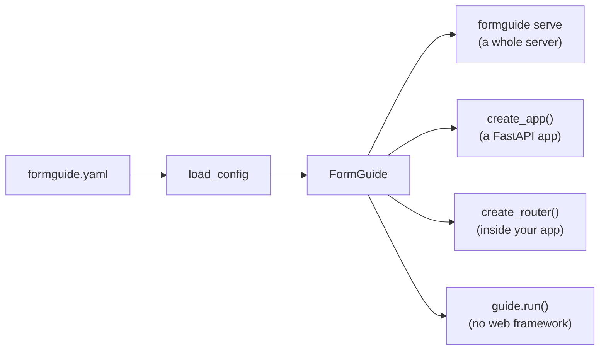

import { Tabs, TabItem, LinkCard, CardGrid, Aside } from '@astrojs/starlight/components';

## Install

<Tabs syncKey="pkg">
  <TabItem label="pip">
    ```bash
    pip install "formguide[all] @ git+https://github.com/denvasylenko/dushes.git#subdirectory=backend"
    ```
  </TabItem>
  <TabItem label="uv">
    ```bash
    uv add "formguide[all] @ git+https://github.com/denvasylenko/dushes.git#subdirectory=backend"
    ```
  </TabItem>
  <TabItem label="Copy the folder">
    ```bash
    cp -r dushes/backend/formguide my_app/formguide   # then install its dependencies from backend/pyproject.toml
    ```
  </TabItem>
</Tabs>

The core needs only LangGraph, LangChain core, Pydantic, PyYAML and pypdf. Extras add the rest:

| Extra | Adds | You need it for |
| --- | --- | --- |
| `anthropic` | `langchain-anthropic` | Claude models |
| `openai` | `langchain-openai` | OpenAI and Azure OpenAI |
| `server` | FastAPI, uvicorn, python-multipart | the HTTP endpoints and `formguide serve` |
| `research` | `deepagents` | the document researcher (`ask_documents`) |
| `sqlite` | the SQLite checkpointer | chat history that survives restarts |
| `all` | everything above | |

## Run it: four ways



<Tabs syncKey="serve">
  <TabItem label="CLI">
    ```bash
    formguide init my-agent                            # formguide.yaml, a domain pack, a skill
    formguide check --config my-agent/formguide.yaml   # loads it and reports; calls no model
    ANTHROPIC_API_KEY=... formguide serve --config my-agent/formguide.yaml --cors "*"
    ```
    The agent is now at `POST http://localhost:8000/agent/run`. Every flag: [CLI](../../reference/cli/).
  </TabItem>
  <TabItem label="create_app">
    ```python title="main.py"
    from formguide.app import create_app

    app = create_app("formguide.yaml", prefix="/agent", cors=["https://my.app"])
    # uvicorn main:app --port 8000
    ```
  </TabItem>
  <TabItem label="Your FastAPI app">
    ```python title="main.py"
    from fastapi import FastAPI, Depends
    from formguide import FormGuide, load_config
    from formguide.server import create_router

    app = FastAPI()
    guide = FormGuide(load_config("formguide.yaml"))
    app.include_router(create_router(guide), prefix="/agent", dependencies=[Depends(require_user)])
    ```
    `require_user` is your own auth dependency: the router authenticates nobody.
  </TabItem>
  <TabItem label="Plain Python">
    ```python
    from formguide import FormGuide, load_config

    guide = FormGuide(load_config("formguide.yaml"))
    info = guide.register_form(jsx, form_id="loan_application")           # once per JSX
    state = {"config": config, "jsx_hash": info["jsx_hash"], "form_id": "loan_application"}

    async for event in guide.run("thread-1", message="Where do I enter my tax id?", state=state):
        print(event["type"])          # AG-UI events as dicts

    async for event in guide.run("thread-1", resume={"accepted": True, "config": new_config}):
        ...                           # after the user accepted a field-change card
    ```
  </TabItem>
</Tabs>

<Aside type="caution">The endpoints authenticate nobody. Put them behind your own auth and rate limiting: see [Deploy and secure](../deploy/).</Aside>

## Next

<CardGrid>
  <LinkCard title="Configuration" description="From one line to per-role models, documents and durable history." href="../configuration/" />
  <LinkCard title="Connect a frontend" description="The chat widget, React, CopilotKit or any AG-UI client." href="../../frontend/overview/" />
</CardGrid>
