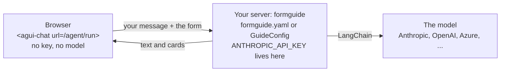

import { Tabs, TabItem, LinkCard, CardGrid, Aside } from '@astrojs/starlight/components';
import ArchFigure from '../../../components/ArchFigure.astro';
import { Summary } from '../../../components/ui';

<Summary what={"Which LLM the agent uses, and how to switch provider."} when={"Choosing Anthropic, OpenAI, Azure, Gemini, Bedrock, Ollama or your gateway."} write={"`model: \"anthropic:claude-opus-5-5\"`, or `Models(agent=ChatOpenAI(...))` in Python."} />

Where the model sits:



- The **configuration** (`formguide.yaml`, or the same `GuideConfig` in Python: pick one) sets up **your server**: which model it calls for each role. The chat is not configured here.
- The **API key** is the model provider's key. It stays in the server's environment; formguide calls the model with it through LangChain.
- The **chat in the browser** only knows your server's address (`url="/agent/run"`). It never sees the key or the model.

formguide does not ship a model client: it takes **any LangChain chat model**, from Anthropic, OpenAI, Azure, Gemini, Bedrock, a local Ollama, a gateway, or your own class.

## Pick a provider

Each tab has the same model in both ways: as a line in `formguide.yaml`, or as an object in Python. Install the provider's LangChain package and put its key in the server's environment.

<Tabs syncKey="provider">
  <TabItem label="Anthropic">
    `pip install langchain-anthropic` · key in `ANTHROPIC_API_KEY`
    ```yaml title="formguide.yaml"
    model: "anthropic:claude-haiku-5-5"
    ```
    ```python title="app.py"
    from formguide import Models
    from langchain_anthropic import ChatAnthropic

    models = Models(agent=ChatAnthropic(model="claude-haiku-5-5", max_tokens=16000))
    ```
  </TabItem>
  <TabItem label="OpenAI">
    `pip install langchain-openai` · key in `OPENAI_API_KEY`
    ```yaml title="formguide.yaml"
    model: "openai:gpt-5"
    ```
    ```python title="app.py"
    from formguide import Models
    from langchain_openai import ChatOpenAI

    models = Models(agent=ChatOpenAI(model="gpt-5"))
    ```
  </TabItem>
  <TabItem label="Azure OpenAI">
    `pip install langchain-openai` · key in `AZURE_OPENAI_API_KEY`, endpoint in `AZURE_OPENAI_ENDPOINT`
    ```yaml title="formguide.yaml"
    models:
      agent:
        class: "langchain_openai:AzureChatOpenAI"
        azure_deployment: gpt-5                    # your deployment's name
        api_version: "2025-04-01-preview"
        azure_endpoint: "${AZURE_OPENAI_ENDPOINT}"
    ```
    ```python title="app.py"
    from formguide import Models
    from langchain_openai import AzureChatOpenAI

    models = Models(agent=AzureChatOpenAI(azure_deployment="gpt-5", api_version="2025-04-01-preview"))
    ```
  </TabItem>
  <TabItem label="Gemini">
    `pip install langchain-google-genai` · key in `GOOGLE_API_KEY`
    ```yaml title="formguide.yaml"
    model: "google_genai:gemini-2.5-pro"
    ```
    ```python title="app.py"
    from formguide import Models
    from langchain_google_genai import ChatGoogleGenerativeAI

    models = Models(agent=ChatGoogleGenerativeAI(model="gemini-2.5-pro"))
    ```
  </TabItem>
  <TabItem label="Bedrock">
    `pip install langchain-aws` · the usual AWS credentials (profile, role or keys)
    ```yaml title="formguide.yaml"
    models:
      agent: {provider: bedrock_converse, model: <model id>, region_name: eu-central-1}
    ```
    ```python title="app.py"
    from formguide import Models
    from langchain_aws import ChatBedrockConverse

    models = Models(agent=ChatBedrockConverse(model="<model id>", region_name="eu-central-1"))
    ```
  </TabItem>
  <TabItem label="Ollama">
    `pip install langchain-ollama` · no key, the model runs on your machine
    ```yaml title="formguide.yaml"
    models:
      agent: {provider: ollama, model: llama3.1, base_url: "http://localhost:11434"}
    ```
    ```python title="app.py"
    from formguide import Models
    from langchain_ollama import ChatOllama

    models = Models(agent=ChatOllama(model="llama3.1", base_url="http://localhost:11434"))
    ```
  </TabItem>
  <TabItem label="Gateway">
    vLLM, LM Studio, LiteLLM or any OpenAI-compatible server · `pip install langchain-openai`
    ```yaml title="formguide.yaml"
    models:
      agent: {class: "langchain_openai:ChatOpenAI", model: my-model, base_url: "http://gateway/v1", api_key: "${GATEWAY_KEY}"}
    ```
    ```python title="app.py"
    import os
    from formguide import Models
    from langchain_openai import ChatOpenAI

    models = Models(agent=ChatOpenAI(model="my-model", base_url="http://gateway/v1", api_key=os.environ["GATEWAY_KEY"]))
    ```
  </TabItem>
  <TabItem label="Your own">
    Any `BaseChatModel` subclass that supports tool calling.
    ```yaml title="formguide.yaml"
    models:
      agent: {class: "my_app.llm:CompanyModel", endpoint: "${LLM_URL}"}   # the other keys go to the constructor
    ```
    ```python title="app.py"
    import os
    from formguide import Models
    from my_app.llm import CompanyModel

    models = Models(agent=CompanyModel(endpoint=os.environ["LLM_URL"]))
    ```
  </TabItem>
</Tabs>

Then serve it. With the YAML file, one command:

```bash
formguide serve --config formguide.yaml --port 8000
```

Or from Python, with the `models` from the snippet above:

```python title="app.py"
from formguide import FormGuide, GuideConfig
from formguide.app import create_app

guide = FormGuide(GuideConfig(models=models))
app = create_app(guide, cors=["https://your-app.example"])   # uvicorn app:app
```


Only Anthropic, OpenAI and Azure OpenAI are covered by the offline tests (their real request payloads); live runs used Anthropic.

## The roles

One model does everything by default. Give a role its own model when it pays off: a cheaper one for research and memory, one that reads images for extraction.

| Role | Does | Needs | Falls back to |
| --- | --- | --- | --- |
| `agent` | the conversation: answers, tool calls, cards | tool calling, streaming | (required) |
| `research` | the document researcher | tool calling | `agent` |
| `compile` | turns business documents into the domain pack | structured output | `agent` |
| `extract` | reads attachments; prefill from free text | structured output, vision or PDF for scans | `agent` |
| `memory` | summarizes older turns of long chats | plain text | `research` |

<ArchFigure page="config" />

### Mix providers

```yaml title="formguide.yaml"
models:
  agent: {class: "langchain_openai:AzureChatOpenAI", azure_deployment: gpt-5, api_version: "2025-04-01-preview",
          azure_endpoint: "${AZURE_OPENAI_ENDPOINT}"}
  research: "openai:gpt-5-mini"                                   # cheaper, for the long tail of documents
  extract: {provider: anthropic, model: claude-haiku-5-5, max_tokens: 8000}   # reads scans
memory: {model: "anthropic:claude-haiku-5-5"}
```
```python title="app.py"
from formguide import FormGuide, GuideConfig, Models
from formguide.config import MemoryConfig
from langchain_anthropic import ChatAnthropic
from langchain_openai import AzureChatOpenAI, ChatOpenAI

guide = FormGuide(GuideConfig(
    models=Models(
        agent=AzureChatOpenAI(azure_deployment="gpt-5", api_version="2025-04-01-preview"),
        research=ChatOpenAI(model="gpt-5-mini"),
        extract=ChatAnthropic(model="claude-haiku-5-5", max_tokens=8000),
    ),
    memory=MemoryConfig(model="anthropic:claude-haiku-5-5"),   # a string works anywhere a model does
))
```


## Every way to write a model

| Form | Example | Becomes |
| --- | --- | --- |
| an object (Python only) | `ChatOpenAI(model="gpt-5")` | used as it is |
| `"provider:model"` | `"openai:gpt-5"` | `init_chat_model("openai:gpt-5")` |
| `{provider, model, ...}` | `{provider: anthropic, model: claude-haiku-5-5, max_tokens: 16000}` | `init_chat_model(model, model_provider=provider, **rest)` |
| `{class, ...}` | `{class: "langchain_openai:AzureChatOpenAI", azure_deployment: gpt-5}` | the class, called with the other keys |

The strings and dicts work in Python too (`Models(research="openai:gpt-5-mini")`). Extra keys go to the model's constructor unchanged: `temperature`, `max_tokens`, `timeout`, `max_retries`, Anthropic's `output_config: {effort: low}`.

<details>
<summary>Which wins: `model`, `models` or the environment?</summary>

- `models:` wins over `model:`; `models: "openai:gpt-5"` (a string) is the same as `model:`.
- With neither, `FORMGUIDE_MODEL` is used (`FORMGUIDE_MODEL=openai:gpt-5 formguide serve`), else the built-in Anthropic defaults: Claude Haiku 5.5, the cheapest, for every role.
- A missing provider package fails at `FormGuide(...)` with the package name to install.

</details>

<Aside title="A missing key is named">Without the provider's key, the server warns at start-up, `formguide check` marks the role, and the chat ends with "model error: no API key (set ANTHROPIC_API_KEY on the server)" instead of a vague "Connection error".</Aside>

## Every option

```yaml title="formguide.yaml"
model: "anthropic:claude-haiku-5-5"        # one model for every role, or per role:
models:                                   # wins over model:
  agent: {provider: anthropic, model: claude-haiku-5-5, max_tokens: 16000}   # required when models: is a map
  research: "anthropic:claude-haiku-5-5" # default: agent
  compile: "anthropic:claude-haiku-5-5"    # default: agent
  extract: {provider: anthropic, model: claude-haiku-5-5, max_tokens: 8000}  # default: agent
memory:
  model: "anthropic:claude-haiku-5-5"     # default: research
suggestions:
  model: "anthropic:claude-haiku-5-5"     # quick replies; default: the memory model
```
```python title="app.py"
from formguide import GuideConfig, Models
from formguide.config import MemoryConfig, SuggestionsConfig

GuideConfig(
    models=Models(agent=..., research=None, compile=None, extract=None),   # None: fall back to agent
    memory=MemoryConfig(model=None),                                       # None: the research model
    suggestions=SuggestionsConfig(enabled=True, model=None),               # None: the memory model
)
```


## Next

<CardGrid>
  <LinkCard title="Domain packs" description="Tell the agent what your form is about." href="../domain-packs/" />
  <LinkCard title="Speed and tracing" description="Which model call took how long." href="../observability/" />
</CardGrid>
