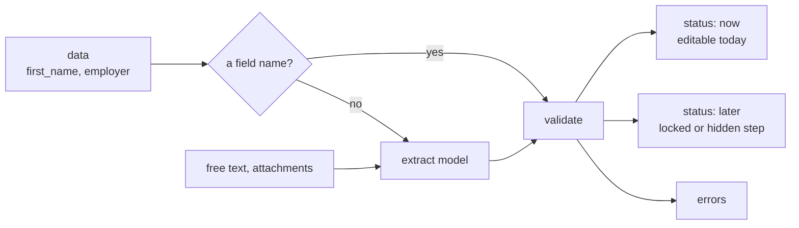

import { Tabs, TabItem, LinkCard, CardGrid, Aside } from '@astrojs/starlight/components';
import { Summary } from '../../../components/ui';

<Summary what={"Turn data your app already has into checked values for the form."} when={"You know the user's profile, or they uploaded a document."} write={"`POST /agent/prefill` with `data`, `text` or `attachment_ids`."} />

Your app often knows half the form already: the user's profile, what they typed on an earlier screen, a document they uploaded. Prefill maps that onto **this** form's fields and validates every value the way the agent's own proposals are validated. It does not write to the form: it tells you what can be filled and you decide.



Keys of `data` that are field names are used directly, with no model call. Everything else (other keys, `text`, `attachment_ids`) goes through the [`extract` model](../models/#the-roles) with the form's field list.

## Ask for values

The server needs the form as your page last sent it (`state`: the same `{config, jsx_hash, form_id}` as every run, see [Send the form each run](../../form/state/)).

<Tabs syncKey="prefill">
  <TabItem label="HTTP">
    ```bash
    curl -X POST http://localhost:8000/agent/prefill -H "Content-Type: application/json" -d '{
      "state": {"config": {"props": {}, "state": {}}, "jsx_hash": "3f9a1c0d2b7e4a55", "form_id": "loan_application"},
      "data":  {"first_name": "Anna", "employer": "Acme"},
      "text":  "Moved to Lyon in 2021"
    }'
    ```
  </TabItem>
  <TabItem label="Python">
    ```python
    result = await guide.suggest_prefill(
        state,                                         # {config, jsx_hash, form_id}
        data={"first_name": "Anna", "employer": "Acme"},
        text="Moved to Lyon in 2021",
        attachment_ids=["att_1a2b3c4d"], thread_id="t1",   # files uploaded in that conversation
    )
    ```
  </TabItem>
</Tabs>

| Input | What it is | Model call |
| --- | --- | --- |
| `data` | `{key: value}` from your app. A key that is a field name fills that field; other keys are read by meaning (`employer` can land in `employer_name`) | only for keys that are not field names |
| `text` | free text: a note, an earlier answer | yes |
| `attachment_ids` + `thread_id` | files the user uploaded to that conversation ([attachments](../../concepts/attachments/)) | yes, with vision or PDF |

## What comes back

The response for the request above:

```json title="POST /agent/prefill → 200"
{
  "values": [
    {"name": "first_name", "label": "First name", "value": "Anna", "display": "Anna",
     "status": "now", "source": "data"},
    {"name": "employer_name", "label": "Employer", "value": "Acme", "display": "Acme",
     "status": "later", "why_later": "hidden", "source": "text"},
    {"name": "city", "label": "City", "value": "Lyon", "display": "Lyon",
     "status": "now", "source": "text", "confidence": "high", "evidence": "Moved to Lyon in 2021"}
  ],
  "errors": ["birth_date: not a date"],
  "notes": []
}
```

| Key | Meaning | What you do with it |
| --- | --- | --- |
| `values[].value` | the value **in your form's own format** (an option object, an id, `"Y"`, `"31.05.1990"`: see [Value formats](../../form/value-formats/)) | send it to your form backend as is |
| `values[].display` | the same value for people | show it on your review screen |
| `values[].status` | `now`: the field is editable now; `later`: it is on a step that is hidden or locked (`why_later`) | apply `now`; keep `later` until that step opens, then call prefill again |
| `values[].source` | `data` (a field name you passed), `text`, or the attachment's file name | show where a value came from |
| `values[].confidence`, `evidence` | for values read by the model: how sure, and the words it read | ask the user to check `medium` values; `low` ones are left out and listed in `notes` |
| `errors` | values that did not pass the form's rules, or unknown, read-only and file fields | log them; nothing to show the user |

Fields that already hold the same value are left out.

## Prefill inside a chat

Instead of a separate call, start the conversation with the same input. The agent then proposes the `now` values on one [field-change card](../../frontend/card-gallery/#set-fields) and keeps the rest for later steps. On the server nothing changes: the run carries `forwardedProps.prefill`, or in Python:

```python
async for event in guide.run(thread_id, state=state, prefill={"data": profile, "text": note}):
    ...
```

From the page, this is one call: [start a chat with prefill](../../frontend/chat-widget/#start-with-prefill).

<Aside>Prefill never writes to the form and does not store the data you pass; it goes only to your `extract` model when a model is needed. Values reach your form backend through your own code, after the user accepts them.</Aside>

## Every option

| Key | Type | Default |
| --- | --- | --- |
| `state` | `{config, jsx_hash, form_id}` | required |
| `data` | object | none |
| `text` | string | none |
| `attachment_ids` | list of ids | none |
| `thread_id` | the conversation the attachments belong to | none (attachments are skipped) |

The model is the `extract` role ([Models](../models/)); nothing else is configured.

## Next

<CardGrid>
  <LinkCard title="Start a chat with prefill" description="One call from the page." href="../../frontend/chat-widget/#start-with-prefill" />
  <LinkCard title="Value formats" description="Why values come back in your format." href="../../form/value-formats/" />
</CardGrid>
