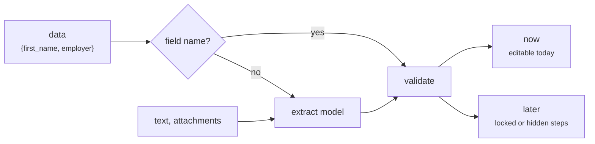

import { Tabs, TabItem, LinkCard, CardGrid } from '@astrojs/starlight/components';

Give formguide what you know about the user: profile fields, a free-text note, attachments. Field names are used directly; anything else goes through the `extract` model with the form's field catalog.



<Tabs syncKey="prefill">
  <TabItem label="In the chat">
    The agent proposes what it can fill now on one card and keeps the rest for later steps.
    ```ts
    agent.runAgent({ forwardedProps: { prefill: { data: { first_name: 'Anna', employer: 'Acme' }, text: 'Moved to Lyon in 2021' } } })
    ```
  </TabItem>
  <TabItem label="Without a chat">
    ```bash
    curl -X POST http://localhost:8000/agent/prefill -H "Content-Type: application/json" \
      -d '{"state": {"config": {...}, "jsx_hash": "3f9a1c0d2b7e4a55", "form_id": "loan_application"},
           "data": {"first_name": "Anna", "employer": "Acme"}}'
    ```
  </TabItem>
  <TabItem label="Python">
    ```python
    result = await guide.suggest_prefill(state, data={"first_name": "Anna"}, text="Moved to Lyon in 2021",
                                         attachment_ids=["att_1a2b3c4d"])
    ```
  </TabItem>
</Tabs>

```json title="The answer"
{
  "values": [
    {"name": "first_name", "label": "First name", "value": "Anna", "display": "Anna", "status": "now", "source": "data"},
    {"name": "employer_name", "label": "Employer", "value": "Acme", "display": "Acme", "status": "later", "source": "extract"}
  ],
  "errors": ["birth_date: not a date"],
  "notes": []
}
```

Values come back in your form's own format (see [Value formats](../../form/value-formats/)).

## Next

<CardGrid>
  <LinkCard title="Cards and answers" description="How the prefill card is answered." href="../../frontend/cards/" />
  <LinkCard title="User documents" description="Reading scans into values." href="../../concepts/attachments/" />
</CardGrid>
