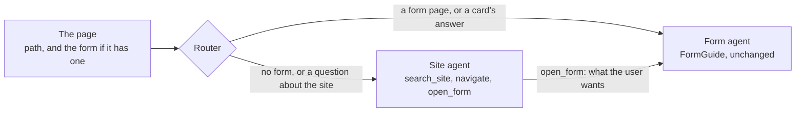

import { LinkCard, CardGrid, Aside } from '@astrojs/starlight/components';
import SiteDemoLink from '../../../components/SiteDemoLink.astro';

`SiteGuide` sits above the form agent. On a page without a form, the **site agent** answers from the site's content and moves the user around. On a page with a form, the turn goes to the **form agent**: the same `FormGuide` as everywhere else, unchanged. One chat follows the user from page to page.

<SiteDemoLink />



## Set it up

Two things on the server: a **site map** (what the site has and where the assistant may go), and the router next to formguide's own.

```yaml title="site.yaml"
title: Main Street
pages:
  - path: /loans
    title: Loans
    description: Aster Bank's car loans, mortgages and cash loans.
    keywords: [car loan, mortgage, interest rate]     # words that point here from another page
    tabs:
      - {id: mortgage, title: Mortgage, text: "A mortgage from 16.5% a year, for up to 30 years."}
  - path: /apply
    title: Apply for a loan
    form: loan_application                            # this page holds a form: the form agent works here
  - path: /contacts
    title: Contacts
    sections:
      - {id: bank, title: Aster Bank, text: "Monday to Friday 9:00 to 19:00."}
```

```python title="app.py"
from formguide.app import create_app
from formguide.site import SiteGuide, SiteMap, create_site_router

app = create_app("formguide.yaml", prefix="/agent")            # the form agent, as on every other page
guide = app.state.guide                                         # its FormGuide

site = SiteGuide(guide, SiteMap.load("site.yaml"))              # the site agent, above it
app.include_router(create_site_router(site), prefix="/site")    # POST /site/run, GET /site/map
```

The site map is both what the site agent knows (a search index over every tab, accordion and section) and where it may go: `navigate` and `open_form` accept only its pages, tabs, sections and forms, so the model cannot invent a page.

## How a turn is routed

| The user is | and writes | The turn goes to |
| --- | --- | --- |
| on a page without a form | anything | the site agent |
| on a form page | about the form ("my name is Anna") | the form agent |
| on a form page | about another page or about moving ("open contacts", "when is the bank open?") | the site agent |
| anywhere | a card's answer | the form agent (only it shows cards) |

On a form page the router checks navigation words and the other pages' titles and `keywords`. A page's own keywords stay with its form: on the booking page, "book a haircut" is the form's.

## The hand-off

"I want a mortgage, I earn 6,000 a month" on the Loans page: the site agent calls `open_form`, keeps a note of what the user said and sends the page a directive to open `/apply`. The page opens the form and runs the chat once with `forwardedProps: {handoff: true}`; the form agent gets the note as its first message and proposes those fields right away, without the user repeating themselves. The page's side: [Site assistant in the page](../../frontend/site-assistant/).

## The endpoints

```bash
curl http://localhost:8000/site/map                       # the site map, for the page to render or check
curl -N -X POST http://localhost:8000/site/run -H "Content-Type: application/json" -d '{
  "threadId": "t1", "runId": "r1", "messages": [{"id": "m1", "role": "user", "content": "When is the bank open?"}],
  "state": {"page": {"path": "/loans", "title": "Loans"}}, "tools": [], "context": [], "forwardedProps": {}
}'
```

`POST /site/run` is AG-UI like `/agent/run`. Its `state` is `{page: {path, title}, form?}`, where `form` is the usual [form state](../../form/state/) on a form page. Besides the form agent's events it sends `CUSTOM site_directive {type: "navigate", path, tab?, section?, form_id?}`.

<Aside>The form agent keeps its own conversation per form inside the site's thread (`<site thread>-<form id>`), with its history, cards and Undo, exactly as on a page of its own.</Aside>

## Every option

```yaml title="site.yaml"
title: Main Street                   # the site's name, in the site agent's prompt
pages:
  - path: /apply                     # required: the page's route, the navigation target
    title: Apply for a loan          # default: the path
    description: One line about the page.
    keywords: [apply, application]   # extra words that route a message to this page
    form: loan_application           # the form_id of the form on this page; none: a content page
    tabs:       [{id: car, title: Car loan, text: "..."}]          # navigate can open a tab
    accordions: [{id: early, title: Can I repay early?, text: "..."}]   # or an accordion
    sections:   [{id: how, title: How applying works, text: "..."}]     # or scroll to a section
```

```python title="app.py"
from formguide.site import SiteGuide, SiteMap, create_site_router

SiteMap.load("site.yaml")            # a path, or a dict with the same shape
SiteGuide(
    guide,                           # your FormGuide: the form agent for form pages
    SiteMap.load("site.yaml"),
    model=None,                      # the site agent's model; None: the form guide's agent model
)
create_site_router(site)             # POST /run (AG-UI), GET /map; mount it under any prefix
```

| `forwardedProps` key | Default | What it does |
| --- | --- | --- |
| `handoff` | `false` | the first run on a form page after `open_form`: the form agent gets the note as its first message |
| `capabilities` | all | the card variants the page draws, as for the form agent |

## Next

<CardGrid>
  <LinkCard title="Site assistant in the page" description="State, the directive, the hand-off run." href="../../frontend/site-assistant/" />
  <LinkCard title="Types and the contract" description="Every message, typed." href="../../form/contract/" />
</CardGrid>
