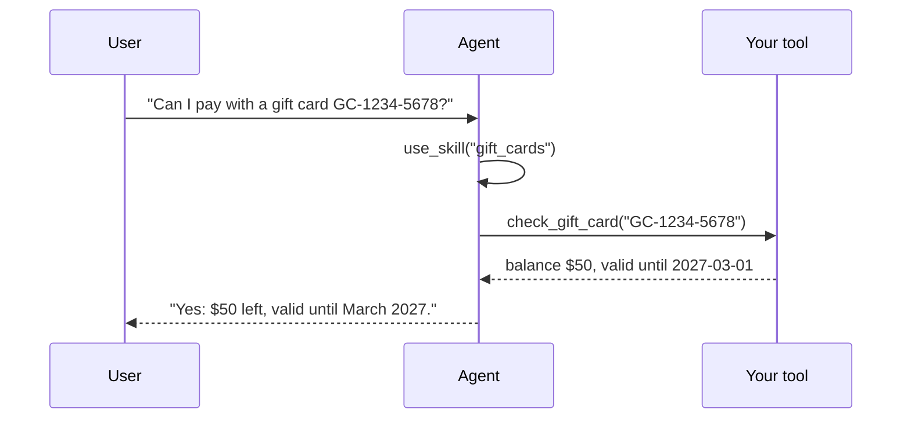

import { Tabs, TabItem, LinkCard, CardGrid } from '@astrojs/starlight/components';

## A skill

A folder with a `SKILL.md`. Only the name and description sit in the prompt; the agent loads the body with `use_skill` when the task calls for it, so a hundred skills cost almost nothing.

```md title="skills/gift_cards/SKILL.md"
---
name: gift_cards
description: Check a gift card balance and explain how a gift card can pay for a booking.
forms: [barber_booking]                       # or "*" for every form (default)
tools: ["demo.skill_tools:check_gift_card"]   # optional: tools bound only where the skill applies
---
When the user mentions a gift card or a voucher:
1. Ask for the card code if they have not given it (format GC-XXXX-XXXX).
2. Check it with check_gift_card and say the balance and expiry date.
```

```yaml title="formguide.yaml"
skills: {dir: skills}
```

## A tool

Any LangChain tool: an HTTP call to your API, a database query.

```python title="demo/skill_tools.py"
from langchain_core.tools import tool

@tool
def check_gift_card(code: str) -> str:
    """Look up a gift card balance by its code (format GC-XXXX-XXXX)."""
    balance, expiry = lookup(code)
    return f"Gift card {code}: balance ${balance}, valid until {expiry}."
```

<Tabs syncKey="tool">
  <TabItem label="Every form">
    ```yaml
    tools: ["my_app.tools:check_credit_score"]
    ```
  </TabItem>
  <TabItem label="Some forms">
    List it in a skill's `tools:` with `forms: [...]` (above).
  </TabItem>
  <TabItem label="Ask first">
    ```yaml
    tools: ["my_app.tools:submit_application"]
    confirm_tools: [submit_application]    # held until the user taps Confirm on a card
    ```
  </TabItem>
  <TabItem label="In code">
    ```python
    from formguide import Skill, SkillRegistry

    skills = SkillRegistry.from_dir("skills")
    cfg.tools.append(check_credit_score)
    ```
  </TabItem>
</Tabs>



Tools that must run in the browser (open a dialog, read local state) are [frontend tools](../../frontend/frontend-tools/).

## Every option

```yaml title="formguide.yaml"
skills: {dir: skills}                      # skills/<name>/SKILL.md
tools: ["my_app.tools:check_status"]       # LangChain tools offered for every form
confirm_tools: [submit_application]        # these always ask the user first (a confirm card)
max_tool_rounds: 10                        # model <-> tool rounds per turn
actions:                                   # the agent's built-in actions: true | false | auto
  ask_user: true
  request_file: auto                       # auto: only when attachments are on
  confirm_action: true
  focus_field: true
  review_form: true
  ask_documents: auto                      # auto: only when the form has documents
  extract_from_attachment: auto
```
```python title="app.py"
from formguide import GuideConfig, SkillRegistry

GuideConfig(
    skills=SkillRegistry.from_dir("skills"),
    tools=[check_status],                                # any BaseTool
    confirm_tools=["submit_application"],
    max_tool_rounds=10,
    actions={"request_file": False, "review_form": True},   # the rest stay on (or auto)
)
```


A skill's `SKILL.md` front matter: `name`, `description` (what the model sees before loading it), `forms` (form ids, or all), `tools` (import strings of tools that come with it).

## Next

<CardGrid>
  <LinkCard title="Frontend tools" description="Tools the browser runs." href="../../frontend/frontend-tools/" />
  <LinkCard title="Confirmations" description="The confirm card for irreversible actions." href="../../frontend/cards/" />
</CardGrid>
