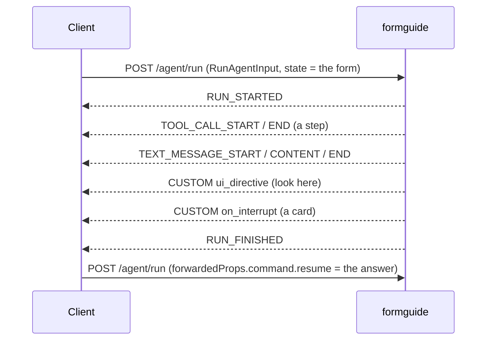

import { LinkCard, CardGrid } from '@astrojs/starlight/components';
import { Summary } from '../../../components/ui';

[AG-UI](https://docs.ag-ui.com) is an open protocol between an agent and a user interface: the client posts a `RunAgentInput`, the server streams events over SSE. formguide uses only standard events, so `<agui-chat>`, CopilotKit, `@ag-ui/client`'s `HttpAgent` or your own client work without adapters.

| AG-UI | formguide uses it for |
| --- | --- |
| `RunAgentInput.state` | the form: `{config, jsx_hash, form_id, ui}` |
| `RunAgentInput.tools` | your frontend tools |
| `forwardedProps` | a card's answer (`command.resume`), prefill, the card variants the client draws (`capabilities`) |
| `TEXT_MESSAGE_*`, `TOOL_CALL_*` | the reply and its steps |
| `CUSTOM` | `ui_directive`, `on_interrupt` (cards), `suggestions`, `sources`, `receipt`, `run_stats` |
| `RUN_FINISHED.outcome.interrupts` | cards for AG-UI 1.0 clients (`interrupt_mode: structured`) |

Every payload, typed: [Types and the contract](../../form/contract/).

## Next

<CardGrid>
  <LinkCard title="Any AG-UI client" description="HttpAgent, step by step." href="../../frontend/agui-client/" />
  <LinkCard title="AG-UI events" description="The reference." href="../../reference/agui-events/" />
</CardGrid>
