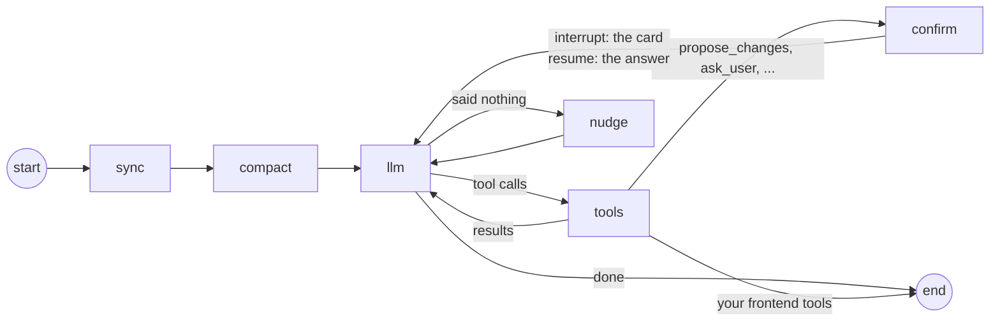

import { LinkCard, CardGrid } from '@astrojs/starlight/components';
import { Summary } from '../../../components/ui';

<Summary what={"The agent's turn as a LangGraph graph."} when={"You want to know what happens inside a turn."} write={"Nothing; a checkpointer is the one LangGraph object you may pass in."} />

Every message runs the same graph. The form arrives with the message, the graph decides what to say, which tools to run and when to stop for the user.



| Node | What it does |
| --- | --- |
| `sync` | compares the incoming form (`config`) with the last one, builds the context the model sees (outline, open section, what changed), adds the message |
| `compact` | in long chats, summarizes older turns into a memory, keeping the form out of the summary ([memory](../../concepts/memory/)) |
| `llm` | calls the `agent` model with formguide's tools and yours; streams the text |
| `tools` | runs the tools: search the form, point at a field, read documents, your APIs |
| `confirm` | a card: the graph **interrupts** with the payload, the page shows it, the next run resumes with the user's answer and the new `config` |
| `nudge` | a safety net when the model ended the turn without a word |

## What formguide uses from LangGraph

| LangGraph | In formguide |
| --- | --- |
| `StateGraph` | the graph above ([`agent/graph.py`](https://github.com/denvasylenko/dushes/blob/main/backend/formguide/agent/graph.py)) |
| `interrupt()` and `Command(resume=...)` | every card: field changes, questions, uploads, confirmations, reviews. The AG-UI answer (`forwardedProps.command.resume`) is the resume value |
| a checkpointer (`BaseCheckpointSaver`) | the model's history per `thread_id`: in memory, SQLite, Postgres, Redis ([Persistence](../../backend/persistence/)) |
| streaming | text, tool steps and custom events become AG-UI events as they happen |

```python
from formguide import FormGuide, GuideConfig, sqlite_checkpointer

guide = FormGuide(GuideConfig(checkpointer=sqlite_checkpointer("data/checkpoints.sqlite")))   # any LangGraph saver
```

## Next

<CardGrid>
  <LinkCard title="One turn, in detail" description="The same graph with the context it builds." href="../../concepts/turn/" />
  <LinkCard title="LangChain" description="Models, tools, documents." href="../langchain/" />
</CardGrid>
