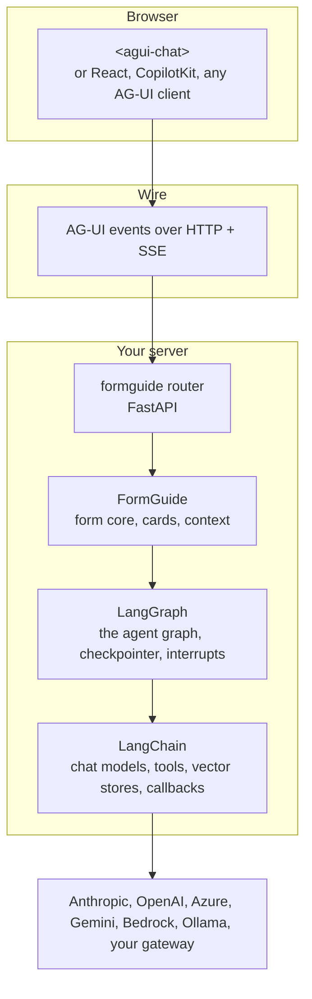

import { LinkCard, CardGrid } from '@astrojs/starlight/components';

formguide is open source ([GitHub](https://github.com/denvasylenko/dushes)) and adds only what is specific to forms: reading the form, the cards, the context. Everything else is a standard you may already use.

| Layer | What it does in formguide | Read |
| --- | --- | --- |
| **LangGraph** | runs one turn as a graph: build the context, call the model, run tools, stop for a card and resume after the answer; keeps the history in a checkpointer | [LangGraph](../langgraph/) |
| **LangChain** | the model of every role, the tools, the document index, tracing callbacks; any provider through one interface | [LangChain](../langchain/) |
| **AG-UI** | the protocol between the page and the server: text, steps, cards, directives as events | [AG-UI](../ag-ui/) |

## The packages

| Python (`pip install "formguide[all]"`) | For |
| --- | --- |
| `langgraph`, `langchain`, `langchain-core` | always: the graph, models, tools |
| `langchain-anthropic`, `langchain-openai` | the `anthropic` and `openai` extras; other providers: their own `langchain-*` package |
| `fastapi`, `uvicorn`, `python-multipart`, `ag-ui-protocol` | the `server` extra: the HTTP router and the AG-UI types |
| `langgraph-checkpoint-sqlite`, `aiosqlite` | the `sqlite` extra: history that survives restarts |
| `deepagents` | the `research` extra: the document researcher |
| `pydantic`, `pyyaml`, `pypdf`, `pillow` | config, PDFs and photos |

| Browser | For |
| --- | --- |
| `@formguide/agui-chat` | the chat widget, no runtime dependencies; `@formguide/agui-chat/formguide` (the form plugin), `@formguide/agui-chat/react` (React, a peer dependency) |
| `@ag-ui/client` | only if you write your own client (`HttpAgent`) |

## Where every name comes from

| Name | Import |
| --- | --- |
| `FormGuide`, `GuideConfig`, `Models`, `load_config`, `DomainPackRegistry`, `KnowledgeBase`, `VectorStoreIndex`, `SkillRegistry`, `sqlite_checkpointer`, `FileTranscriptStore` | `from formguide import ...` |
| `MemoryConfig`, `SuggestionsConfig`, `TracingConfig` | `from formguide.config import ...` |
| `create_app` / `create_router` | `from formguide.app import create_app` / `from formguide.server import create_router` |
| `ChatAnthropic` / `ChatOpenAI`, `AzureChatOpenAI` / `ChatGoogleGenerativeAI` | `langchain_anthropic` / `langchain_openai` / `langchain_google_genai` |
| `tool`, `BaseTool`, `BaseChatModel` | `langchain_core.tools` / `langchain_core.language_models` |
| `AsyncPostgresSaver` | `langgraph.checkpoint.postgres.aio` (`langgraph-checkpoint-postgres`) |
| `<agui-chat>`, `defineTheme`, `formguide()` | `import '@formguide/agui-chat'`, `import { formguide } from '@formguide/agui-chat/formguide'` |
| `HttpAgent` | `@ag-ui/client` |

## Next

<CardGrid>
  <LinkCard title="LangGraph" description="The agent graph, step by step." href="../langgraph/" />
  <LinkCard title="AG-UI" description="The events on the wire." href="../ag-ui/" />
</CardGrid>
