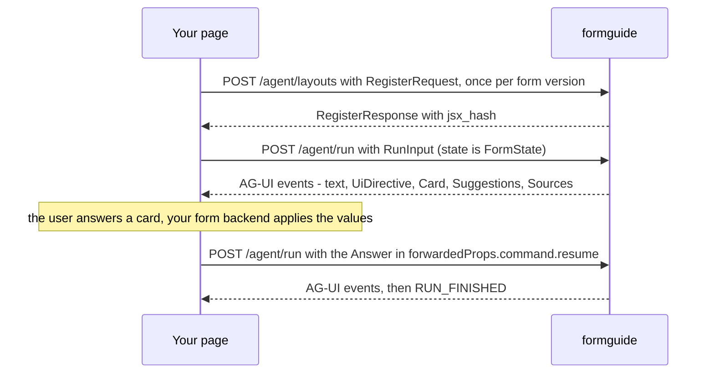

import { Tabs, TabItem, LinkCard, CardGrid, Aside } from '@astrojs/starlight/components';
import { Summary } from '../../../components/ui';

<Summary what={"Every message between the page and the server, as TypeScript types."} when={"You write your own client, or debug the wire."} write={"Nothing: a reference of `FormState`, `Card`, `Answer`, ..."} />

Your page and formguide exchange six kinds of messages. This page types all of them. The widget and the formguide plugin build and read these for you; you need the types when you write your own client, your own cards, or debug what crosses the wire.



## The words

| Word | What it is | Who makes it | Changes when |
| --- | --- | --- | --- |
| `jsx` | the form's skeleton as text: which elements exist and how they nest (`<Tab name="loan"><Input name="amount"/></Tab>`) | your form backend | you ship a new version of the form |
| `jsx_hash` | a short id of that skeleton, so the skeleton is sent **once** and every run refers to it | formguide, in the answer to `POST /agent/layouts` | the `jsx` changes; the same `jsx` always gives the same hash |
| `form_id` | your name for the form; picks its [domain pack](../../backend/domain-packs/) and documents | you | never |
| `config` | the form right now: `props` (label, visible, disabled, required, options, error of every element) and `state` (every field's value) | your form backend, after every change | after every change the user or a card makes |
| `ui` | what the user is looking at: open tab, open accordions, the focused field, the local time | your page | as the user moves around |
| `thread_id` | one conversation; the chat history and cards belong to it | the client (the widget keeps it in `localStorage`) | "New chat" |
| `card_id` | one card in that conversation | formguide | each new card |

`config` is the important one: formguide never computes your form's rules. It reads `config`, proposes values, and your form backend (the one that already decides what is visible and valid) applies them and returns the next `config`.

## 1. Register the form

```ts
// POST /agent/layouts
interface RegisterRequest {
  jsx: string                       // the skeleton, up to 2 MB
  form_id?: string                  // e.g. "loan_application"
  domain?: DomainPack               // a pack sent with the form (optional, see Domain packs)
  config?: FormConfig               // a sample config: adds value-format warnings
}
interface RegisterResponse {
  jsx_hash: string                  // "3f9a1c0d2b7e4a55": keep it, send it with every run
  nodes: number                     // elements found in the jsx
  domain_pack: string               // where the pack came from: "dir", "provider", "inline", "default", ...
  warnings: string[]                // value formats that do not match your components
}
```

## 2. The form, with every run

```ts
interface FormState {               // AG-UI RunAgentInput.state
  config: FormConfig
  jsx_hash: string
  form_id?: string
  ui?: UiState
  attachments?: { id: string; filename: string; bytes?: number }[]   // files attached to this message
}
interface FormConfig {
  props: Record<string, ElementProps>   // one entry per element name
  state: Record<string, unknown>        // one entry per field name, in your components' own format
}
interface ElementProps {
  label?: string
  visible?: boolean                 // default true; false hides everything inside
  disabled?: boolean                // default false; true locks everything inside
  readonly?: boolean                // computed by the form; never proposed
  required?: boolean
  options?: unknown[]               // the allowed choices right now ({id, name} by default)
  placeholder?: string              // a format hint
  error?: string                    // your backend's validation message
  [other: string]: unknown          // passed along, ignored
}
interface UiState {
  activeTabs?: Record<string, string>   // tab set name -> open tab name
  openAccordions?: string[]
  focused?: string                      // the field with the cursor
  now?: string                          // "2026-11-12 Thursday 14:05", so "next Tuesday" works
}
```

Values in `state` use your components' formats (an option object, an id, `"Y"`, `"31.05.1990"`); describe them once in [Value formats](../value-formats/). Everything formguide sends back uses the same formats.

## 3. One run

```ts
// POST /agent/run: an AG-UI RunAgentInput
interface RunInput {
  threadId: string
  runId: string
  messages: { id: string; role: 'user' | 'assistant' | 'tool'; content: string }[]
  state: FormState
  tools: { name: string; description: string; parameters: object }[]   // your frontend tools
  context: unknown[]
  forwardedProps?: {
    command?: { resume: Answer }                    // answering a card
    prefill?: { data?: Record<string, unknown>; text?: string; attachment_ids?: string[] }
    capabilities?: string[]                         // the card variants this client draws
  }
}
```

The response is a stream of AG-UI events (`text/event-stream`). Besides text and tool steps, formguide sends these `CUSTOM` events:

| `name` | `value` | When |
| --- | --- | --- |
| `ui_directive` | `UiDirective` | the agent points at a field |
| `on_interrupt` | `Card`, as a JSON **string** | the agent needs a decision; the run ends after it |
| `suggestions` | `{ items: string[]; applies?: (Change[] \| null)[] }` | quick replies after an answer |
| `sources` | `{ items: { title: string; section?: string; quote?: string }[] }` | an answer used your documents |
| `receipt` | `{ card_id: string; title?: string; number?: string; eta?: string }` | a confirmed action returned a receipt |
| `site_directive` | `{ type: 'navigate'; path: string; tab?: string; section?: string; form_id?: string }` | the [site assistant](../../backend/site-assistant/) moves the user to another page (`/site/run` only) |
| `run_stats` | timings and tokens | last event of every run ([Speed and tracing](../../backend/observability/)) |

```ts
interface UiDirective {
  type: 'focus'
  target: string                    // the field's name
  reveal: ({ type: 'tab'; tabs: string; tab: string } | { type: 'accordion'; name: string })[]   // open these first
  hint: string                      // a short note to show under the field, may be ""
}
```

## 4. Cards

```ts
type Card = SetFields | Ask | Upload | Confirm | Review

interface SetFields {
  type: 'set_fields'; card_id: string
  changes: Change[]
  source?: { kind: 'document'; title?: string; attachment_id?: string; found?: number }   // values read from a scan
}
interface Change {
  name: string; label: string
  value: unknown                    // in your form's format: apply it as it is
  display: string                   // the same for people
  kind?: 'text' | 'number' | 'date' | 'select' | 'radio' | 'multiselect' | 'bool'
  previous?: unknown; previous_display?: string | null
  reason?: string
  reveal?: UiDirective['reveal']
  consent?: boolean; required?: boolean; doc?: { title?: string; text?: string; url?: string }
  issue?: { severity?: 'warning' | 'error'; message: string; why?: string }
  confidence?: 'high' | 'medium' | 'low'
  deferred?: boolean; lookup?: string; after?: string[]; shape?: 'option' | 'id' | 'name'   // dependent dropdowns
}

interface Ask {
  type: 'ask'; card_id: string
  question: string                  // inline Markdown
  options?: { id: string; label: string; value?: unknown; description?: string; attrs?: Record<string, string> }[]
  multiple?: boolean
  allow_text?: boolean
  field?: string; label?: string; applies?: boolean; previous?: unknown; reveal?: UiDirective['reveal']   // fills a field
  input?: { type: 'date' | 'time' | 'number' | 'address'; min?: string | number; max?: string | number; step?: number; unit?: string }
  fields?: { name: string; label?: string; input?: { type?: string }; required?: boolean }[]   // 2-3 fields at once
  recommended?: string; suggested?: string[]; sources?: { title: string }[]
}

interface Upload  { type: 'upload'; card_id: string; prompt: string; accept?: string; multiple?: boolean; privacy?: string }
interface Confirm { type: 'confirm'; card_id: string; title: string; message?: string; confirm_label?: string; danger?: boolean
                    details?: { label: string; value: string }[]; consequence?: string }
interface Review  { type: 'review'; card_id: string; mode: 'status' | 'submit'
                    sections?: { name: string; label?: string; left: number; reveal?: unknown[] }[]
                    issues?: { severity: 'error' | 'warning'; field: string; label: string; message: string; detail?: string
                               fix?: { value: unknown; display: string }; source?: { title: string }; reveal?: unknown[] }[] }
```

See each one live, with its exact payload: [Card gallery](../../frontend/card-gallery/).

## 5. Answers

The next run carries the answer in `forwardedProps.command.resume`. When the answer filled fields, it also carries the **new** `config` your form backend returned.

```ts
type Answer =
  | { accepted: true; config: FormConfig; ui?: UiState; names?: string[]; edited?: Record<string, unknown> }   // SetFields
  | { answer: { ids?: string[]; text?: string }; config?: FormConfig; ui?: UiState }                          // Ask
  | { answers: Record<string, unknown>; config: FormConfig; ui?: UiState }                                    // Ask with fields
  | { attachment_ids: string[] }                                                                              // Upload
  | { accepted: boolean }                                                                                     // Confirm; also "skip" on any card
  | { action: 'continue'; section: string } | { action: 'submit' } | { action: 'fixed'; names: string[]; config: FormConfig }   // Review
```

| Field | Meaning |
| --- | --- |
| `names` | only these rows were applied (the user unticked the others); absent = all |
| `edited` | rows whose value the user changed on the card: `{name: value}` |
| `config` | the form after your form backend applied the values; formguide reads what changed from it |
| `{accepted: false}` | the user rejected or skipped the card |

AG-UI 1.0 clients can receive cards as `RUN_FINISHED.outcome.interrupts` and answer with `resume: [{interruptId, payload}]` instead (server option `interrupt_mode: structured`; see [Cards and answers](../../frontend/cards/)).

## 6. The other endpoints

```ts
// POST /agent/attachments  (multipart: thread_id, file)
interface Attachment { id: string; filename: string; bytes?: number }

// POST /agent/prefill  { state: FormState; data?; text?; attachment_ids?; thread_id? }
interface PrefillResponse {
  values: (Change & { status: 'now' | 'later'; why_later?: 'hidden' | 'disabled' | ''; source: string; evidence?: string })[]
  errors: string[]; notes: string[]
}

// GET /agent/threads/{thread_id}?format=agui&form_id=...
interface Thread { thread_id: string; messages: RunInput['messages']; pending_card: object | null; starters?: string[] }
```

Field by field: [Prefill](../../backend/prefill/#what-comes-back), [HTTP API](../../reference/http-api/).

<Aside title="Where these types live in code">The widget's TypeScript: `packages/agui-chat/src/types.ts` and `src/formguide/index.ts` (`FormState`, `Directive`). The server builds the same shapes in `backend/formguide/agent/` (cards) and `server.py` (endpoints).</Aside>

## Next

<CardGrid>
  <LinkCard title="Send the form each run" description="Props, state and ui in detail." href="../state/" />
  <LinkCard title="Card gallery" description="Every card, live, with its payload." href="../../frontend/card-gallery/" />
</CardGrid>
