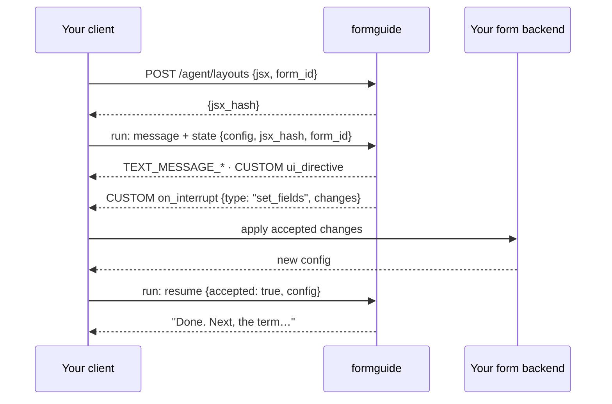

import { Tabs, TabItem, LinkCard, CardGrid } from '@astrojs/starlight/components';
import { Summary } from '../../../components/ui';

<Summary what={"Talk to formguide from your own chat UI."} when={"You already have a chat and want only the agent."} write={"`new HttpAgent({ url: '/agent/run' })`, then draw the events."} />



```ts
import { HttpAgent } from '@ag-ui/client'          // or CopilotKit's re-export

const agent = new HttpAgent({ url: '/agent/run', threadId })
agent.setState({ config, jsx_hash, form_id: 'loan_application', ui })
agent.addMessage({ id: crypto.randomUUID(), role: 'user', content: 'Where do I start?' })

await agent.runAgent({ tools: frontendTools }, {
  onTextMessageContentEvent: ({ event }) => appendToBubble(event.delta),
  onCustomEvent: ({ event }) => {
    if (event.name === 'ui_directive') focusField(event.value)
    if (event.name === 'on_interrupt') showCard(JSON.parse(event.value))   // a JSON string
  },
})
```

## Answer a card

<Tabs syncKey="answer">
  <TabItem label="Field changes">
    ```ts
    const config = await formBackend.apply(pick(card.changes, keptNames))
    agent.setState({ ...agent.state, config })
    await agent.runAgent({ forwardedProps: { command: { resume: { accepted: true, config, names: keptNames } } } })
    ```
  </TabItem>
  <TabItem label="A question">
    ```ts
    await agent.runAgent({ forwardedProps: { command: { resume: { answer: { ids: ['auto'] } } } } })
    // or { answer: { text: 'about 40,000' } }, or { accepted: false } to skip
    ```
  </TabItem>
  <TabItem label="AG-UI 1.0 interrupts">
    With `interrupt_mode: structured` the card arrives in `RUN_FINISHED.outcome.interrupts[]`. The next run's input carries the answer:
    ```json
    { "resume": [{ "interrupt_id": "card_7f3a", "status": "resolved", "payload": { "accepted": true, "config": { "props": {}, "state": {} } } }] }
    ```
    `"status": "cancelled"` skips the card.
  </TabItem>
</Tabs>

Restore a chat after a reload: `GET /agent/threads/{id}?format=agui` → `agent.setMessages(messages)`.

## Next

<CardGrid>
  <LinkCard title="AG-UI events" description="Every event and card type." href="../../reference/agui-events/" />
  <LinkCard title="Cards and answers" description="Payloads with real examples." href="../cards/" />
</CardGrid>
