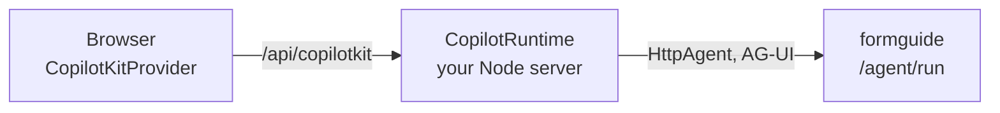

import { Tabs, TabItem, Steps, Aside, LinkCard, CardGrid } from '@astrojs/starlight/components';

Pick CopilotKit when your app already uses it, or you want its React chat components. Otherwise [`<agui-chat>`](../chat-widget/) needs no server of its own and draws [every card](../card-gallery/) for you.



The browser talks to CopilotKit's runtime; the runtime talks AG-UI to formguide. Your formguide server and its model keys stay as they are.

<Steps>

1. **The runtime: one agent, pointing at formguide.** A small Node endpoint in your app.

   <Tabs syncKey="ckserver">
     <TabItem label="Express">
       ```ts title="server.ts"
       import express from 'express'
       import { HttpAgent } from '@ag-ui/client'
       import { CopilotRuntime } from '@copilotkit/runtime/v2'
       import { createCopilotExpressHandler } from '@copilotkit/runtime/v2/express'

       const runtime = new CopilotRuntime({
         agents: { formguide: new HttpAgent({ url: process.env.FORMGUIDE_URL + '/agent/run' }) },
       })

       const app = express()
       app.use(createCopilotExpressHandler({ runtime, basePath: '/api/copilotkit' }))
       app.listen(4000)
       ```
     </TabItem>
     <TabItem label="Next.js">
       ```ts title="app/api/copilotkit/[[...path]]/route.ts"
       import { HttpAgent } from '@ag-ui/client'
       import { CopilotRuntime, createCopilotRuntimeHandler } from '@copilotkit/runtime/v2'

       const runtime = new CopilotRuntime({
         agents: { formguide: new HttpAgent({ url: process.env.FORMGUIDE_URL + '/agent/run' }) },
       })
       const handler = createCopilotRuntimeHandler({ runtime, basePath: '/api/copilotkit' })
       export { handler as GET, handler as POST, handler as PATCH, handler as DELETE }
       ```
     </TabItem>
   </Tabs>

   `npm i @copilotkit/runtime @ag-ui/client`. No model key here: the model runs inside formguide. To pass the user's identity on, send `headers` from the provider below; the runtime forwards `Authorization` and `x-*` headers to formguide.

2. **The provider: point it at the runtime.**

   ```tsx title="main.tsx"
   import { CopilotKitProvider } from '@copilotkit/react-core/v2'

   <CopilotKitProvider runtimeUrl="/api/copilotkit" agentId="formguide" headers={{ Authorization: `Bearer ${token}` }}>
     <App />
   </CopilotKitProvider>
   ```

3. **Register the form, and send it with every run.** The same two steps as any client ([Your form](../../form/overview/)).

   ```tsx
   const r = await fetch(`${FORMGUIDE_URL}/agent/layouts`, {
     method: 'POST', headers: { 'Content-Type': 'application/json' },
     body: JSON.stringify({ jsx, form_id: FORM_ID }),
   })
   const { jsx_hash } = await r.json()

   const { agent } = useAgent({ agentId: 'formguide' })
   useEffect(() => {
     if (config && jsx_hash) agent.setState({ config, jsx_hash, form_id: FORM_ID, ui: { now: new Date().toString() } })
   }, [agent, config, jsx_hash])
   ```

4. **Draw the cards with `useInterrupt`.** formguide sends a card as `CUSTOM on_interrupt` (a JSON string). The two you need first: field changes and questions ([all cards](../card-gallery/)).

   ```tsx
   useInterrupt({
     agentId: 'formguide',
     render: ({ event, resolve }) => {
       const card = typeof event.value === 'string' ? JSON.parse(event.value) : event.value
       if (card.type === 'ask') return <Question card={card} onAnswer={(ids) => resolve({ answer: { ids } })} />
       return <FieldChanges card={card} onAnswer={async (names) => {
         if (!names) return resolve({ accepted: false })
         const config = await formBackend.apply(pick(card.changes, names))   // your form backend recomputes the form
         setConfig(config)
         resolve({ accepted: true, config, names })
       }} />
     },
   })
   ```

</Steps>

| Card | Answer with `resolve(...)` |
| --- | --- |
| field changes (`set_fields`) | `{accepted: true, config, names?}`, or `{accepted: false}` |
| question (`ask`) | `{answer: {ids: ["auto"]}}`, `{answer: {text}}`, or `{accepted: false}` |
| file request (`upload`) | `{attachment_ids: [...]}` after uploading to `/agent/attachments`, or `{accepted: false}` |
| confirmation (`confirm`) | `{accepted: true}` or `{accepted: false}` |

Every payload, with the fields each card carries: [Cards and answers](../cards/).

## Frontend tools and prefill

Tools registered with `useFrontendTool` are sent with each run; when the model calls one, its result comes back as a `tool` message. To start a chat from data the page already has, run the agent with a prefill ([what it does](../../backend/prefill/)):

```ts
agent.runAgent({ forwardedProps: { prefill: { data: profile } } })
```

## Try it without a runtime

For a quick prototype, CopilotKit can call formguide directly from the browser. CopilotKit names this option `agents__unsafe_dev_only`: there is no server of yours in between, so do not ship it.

```tsx
const agents = useMemo(() => ({ formguide: new HttpAgent({ url: `${FORMGUIDE_URL}/agent/run` }) }), [])
<CopilotKitProvider agents__unsafe_dev_only={agents} agentId="formguide">
```

[`examples/copilotkit/`](https://github.com/denvasylenko/dushes/tree/main/examples/copilotkit) is this prototype: `npm install && npm run dev` opens it on port 5174, and its dev server forwards `/agent` to a formguide server on `localhost:8000` (change it in `vite.config.ts`).

<Aside type="caution" title="What was tested">The prototype path runs in `examples/copilotkit` against CopilotKit 1.86. The runtime setup follows CopilotKit's documentation for 1.86 and has not been run in this repository's tests.</Aside>

## Next

<CardGrid>
  <LinkCard title="Card gallery" description="Every card, live, with its payload." href="../card-gallery/" />
  <LinkCard title="Any AG-UI client" description="The same protocol without CopilotKit." href="../agui-client/" />
</CardGrid>
