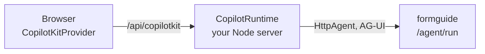

import { Tabs, TabItem, Steps, Aside, LinkCard, CardGrid } from '@astrojs/starlight/components';
import { Summary } from '../../../components/ui';

<Summary what={"CopilotKit's chat and hooks talking to Dushes."} when={"Only if your app already uses CopilotKit."} write={"An `HttpAgent` to `/agent/run` and a `useInterrupt` that draws the cards."} />

## Do you need this page?

| Your situation | Use |
| --- | --- |
| Your React app **already uses CopilotKit** (its chat, its hooks) | this page: CopilotKit talks to Dushes like to any AG-UI agent |
| You are starting fresh | [`<agui-chat>`](../chat-widget/) or [React](../react/): fewer lines, and **every card is drawn for you** |

With CopilotKit you draw Dushes' cards yourself (a small React component per card type). With `<agui-chat>` they are built in. That is the whole trade-off.

## Run the working example

[`examples/copilotkit/`](https://github.com/denvasylenko/dushes/tree/main/examples/copilotkit): a barber booking form, CopilotKit's chat next to it, field cards and questions drawn with `useInterrupt`, a frontend tool and a prefill button.

```bash
cd backend && ANTHROPIC_API_KEY=... uv run uvicorn demo.app:app --port 8000   # terminal 1: formguide + a mock form backend
```

```bash
cd examples/copilotkit && npm install && npm run dev                           # terminal 2: open http://localhost:5174
```

Ask "Book a haircut tomorrow at 10": the agent answers in CopilotKit's chat and proposes the fields as a card; tick, fill in, and the values on the left change.

## The example, in four parts

All of it is one file, [`src/App.tsx`](https://github.com/denvasylenko/dushes/blob/main/examples/copilotkit/src/App.tsx). `FORM_ID`, `formBackendLoad()` and `formBackendEvent()` stand for your form and your form backend.

<Steps>

1. **One agent, pointing at Dushes.**

   ```tsx
   import { CopilotChat, CopilotKitProvider, HttpAgent, useAgent, useFrontendTool, useInterrupt } from '@copilotkit/react-core/v2'

   export default function App() {
     const agents = useMemo(() => ({ formguide: new HttpAgent({ url: '/agent/run' }) }), [])
     return (
       <CopilotKitProvider agents__unsafe_dev_only={agents} agentId="formguide">   {/* production: see below */}
         <Page />
       </CopilotKitProvider>
     )
   }
   ```

2. **Register the form once, and send it with every run.**

   ```tsx
   const { agent } = useAgent({ agentId: 'formguide' })

   useEffect(() => {
     formBackendLoad().then(async (f) => {
       const r = await fetch('/agent/layouts', {
         method: 'POST', headers: { 'Content-Type': 'application/json' },
         body: JSON.stringify({ jsx: f.jsx, form_id: FORM_ID, domain: f.domain }),
       })
       setHash((await r.json()).jsx_hash)
       setConfig(f.config)
     })
   }, [])

   useEffect(() => {
     if (config && hash) agent.setState({ config, jsx_hash: hash, form_id: FORM_ID, ui: { now: new Date().toString() } })
   }, [agent, config, hash])
   ```

3. **Draw the cards with `useInterrupt`.** Dushes sends a card as `CUSTOM on_interrupt`; answer it with `resolve(...)`.

   ```tsx
   useInterrupt({
     agentId: 'formguide',
     render: ({ event, resolve }) => {
       const card = typeof event.value === 'string' ? JSON.parse(event.value) : event.value
       if (card.type === 'ask') return <Ask card={card} onAnswer={(a) => void resolve(a)} />
       return <Changes card={card} onAnswer={async (names) => {
         const kept = names ? card.changes.filter((c) => names.includes(c.name)) : []
         const cfg = kept.length
           ? await formBackendEvent(cfgRef.current.state, Object.fromEntries(kept.map((c) => [c.name, c.value])))
           : cfgRef.current
         setConfig(cfg)
         agent.setState({ ...agent.state, config: cfg })
         await resolve({ accepted: kept.length > 0, config: cfg, ...(names && kept.length < card.changes.length ? { names } : {}) })
       }} />
     },
   })
   ```

   `<Changes>` and `<Ask>` are about 20 lines each in the example: a list of rows with checkboxes and "Fill in", and option buttons with "Skip".

4. **Optional: a frontend tool and prefill.**

   ```tsx
   useFrontendTool({
     name: 'get_user_locale',
     description: "The user's browser language and time zone.",
     parameters: z.object({}),
     handler: async () => ({ language: navigator.language, time_zone: Intl.DateTimeFormat().resolvedOptions().timeZone }),
   })

   const prefill = () => agent.runAgent({ forwardedProps: { prefill: { data: { client_name: 'Anna Smith' } } } })
   ```

</Steps>

## What you draw yourself

| Card (`type`) | Answer with `resolve(...)` | In the example |
| --- | --- | --- |
| field changes (`set_fields`) | `{accepted: true, config, names?}`, or `{accepted: false}` | `<Changes>` |
| question (`ask`) | `{answer: {ids: ["auto"]}}`, `{answer: {text}}`, or `{accepted: false}` | `<Ask>` |
| file request (`upload`) | `{attachment_ids: [...]}` after uploading to `/agent/attachments`, or `{accepted: false}` | not in the example |
| confirmation (`confirm`) | `{accepted: true}` or `{accepted: false}` | not in the example |

What each card looks like and carries: [Card gallery](../card-gallery/); every payload typed: [Types and the contract](../../form/contract/).

## In production: CopilotKit's runtime

`agents__unsafe_dev_only` lets the browser call Dushes directly: fine for the example, not for production. There, a small Node server of yours (CopilotKit's runtime) sits in between:



<Tabs syncKey="ckserver">
  <TabItem label="Express">
    ```ts title="server.ts"
    import express from 'express'
    import { HttpAgent } from '@ag-ui/client'
    import { CopilotRuntime } from '@copilotkit/runtime/v2'
    import { createCopilotExpressHandler } from '@copilotkit/runtime/v2/express'

    const runtime = new CopilotRuntime({
      agents: { formguide: new HttpAgent({ url: process.env.FORMGUIDE_URL + '/agent/run' }) },
    })

    const app = express()
    app.use(createCopilotExpressHandler({ runtime, basePath: '/api/copilotkit' }))
    app.listen(4000)
    ```
  </TabItem>
  <TabItem label="Next.js">
    ```ts title="app/api/copilotkit/[[...path]]/route.ts"
    import { HttpAgent } from '@ag-ui/client'
    import { CopilotRuntime, createCopilotRuntimeHandler } from '@copilotkit/runtime/v2'

    const runtime = new CopilotRuntime({
      agents: { formguide: new HttpAgent({ url: process.env.FORMGUIDE_URL + '/agent/run' }) },
    })
    const handler = createCopilotRuntimeHandler({ runtime, basePath: '/api/copilotkit' })
    export { handler as GET, handler as POST, handler as PATCH, handler as DELETE }
    ```
  </TabItem>
</Tabs>

Then swap one line in step 1, and keep everything else:

```tsx
<CopilotKitProvider runtimeUrl="/api/copilotkit" agentId="formguide" headers={{ Authorization: `Bearer ${token}` }}>
```

`npm i @copilotkit/runtime @ag-ui/client`. No model key on this server: the model runs inside Dushes. The runtime forwards `Authorization` and `x-*` headers to Dushes.

<Aside type="caution" title="What is tested">The example runs against CopilotKit 1.86 with the direct connection. The runtime setup follows CopilotKit's 1.86 documentation; it is not run in this repository's tests.</Aside>

## Next

<CardGrid>
  <LinkCard title="Card gallery" description="Every card, live, with its payload." href="../card-gallery/" />
  <LinkCard title="The chat widget" description="Every card built in, no runtime." href="../chat-widget/" />
</CardGrid>
