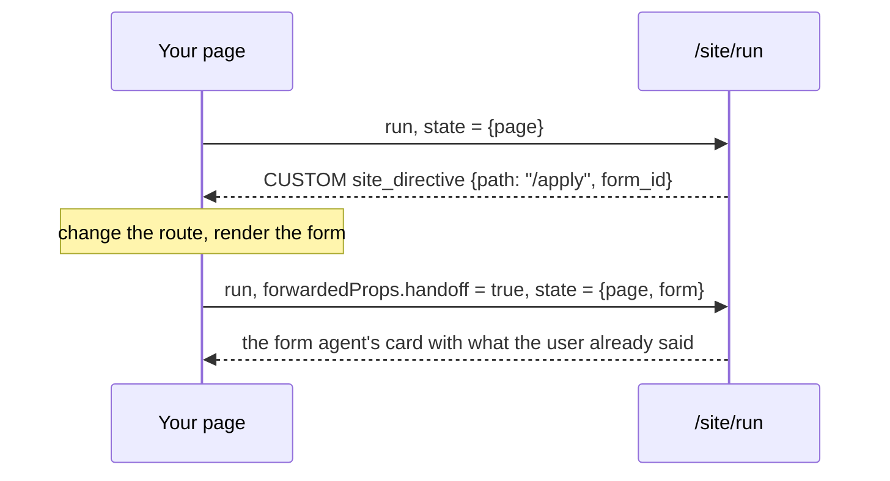

import { LinkCard, CardGrid } from '@astrojs/starlight/components';
import SiteDemoLink from '../../../components/SiteDemoLink.astro';

The server side is [Site assistant](../../backend/site-assistant/). In the page, the chat points at `/site/run` instead of `/agent/run`, and three things change.

<SiteDemoLink />



## 1. Send the page, and the form when there is one

```js
import '@formguide/agui-chat'
import { formguide } from '@formguide/agui-chat/formguide'

const chat = document.querySelector('agui-chat')          // <agui-chat url="/site/run" mode="inline">
const fg = formguide({ getState, applyChanges, baseUrl: '/agent' })   // the form agent's cards, as on a form page

const formRun = fg.beforeRun
fg.beforeRun = async (input, c) => {
  const page = { path: location.pathname, title: document.title }
  if (currentForm()) {                                     // a page with a form: the form state goes under "form"
    await formRun(input, c)
    input.state = { page, form: input.state }
  } else {
    input.state = { page }
  }
}
```

## 2. Follow the directive

```js
const onEvent = fg.onEvent
fg.onEvent = (ev, c) => {
  if (ev.type === 'CUSTOM' && ev.name === 'site_directive') {
    const d = ev.value                                     // {type: "navigate", path, tab?, section?, form_id?}
    if (d.form_id) pendingHandoff = d.form_id
    router.push(d.path)                                    // your router
    if (d.tab || d.section) openAndScroll(d.tab ?? d.section)
    return true
  }
  return onEvent(ev, c)
}
chat.use(fg)
```

## 3. Run once when the form is on the page

```js
onFormRendered((formId) => {
  if (pendingHandoff === formId) {
    pendingHandoff = null
    chat.run({ forwardedProps: { handoff: true } })        // the form agent starts with what the user asked for
  }
})
```

The demo does exactly this in React: [`frontend/src/site/Site.tsx`](https://github.com/denvasylenko/dushes/blob/main/frontend/src/site/Site.tsx).

## The directive

| Key | Meaning |
| --- | --- |
| `type` | `"navigate"` |
| `path` | a page from the site map |
| `tab`, `section` | open this tab or accordion, or scroll to this section |
| `form_id` | the page holds this form: run once with `handoff: true` after it renders |

## Next

<CardGrid>
  <LinkCard title="Site assistant" description="The server: site map, router, hand-off." href="../../backend/site-assistant/" />
  <LinkCard title="Types and the contract" description="Every message, typed." href="../../form/contract/" />
</CardGrid>
