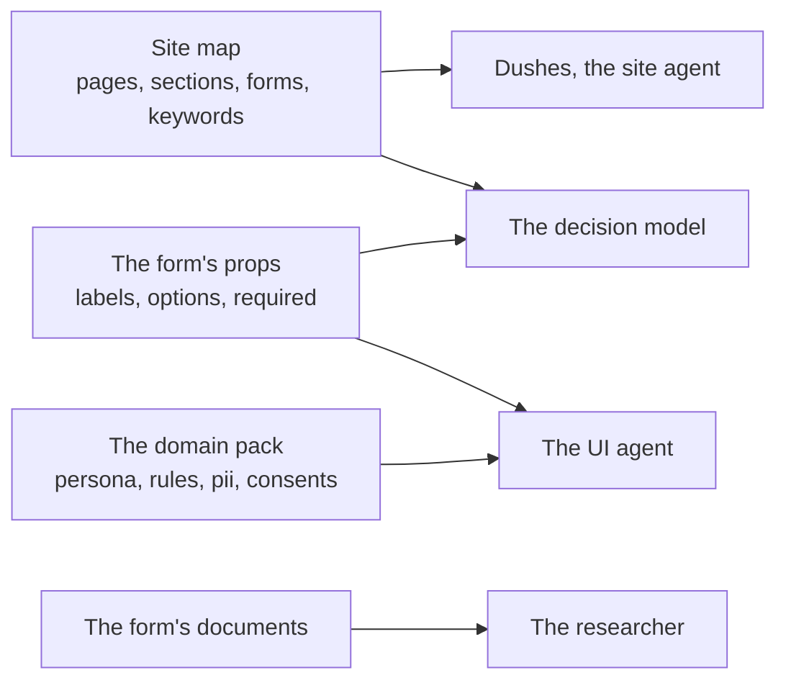

import { Aside, LinkCard, CardGrid } from '@astrojs/starlight/components';

<Aside type="tip" title="For a coding agent">
This page is written to be followed step by step by a coding agent, after it has installed Dushes. Each section says what affects quality, then gives a block to copy and adapt. Give your agent this page's Markdown: append `.md` to its address.
</Aside>

The agents know your site and forms only from what you describe. They do not crawl pages or guess: a page that is not in the site map does not exist for them, a field label is how they name a field, and a document that was never uploaded cannot be quoted. Quality comes from these descriptions more than from the model.



## 1. Titles in every language of your site

**What it affects.** Before a line goes to the [decision model](../../agents/site-agent/decision-model/), a capitalised word it does not know is replaced with `<name>`, so that a person's name never leaves your host. Today the words it knows are the titles of the pages and parts it is choosing between, the labels of the form's fields, and the options on the screen. A visitor who writes in another language uses words your titles may not have; in German every noun has a capital, so "jetzt die Kfz-Versicherung" goes out as "jetzt die `<name>`" unless that word is one of those titles or labels.

**How to fill it in.** Give each field its label in every language your visitors use, with `i18n` in the form's props (cards then show the label in the person's language, with no model call):

```json title="the form's props, one field"
{
  "coverage": {
    "label": "Coverage",
    "required": true,
    "options": [{"id": "basic", "name": "Basic"}, {"id": "full", "name": "Full cover"}],
    "i18n": {"de": {"label": "Deckung"}, "it": {"label": "Copertura"}}
  }
}
```

Page keywords in other languages help too: they route a message to the right page (next section). That they also keep a word from being masked is [coming next](#coming-next).

## 2. The site map: pages, sections, forms and keywords

**What it affects.** Dushes may open only the pages, tabs, accordions and sections the map lists, and answers from their `text`. `keywords` are extra words that send a message to a page from anywhere on the site. `form` says which page holds which form; without it, a request to apply cannot be handed to the UI agent.

**How to fill it in.** One entry per page that matters. Write keywords in every language of the site. Put the facts people ask about (prices, hours, conditions) into the `text` of a tab or section, in the words the page itself uses.

```yaml title="site.yaml"
title: Main Street
instructions: |
  For anything you cannot do here, give the contact on the Contacts page.
pages:
  - path: /insurance
    title: Car insurance
    description: "Car insurance from Aster: cover, prices, how to claim."
    keywords: [car insurance, insurance, Kfz-Versicherung, assicurazione auto]
    form: car_insurance
    sections:
      - {id: prices, title: Prices, text: "Basic cover from 19 EUR a month; full cover from 34 EUR a month."}
      - {id: after, title: After you apply, text: "We reply by email within one working day. You can change or cancel your request until then."}
  - path: /contacts
    title: Contacts
    keywords: [contact, phone, Kontakt, contatti]
    sections:
      - {id: phone, title: Phone, text: "Call +49 30 1234567, Monday to Friday, 9:00 to 18:00."}
```

Every key: [Site agent, every option](../../agents/site-agent/#every-option). A large site can build the same map from its CMS: [Site map](../../agents/site-agent/site-map/).

## 3. Field labels and options in your users' words

**What it affects.** The agents name a field by its `label` and choose among its `options` by their `name`. A label like `fld_2` or an option like `OPT_A` is what they will say to a person, and what the decision model has to match a line against.

**How to fill it in.** Labels as a person would say them, options as they appear on the screen, one option list per choice field, and `required` on every field the form needs before it can be sent.

```json title="the form's props"
{
  "first_name": {"label": "First name", "required": true},
  "start_date": {"label": "Cover starts on", "required": true, "placeholder": "YYYY-MM-DD"},
  "payment":    {"label": "How do you want to pay?", "options": [{"id": "card", "name": "Card"}, {"id": "invoice", "name": "Invoice"}]}
}
```

The whole contract: [Connect your form](../../frontend/connect-your-form/contract/).

## 4. Required fields

**What it affects.** The UI agent asks only for what is missing, and `review_form` tells the person what still blocks sending. A field that is required in your backend but not marked `required` is never asked for; the person finds out only when sending fails.

**How to fill it in.** Mark `required: true` in the props for every field your backend requires right now, and send the backend's validation message in `error`. When a rule changes what is required (a field appears for one option), send the new props: the agent reads them every turn.

## 5. `pii`: what it does and does not

**What it affects.** A field listed in the domain pack's `pii` reaches the model only as `<filled>`: the model knows it has a value and does not ask for it again, but cannot read it back.

```json title="domain_packs/car_insurance.json"
{
  "title": "Car insurance",
  "persona": "You are Aster's insurance assistant. Plain words, short answers.",
  "pii": ["email", "phone", "iban", "id_number"]
}
```

It does not hide what the person types into the chat: a message goes to the model as written. Ask for personal data in its field, not in the chat. Details: [What `pii` does, and what it does not](../../agents/ui-agent/domain-packs/#what-pii-does-and-what-it-does-not).

## 6. The form's documents, for the researcher

**What it affects.** Questions the form cannot answer (conditions, exclusions, fees) go to the researcher, which reads only the documents uploaded for that form. With none, it can only say that the documents do not answer.

**How to fill it in.** Upload them into the form's namespace (the form id), as PDF, Markdown or text:

```bash
curl -F "files=@policy_terms.pdf" -F "files=@faq.md" http://localhost:8000/agent/kb/car_insurance/documents
```

Shared documents for several forms, and the vector store: [Business documents](../../agents/shared/business-documents/).

## 7. A human contact

**What it affects.** When a person asks for someone to talk to, the agent can give only a contact it has been given. Today there is no dedicated key for it.

**How to fill it in.** Put the contact on a page of the site map (a Contacts page with its `text`, as in section 2) and say in `instructions` that the agent gives it for anything it cannot do. A dedicated key is [coming next](#coming-next).

## 8. Consents

**What it affects.** A consent checkbox is applied only by the person's own tick: the agent never gives a consent, not even after a typed "yes". The agent has to know which checkboxes are consents.

**How to fill it in.** Mark each one, in the props (`"consent": true`) or in the domain pack, with the document it refers to:

```json title="domain_packs/car_insurance.json"
{
  "consents": {
    "accept_terms": {"required": true, "doc": {"title": "Policy terms", "text": "The terms you accept by ticking."}},
    "marketing": {"required": false}
  }
}
```

## 9. What happens after sending

**What it affects.** People hesitate before a step they cannot undo. The agent can say what happens next only if you wrote it down; otherwise it says nothing or guesses nothing.

**How to fill it in.** Write it where the agent reads it: the page's `text` (the "After you apply" section in section 2) or the domain pack's `rules`. Make the sending tool ask first with `confirm_tools` in `formguide.yaml`, and report the result on the form's root with `submitted`:

```yaml title="formguide.yaml"
confirm_tools: [submit_application]
```

```json title="domain_packs/car_insurance.json"
{
  "rules": ["After sending, we reply by email within one working day; the request can be changed or cancelled until then."]
}
```

## Before launch

- [ ] Every page a person may ask about is in the site map, with its tabs and sections and the `text` people ask about.
- [ ] Every page with a form names it in `form`.
- [ ] Page titles and keywords cover every language of the site; field labels have `i18n` for each.
- [ ] Every field has a label in the users' words; every choice field has its options with readable names.
- [ ] Every field the backend requires is `required: true`, and validation messages come back in `error`.
- [ ] Every field with an e-mail, phone number, ID, account or card number is in `pii`.
- [ ] Each form's documents are uploaded to its namespace, and a question only they answer gets an answer with its source.
- [ ] A human contact is on a page, and `instructions` say when to give it.
- [ ] Every consent checkbox is marked as a consent.
- [ ] What happens after sending is written down, the sending tool is in `confirm_tools`, and the root reports `submitted`.
- [ ] The configuration passes the check:

```bash
formguide check --config formguide.yaml
```

A check of the descriptions themselves (missing labels, untranslated titles, pages without text) is being added to `formguide check`; this page will name what it reports when it is released.

## Coming next

<Aside type="note" title="Not in the package yet">
Built or designed, not released. Nothing in this list works with the package you install today.
</Aside>

- **Keywords count as the site's own words:** a page's keywords, in any language, are never masked as a name before the decision model (built, arriving with the next release).
- **Per-field notes for the agent:** why a field is asked, and which fields are sensitive or special (planned).
- **"Done when":** the conditions on the form's fields that mean a person's goal is reached (designed, [The goal module](../../agents/how-it-works/goal-module/)).
- **A dedicated key for the human contact** (planned).
- **The decision journal:** records of the decision model's choices to set its thresholds from (built, not released).

## Next

<CardGrid>
  <LinkCard title="Quickstart" description="Install and run it first." href="../quickstart/" />
  <LinkCard title="Domain packs" description="Every key of the form's pack." href="../../agents/ui-agent/domain-packs/" />
</CardGrid>
