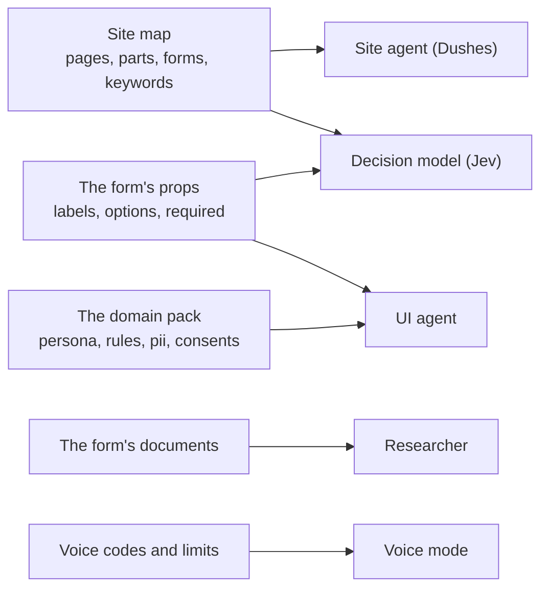

import { Aside, LinkCard, CardGrid } from '@astrojs/starlight/components';
import PagePrompt from '../../../../components/PagePrompt.astro';

<Aside type="tip" title="For a coding agent">
These pages are written to be followed step by step, by a person or by a coding agent after it has installed Dushes. Each one goes: what to describe, what breaks without it, exactly how to write it (keys and a block to copy), and a checklist. Give your agent a page's Markdown: append `.md` to its address.
</Aside>

The agents know your site and forms only from what you describe. They do not crawl pages or guess: a page that is not in the site map does not exist for them, a field's label is how they name it, and a document that was never uploaded cannot be quoted. Quality comes from these descriptions more than from the model.



<PagePrompt what="your site, forms and documents for every agent you use (the site map, the domain packs, the documents, the voice and decision model settings)" asks={["Is it one form, or a whole site with several pages and forms?", "Which languages do your visitors write in?", "Do people talk to it (voice mode)? Do you use the decision model?", "Which forms hold personal data, and which have documents people ask about?"]} />

## The pages

Start with the site agent: the site map is what every other agent builds on. Then describe each form for the UI agent, its documents for the researcher, and voice and the decision model if you use them.

| Page | What you describe | When you need it |
| --- | --- | --- |
| [Site agent](site-agent/) | the site map: pages, parts, which page holds which form, titles and keywords in every language, the facts people ask about, a human contact | a site with Dushes across its pages |
| [UI agent](ui-agent/) | the form's props and its domain pack: labels, options, required fields, `pii`, consents, the glossary, the order of work, what happens after sending | every form |
| [Researcher](researcher/) | the form's documents: format, how they are cut, versions, what not to put in | a form people ask questions about that the form itself cannot answer |
| [Voice](voice/) | codes, limits, what is filled from speech and what is said aloud, the audio's privacy | people talk instead of typing |
| [Decision model](decision-model/) | the provider and its key, codes, what is sent and masked, the bars, diagnostics | plain requests done at once, without the large model |
| [Develop a domain](domain/) | a new kind of form or business from scratch: its pack, instructions, documents, keywords and QA scenarios, with a complete pack to copy | a form for a business the package has no pack for |
| [Configuration examples](examples/) | the demo's complete site map and three domain packs, to copy and adapt | always: start from the closest one |

## What a host gets by default, and what to set

Every default below is safe, but weaker than what most sites need. Each row says what you get without configuration and the setting that changes it.

| By default | What to set |
| --- | --- |
| Conversations live in memory: a restart forgets them | `checkpointer: {sqlite: data/checkpoints.sqlite}` in `formguide.yaml` (or a Postgres or Redis saver in Python) |
| No quick replies after an answer | `suggestions: {enabled: true, max: 3}` in `formguide.yaml`, and `Dushes(..., suggestions=True)` |
| After a hand-off, a form's first turn waits for its page to load | `Dushes(..., form_for=fn)`, where `fn(form_id, ctx)` returns `{config, jsx_hash, form_id}` |
| One model serves every role | `models:` with a model per role (`agent`, `research`, `compile`, `extract`, `memory`, `suggestions`): [Configuration](../../reference/configuration/) |
| No domain pack: a neutral persona, no field notes, no personal fields marked | a pack per form with `title`, `persona`, `glossary`, `pii` and `rules` ([UI agent](ui-agent/), [Configuration examples](examples/)) |
| No business documents: the agent answers from the form alone | upload them: `POST /agent/kb/{form_id}/documents` ([Researcher](researcher/)) |
| Pages without keywords, or fewer than the site's languages | `keywords:` per page in `site.yaml`, at least one per language ([Site agent](site-agent/)) |
| The page a person is on is unknown | the host sends `state.page.path` with every run |

Voice mode and the decision model are off unless configured ([Voice](voice/), [Decision model](decision-model/)).

## Before launch

Go through each page's checklist, then run the check, which calls no model. Give it the site map and, for each form, its JSX and a sample of its props; `--public` for a host anyone can open:

```bash
formguide check --config formguide.yaml --site site.yaml --jsx form.jsx --form-config sample.json --form-id <form_id> --public
```

It prints the configuration, then what it found, grouped as ERROR, WARNING and NOTE, each with what follows from it and a `fix:` line to paste, and `OK` when there is no error. It exits with 1 on any error. What it looks at:

- **the site map:** a page with no keywords, fewer keywords than `languages:` in `formguide.yaml`, a title two places share, a form with no documents or no domain pack;
- **each form:** a label that is empty, its own name or written like an identifier; options with no readable name; a phone or e-mail field not in `pii` (an error), an ID or bank detail not in it (a warning), a special category such as health (an error); a required field with no note in the `glossary`;
- **the weaker defaults** it can see: no `checkpointer`, quick replies off, a site with forms and no `form_for`;
- **the environment:** `INTENT_PROVIDER` without `INTENT_API_KEY`, a voice secret without `VOICE_CODES`, the diagnostics switches (`INTENT_LABELS`, `INTENT_TRACE`, `INTENT_SCORES`) on; with `--public` those switches and `DEMO_SHOW_CONFIG=1` are errors, and the decision model without `EXPERIMENT_CODES` and `VOICE_CODES` without `VOICE_SECRET` are warnings.

Every option: [CLI](../../reference/cli/#formguide-check).

## Next

<CardGrid>
  <LinkCard title="Site agent" description="The site map, titles and keywords, facts, the human contact." href="site-agent/" />
  <LinkCard title="UI agent" description="Labels, options, required fields, pii, consents, after sending." href="ui-agent/" />
</CardGrid>
