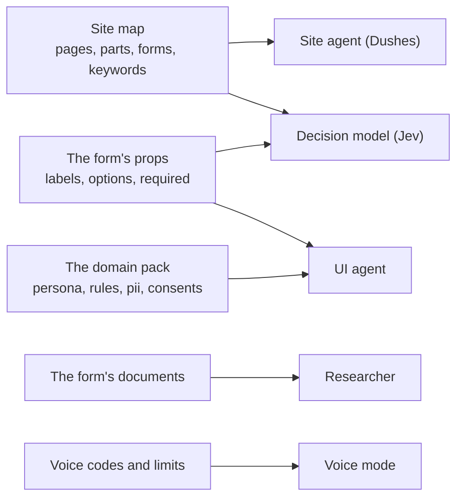

import { Aside, LinkCard, CardGrid } from '@astrojs/starlight/components';
import PagePrompt from '../../../../components/PagePrompt.astro';

<Aside type="tip" title="For a coding agent">
These pages are written to be followed step by step, by a person or by a coding agent after it has installed Dushes. Each one goes: what to describe, what breaks without it, exactly how to write it (keys and a block to copy), and a checklist. Give your agent a page's Markdown: append `.md` to its address.
</Aside>

The agents know your site and forms only from what you describe. They do not crawl pages or guess: a page that is not in the site map does not exist for them, a field's label is how they name it, and a document that was never uploaded cannot be quoted. Quality comes from these descriptions more than from the model.



<PagePrompt what="your site, forms and documents for every agent you use (the site map, the domain packs, the documents, the voice and decision model settings)" asks={["Is it one form, or a whole site with several pages and forms?", "Which languages do your visitors write in?", "Do people talk to it (voice mode)? Do you use the decision model?", "Which forms hold personal data, and which have documents people ask about?"]} />

## The pages

Start with the site agent: the site map is what every other agent builds on. Then describe each form for the UI agent, its documents for the researcher, and voice and the decision model if you use them.

| Page | What you describe | When you need it |
| --- | --- | --- |
| [Site agent](site-agent/) | the site map: pages, parts, which page holds which form, titles and keywords in every language, the facts people ask about, a human contact | a site with Dushes across its pages |
| [UI agent](ui-agent/) | the form's props and its domain pack: labels, options, required fields, `pii`, consents, the glossary, the order of work, what happens after sending | every form |
| [Researcher](researcher/) | the form's documents: format, how they are cut, versions, what not to put in | a form people ask questions about that the form itself cannot answer |
| [Voice](voice/) | codes, limits, what is filled from speech and what is said aloud, the audio's privacy | people talk instead of typing |
| [Decision model](decision-model/) | the provider and its key, codes, what is sent and masked, the bars, diagnostics | plain requests done at once, without the large model |
| [Develop a domain](domain/) | a new kind of form or business from scratch: its pack, instructions, documents, keywords and QA scenarios, with a complete pack to copy | a form for a business the package has no pack for |
| [Configuration examples](examples/) | the demo's complete site map and three domain packs, to copy and adapt | always: start from the closest one |

## Before launch

Go through each page's checklist, then run the check of the configuration, which calls no model:

```bash
formguide check --config formguide.yaml
```

A check of the descriptions themselves (missing labels, untranslated titles, pages without text) is being added to `formguide check`; these pages will name what it reports when it is released.

## Next

<CardGrid>
  <LinkCard title="Site agent" description="The site map, titles and keywords, facts, the human contact." href="site-agent/" />
  <LinkCard title="UI agent" description="Labels, options, required fields, pii, consents, after sending." href="ui-agent/" />
</CardGrid>
