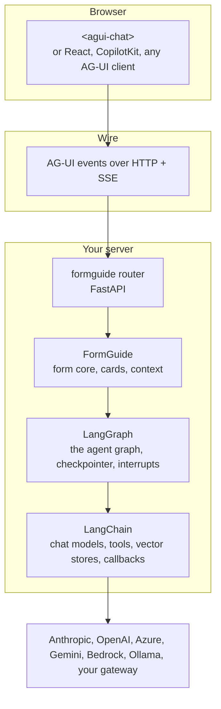
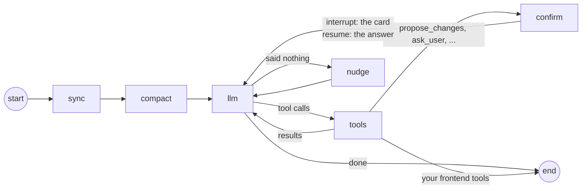
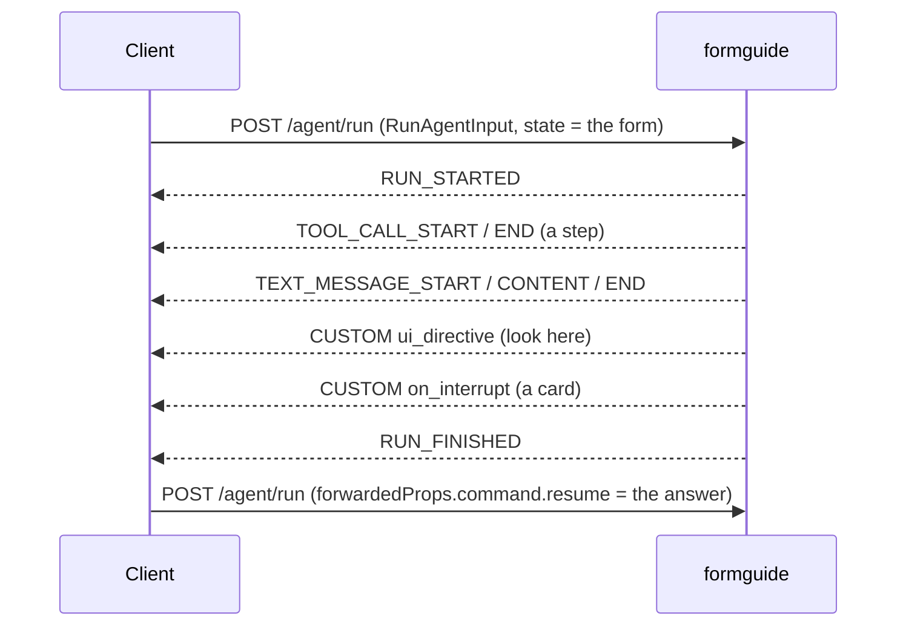

import { LinkCard, CardGrid } from '@astrojs/starlight/components';
import { Summary } from '../../../components/ui';

<Summary what={"The open-source pieces under Dushes and where every import comes from."} when={"You want to know what you are adding to your stack."} write={"Nothing: a map of LangGraph, LangChain, AG-UI and the packages."} />

Dushes is open source ([GitHub](https://github.com/denvasylenko/dushes)) and adds only what is specific to forms: reading the form, the cards, the context. Everything else is a standard you may already use.



| Layer | What it does in Dushes | Read |
| --- | --- | --- |
| **LangGraph** | runs one turn as a graph: build the context, call the model, run tools, stop for a card and resume after the answer; keeps the history in a checkpointer | [LangGraph](./) |
| **LangChain** | the model of every role, the tools, the document index, tracing callbacks; any provider through one interface | [LangChain](./) |
| **AG-UI** | the protocol between the page and the server: text, steps, cards, directives as events | [AG-UI](./) |

## The packages

| Python (`pip install "formguide[all]"`) | For |
| --- | --- |
| `langgraph`, `langchain`, `langchain-core` | always: the graph, models, tools |
| `langchain-anthropic`, `langchain-openai` | the `anthropic` and `openai` extras; other providers: their own `langchain-*` package |
| `fastapi`, `uvicorn`, `python-multipart`, `ag-ui-protocol` | the `server` extra: the HTTP router and the AG-UI types |
| `langgraph-checkpoint-sqlite`, `aiosqlite` | the `sqlite` extra: history that survives restarts |
| `deepagents` | the `research` extra: the researcher |
| `pydantic`, `pyyaml`, `pypdf`, `pillow` | config, PDFs and photos |

| Browser | For |
| --- | --- |
| `@formguide/agui-chat` | the chat widget, no runtime dependencies; `@formguide/agui-chat/formguide` (the form plugin), `@formguide/agui-chat/react` (React, a peer dependency), `@formguide/agui-chat/react-hook-form` (`useFormguide`) |
| `@ag-ui/client` | only if you write your own client (`HttpAgent`) |

## Where every name comes from

| Name | Import |
| --- | --- |
| `FormGuide`, `GuideConfig`, `Models`, `load_config`, `DomainPackRegistry`, `KnowledgeBase`, `VectorStoreIndex`, `SkillRegistry`, `sqlite_checkpointer`, `FileTranscriptStore` | `from formguide import ...` |
| `MemoryConfig`, `SuggestionsConfig`, `TracingConfig` | `from formguide.config import ...` |
| `create_app` / `create_router` | `from formguide.app import create_app` / `from formguide.server import create_router` |
| `ChatAnthropic` / `ChatOpenAI`, `AzureChatOpenAI` / `ChatGoogleGenerativeAI` | `langchain_anthropic` / `langchain_openai` / `langchain_google_genai` |
| `tool`, `BaseTool`, `BaseChatModel` | `langchain_core.tools` / `langchain_core.language_models` |
| `AsyncPostgresSaver` | `langgraph.checkpoint.postgres.aio` (`langgraph-checkpoint-postgres`) |
| `<agui-chat>`, `defineTheme`, `formguide()` | `import '@formguide/agui-chat'`, `import { formguide } from '@formguide/agui-chat/formguide'` |
| `HttpAgent` | `@ag-ui/client` |

## LangGraph

Every message runs the same graph. The form arrives with the message, the graph decides what to say, which tools to run and when to stop for the user.



| Node | What it does |
| --- | --- |
| `sync` | compares the incoming form (`config`) with the last one, builds the context the model sees (outline, open section, what changed), adds the message |
| `compact` | in long chats, summarizes older turns into a memory, keeping the form out of the summary ([memory](../../agents/how-it-works/memory/)) |
| `llm` | calls the `agent` model with Dushes' tools and yours; streams the text |
| `tools` | runs the tools: search the form, point at a field, read documents, your APIs |
| `confirm` | a card: the graph **interrupts** with the payload, the page shows it, the next run resumes with the user's answer and the new `config` |
| `nudge` | a safety net when the model ended the turn without a word |

### What Dushes uses from LangGraph

| LangGraph | In Dushes |
| --- | --- |
| `StateGraph` | the graph above ([`agent/graph.py`](https://github.com/denvasylenko/dushes/blob/main/backend/formguide/agent/graph.py)) |
| `interrupt()` and `Command(resume=...)` | every card: field changes, questions, uploads, confirmations, reviews. The AG-UI answer (`forwardedProps.command.resume`) is the resume value |
| a checkpointer (`BaseCheckpointSaver`) | the model's history per `thread_id`: in memory, SQLite, Postgres, Redis ([Persistence](../../agents/shared/persistence/)) |
| streaming | text, tool steps and custom events become AG-UI events as they happen |

```python
from formguide import FormGuide, GuideConfig, sqlite_checkpointer

guide = FormGuide(GuideConfig(checkpointer=sqlite_checkpointer("data/checkpoints.sqlite")))   # any LangGraph saver
```

## LangChain

| LangChain | In Dushes | Guide |
| --- | --- | --- |
| chat models (`BaseChatModel`, `init_chat_model`) | the model of each role: agent, research, compile, extract, memory | [Models and providers](../../agents/shared/models/) |
| tools (`BaseTool`, `@tool`) | your APIs the agent may call, per form or for all forms | [Skills and tools](../../agents/ui-agent/skills/) |
| vector stores (`VectorStore`) | the index of business documents instead of the built-in BM25 | [Business documents](../../agents/shared/business-documents/) |
| callbacks (`BaseCallbackHandler`) | tracing every model and tool call (LangSmith, Langfuse, your own) | [Speed and tracing](../../agents/shared/observability/) |

A tool is a plain LangChain tool:

```python
from langchain_core.tools import tool
from formguide import FormGuide, GuideConfig

@tool
def check_credit_score(tax_id: str) -> str:
    """The applicant's credit score from the bureau."""
    return bureau.score(tax_id)

guide = FormGuide(GuideConfig(tools=[check_credit_score], confirm_tools=["check_credit_score"]))   # asks the user first
```

A model is any LangChain chat model with tool calling, as an object or a string:

```python
from langchain_openai import AzureChatOpenAI
from formguide import Models

models = Models(agent=AzureChatOpenAI(azure_deployment="gpt-5", api_version="2025-04-01-preview"),
                research="openai:gpt-5-mini")          # a string goes through init_chat_model
```

## AG-UI

[AG-UI](https://docs.ag-ui.com) is an open protocol between an agent and a user interface: the client posts a `RunAgentInput`, the server streams events over SSE. Dushes uses only standard events, so `<agui-chat>`, CopilotKit, `@ag-ui/client`'s `HttpAgent` or your own client work without adapters.



| AG-UI | Dushes uses it for |
| --- | --- |
| `RunAgentInput.state` | the form: `{config, jsx_hash, form_id, ui}` |
| `RunAgentInput.tools` | your frontend tools |
| `forwardedProps` | a card's answer (`command.resume`), prefill, the card variants the client draws (`capabilities`) |
| `TEXT_MESSAGE_*`, `TOOL_CALL_*` | the reply and its steps |
| `CUSTOM` | `ui_directive`, `on_interrupt` (cards), `suggestions`, `sources`, `receipt`, `run_stats` |
| `RUN_FINISHED.outcome.interrupts` | cards for AG-UI 1.0 clients (`interrupt_mode: structured`) |

Every payload, typed: [Types and the contract](../../frontend/connect-your-form/contract/).

## Next

<CardGrid>
  <LinkCard title="LangGraph" description="The agent graph, step by step." href="./" />
  <LinkCard title="AG-UI" description="The events on the wire." href="./" />
</CardGrid>
