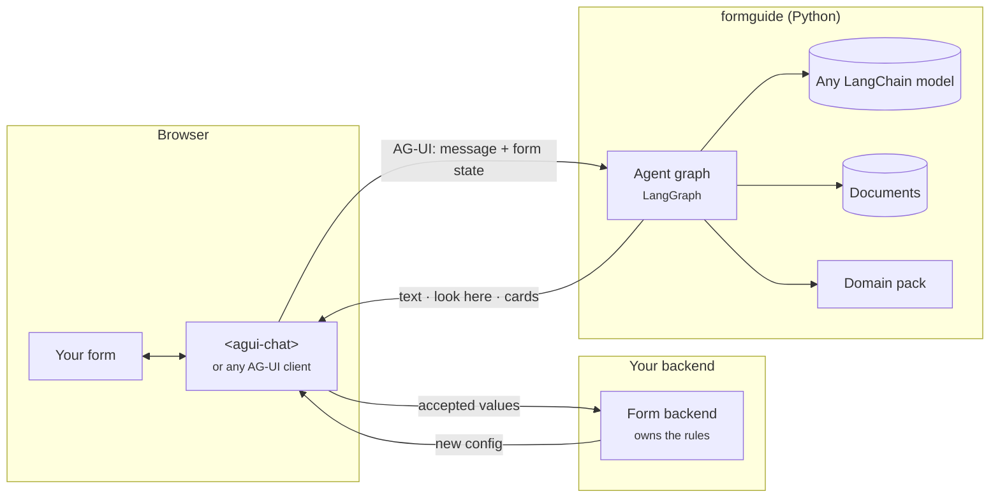

import { Card, CardGrid, LinkCard } from '@astrojs/starlight/components';

formguide is a chat agent that sits next to a large form (a loan application with 200 fields, an insurance claim, a booking wizard) and helps the person fill it in. The core knows nothing about your domain or model provider; everything specific is configured.

**The rule everything follows:** the form owns the config; the agent advises and proposes. It reads the form sent with every message and proposes changes on a card. Only when the user accepts does your frontend apply them, the same way user input goes.

## The parts

<CardGrid>
  <Card title="The library" icon="seti:python">Python: the agent graph, the form core, domain packs, documents, attachments, models, skills; a FastAPI router and a CLI. `backend/formguide/`</Card>
  <Card title="The wire" icon="random">Strict AG-UI. Each run carries the form in `state`; cards are interrupts. `POST /agent/run`</Card>
  <Card title="The chat" icon="laptop">`<agui-chat>`: a Web Component with a formguide plugin, a React wrapper and a react-hook-form hook. `packages/agui-chat/`</Card>
  <Card title="The demo" icon="rocket">A mock form backend, two forms (221 fields; a 4-step wizard) and a React UI. `backend/demo/`, `frontend/`</Card>
</CardGrid>

## Where to go

| You are | Start with |
| --- | --- |
| trying it | [Quickstart](../quick-start/), then [Run the demo app](../demo-app/) |
| setting up the server | [Install and serve](../../backend/install/), [Configuration](../../backend/configuration/) |
| putting the chat on a page | [Choose a client](../../frontend/overview/) |
| connecting your form | [How the form and the agent talk](../../form/overview/) |
| curious how it works | [One turn](../../concepts/turn/), [What the model sees](../../concepts/context/) |

<CardGrid>
  <LinkCard title="Quickstart" description="A running agent and a chat in five minutes." href="../quick-start/" />
  <LinkCard title="System overview" description="The architecture on one diagram." href="../../concepts/overview/" />
</CardGrid>
