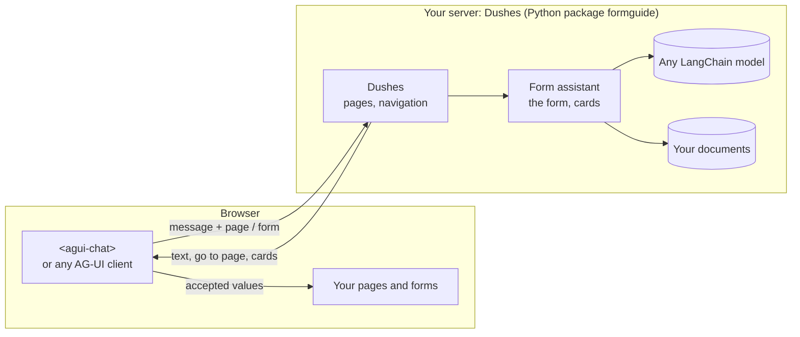

import { Card, CardGrid, LinkCard } from '@astrojs/starlight/components';
import { Summary } from '../../../components/ui';

` tag on the page"} />

Dushes is an AI assistant for your product's interface. It answers from your pages and documents, takes people to the right page, tab or field, and fills forms with them, always after they confirm. The core knows nothing about your domain or model provider; everything specific is configured.

## Two assistants, one base

| | Dushes | Form assistant |
| --- | --- | --- |
| **For** | a whole site or app | one large form (a loan application with 200 fields, a claim, a booking wizard) |
| **It** | answers about any page, opens the right page, tab or section, hands over to a form | shows where to click, explains fields, reads the user's documents, fills fields on a card |
| **Knows** | your site map: pages, sections, which page holds which form | the form itself, sent with every message, and the form's documents |
| **Server** | `Dushes` over the form assistant, at `/site/run` | `FormGuide`, at `/agent/run` |
| **Start with** | [Dushes](../../backend/dushes/) | [How the form and the agent talk](../../form/overview/) |

Use the form assistant alone for one form; add Dushes on top when the forms are part of a bigger site. One chat then follows the user from page to page.

**The rule everything follows:** your app owns its pages and its form; the assistant advises and proposes. It reads what the page sends with every message and proposes changes on a card. Only when the user accepts does your app apply them, the same way user input goes.

## The parts

<CardGrid>
  <Card title="The library" icon="seti:python">Python: the agent graph, Dushes, the form core, domain packs, documents, attachments, models, skills; a FastAPI router and a CLI. The Python package `formguide`, in `backend/formguide/`</Card>
  <Card title="The wire" icon="random">Strict AG-UI. Each run carries the page and the form in `state`; cards are interrupts. `POST /agent/run`, `POST /site/run`</Card>
  <Card title="The chat" icon="laptop">`<agui-chat>`: a Web Component with every card built in, a React wrapper and a react-hook-form hook. `@formguide/agui-chat`</Card>
  <Card title="The demos" icon="rocket">A small site with a bank and a barbershop, a 221-field loan form, a booking wizard. `backend/demo/`, `frontend/`</Card>
</CardGrid>

## Where to go

| You are | Start with |
| --- | --- |
| trying it | [Quickstart](../quick-start/), then [Run the demo app](../demo-app/) |
| adding it to a whole site | [Dushes](../../backend/dushes/), then [in the page](../../frontend/dushes/) |
| connecting one form | [How the form and the agent talk](../../form/overview/) |
| setting up the server | [Install and serve](../../backend/install/), [Configuration](../../backend/configuration/) |
| putting the chat on a page | [Choose a client](../../frontend/overview/) |
| curious how it works | [One turn](../../concepts/turn/), [Built on](../../built-on/overview/) |

<CardGrid>
  <LinkCard title="Quickstart" description="A running assistant and a chat in five minutes." href="../quick-start/" />
  <LinkCard title="Dushes" description="One chat across your whole site." href="../../backend/dushes/" />
</CardGrid>
